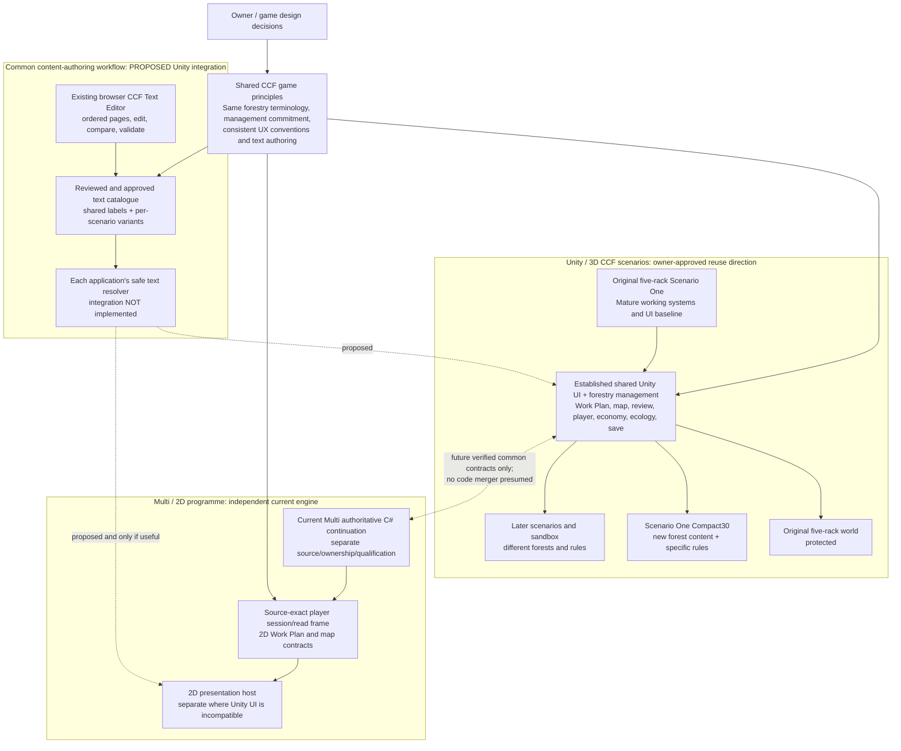

# CCF shared architecture — overall proposal for 2D and 3D manager input

**20 November 2026 · Owner-requested cross-programme DESIGN CONSULTATION · DRAFT / REVIEW REQUEST — NOT APPROVED IMPLEMENTATION · Prepared by Scenario One 3D Manager #844 for Overall Manager #425 and Multi 2D Manager #730**

**Purpose:** give both managers **one short common architecture proposal** to criticise and amend, before the Overall Manager locks a formal technical design. This document intentionally does **not** propose a large refactor, establish a shared binary, grant C# file/scene/Unity write permission, approve save-policy or interfere with current Multi source work.

**Authoritative owner intent, established in conversation (20 November):**
- The original, more-developed **five-rack Scenario One code and familiar working menus/UI** should be the *starting foundation for the Unity/3D game*, not the new Compact30 controller/temporary `OnGUI` panel.
- **One coherent game foundation**, with shared player movement, menu/HUD, Work Plan, Stand Map, tree inspection, Annual Review, economy, causal forestry simulation and compatible save framework, wherever each feature applies.
- New forestry scenarios, including Compact30, should vary **scene, terrain, species, initial trees, objectives, allowed interventions and scenario guidance**, not independently rebuild every common feature.
- Original five-rack, Legacy40/Enlarged80, historical saves and frozen Reference Future v1 remain protected.
- The owner wants a **browser-accessible, page-ordered text authoring experience** for every scenario without manually editing Unity. Whether every part of the UX and code can be shared with the *separate 2D programme* is a **question for #730**, not already approved.

## 1. The broad connection, visually

**Diagram interpretation:** boxes denote responsibilities, not an instruction to create one class/interface per box. Solid connections in this **overall concept** are intentions, except for separately source-established individual UI/engine flows; dashed connections are future proposals. **The 2D engine and Unity game are not one currently integrated executable and must not be described as such.**

## 2. What stays familiar, and what varies

| Capability | Unity / 3D default | Multi / 2D input requested | Per-scenario variation |
|---|---|---|---|
| Player navigation, menus, common terminology | Reuse established five-rack controls and UI where relevant | Advise whether **same conceptual screens/terms** fit the 2D browser/standalone presentation; do **not** assume Unity UI Toolkit can be used unmodified | Intro and workflow availability, not independent general menus |
| Work Plan approval and real forestry action | Reuse existing authoritative `ScenarioOneManager` Work Plan/economy, not a new copy | Preserve Multi's actual **source-token + pending/approve/execute + event/year** guards; do not insert Scenario One manager or invent instant execution | Allowed orders, cost/contract and lesson guidance |
| Stand Map | Reuse existing five-rack map views, with rack features disabled when inapplicable | Adopt reviewed visual/map-space conventions and adapt Unity-free presentation logic where **compile/dependency and source grants** permit; keep a separate standalone UI host | Real area, tree IDs, canopy, racks/paths when genuinely present |
| Forestry causality | Existing `ForestEcologyController`, `ForestTree`, species definitions for 3D | Multi existing continuation remains **authoritative** for Multi until owner approves proved compatibility contracts; avoid dual live truth | Species, calibration, initial inventory, interventions |
| Save/continuation identity | Preserve old saves and separate new-world identities; new policy requires approval | Distinguish Multi's current source-token/session/digest guarantees from Unity save schema; no shared unverified save file | World/profile and versioned provenance |
| UI text and player guidance | Common permanent labels plus scenario-specific content | Can the same **text IDs, ordered review catalogue and language style** serve Multi 2D? What 2D text is currently player-visible versus proposed? | Specific introductions/objectives/conditional variant wording |

**Important distinction:** A shared *game design* does not automatically imply one UI implementation for Unity and non-Unity, one giant C# manager, a single map data source class, an unchanged binary map renderer or identical simulation precision. Reuse verified **contracts and source** where feasible; use a native 2D presentation adapter where required. The owner's original-five-rack baseline direction governs the Unity 3D foundation, **not replacement of Multi's qualified independent engine**.

## 3. Text template and existing browser editor

The template should be **useful before scenario-specific copy is written**, not empty or full of accidentally shipped filler:

1. **Real shared labels:** e.g. `Work Plan`, `Annual Review`, `Stand Map`, `Approve Plan`; owned by common UI/content policy, not independently rewritten by each scenario.
2. **Scenario-specific text slots:** e.g. `[SCENARIO INTRODUCTION]`, `[OBJECTIVE DESCRIPTION]`, `[SITE-SPECIFIC GUIDANCE]` — clearly visible in authoring/dev previews, and *missing required content must not silently appear to players as an accepted paragraph*.
3. **Dynamic fields:** live year, work status, money, forestry results and tree properties continue to come from the authoritative simulation and approved formatters, **not manually edited values**. Browser text catalogue owns static text/templates only.
4. **Condition/variant rules:** optional rack lessons must not leak into no-rack scenarios; past saves/profile IDs and progression keys are not text fields. Unknown/missing variant uses a validated fallback or explicit refusal as approved, not an invented default.

**Existing tool—do not duplicate:**
- [CCF Text Editor #473](https://github.com/jermur788/CCF/issues/473), improved under [#477](https://github.com/jermur788/CCF/issues/477), independently approved for **standalone browser use on the earlier repaired candidate** in [#480](https://github.com/jermur788/CCF/issues/480). [README on latest #487 branch](https://github.com/jermur788/CCF/blob/feature/ccf-text-editor-treemarks-n01-20261114-v1/Tools/ContentReview/README.md). It has Previous/Next sequence, original/draft, JSON validation/import/export, conditional variants; 79 pages, 278 field records, not every live player string. Compact and later scenarios are not complete copy inventories.
- [#487](https://github.com/jermur788/CCF/issues/487) repaired source-accurate composed Tree Marks and published author-tested code. Its **separate #492 independent delta review is still READY / NOT RUNNING**; do not promote #487 to independently accepted on #480 evidence.
- The pre-existing [four-file cross-scenario text-editor specification](https://github.com/jermur788/CCF/blob/feature/ccf-text-editor-treemarks-n01-20261114-v1/specs/ccf-cross-scenario-text-editor-v1/spec.md) is **DRAFT / NOT APPROVED**; it already proposes typed read-only Unity catalogue loading, source-text fallback and approval. **Browser edits today only export a draft JSON file; they do not change Unity code/runtime automatically.** Proposed shared content authoring requires a separate reviewed source adapter and full player-text coverage before any release claim.
- **Text-placeholder handling above is a DESIGN PROPOSAL** from owner discussion, not an already implemented production/content rule. Overall #425 should reconcile it with the existing DRAFT rather than launch a new duplicate spec.

## 4. 2D Manager #730: precise questions for independent input

Please review the **overall proposal only**, not Scenario One's full 29k line-by-line C# audit, and return a short structured opinion in a GitHub comment or dedicated markdown response with:

**A. ADOPT / ADAPT / REJECT** the shared-game *principles*: consistent forestry terminology, transparent actual vs proposed Work Plan decisions, common map symbology and management semantics, shared content-authoring practice, scenario-specific configuration. What is useful to a stand-alone 2D simulator? What must remain different?

**B. Real portability boundary:** What, if anything, from the original five-rack game's map and presentation can be used *directly* by Multi C#? Refer to the already completed [Multi Stand Map reuse fit audit](https://github.com/jermur788/CCF/blob/docs/Multi-StandMap-Reuse-Assessment-20261120-v1/Docs/Handoffs/MultiRack-Simulation-20261116/Multi-ScenarioOne-StandMap-Reuse-Fit-Assessment-20261120.md): Unity-free map math/draw concepts are conditional; Unity UI Toolkit and scene-scanning `StandMapSource` are not unmodified standalone 2D components. Any new compile-linked import needs explicit V-01 file scope and source owner gate, **not** inference from the separate approved `SitkaGrowthModel.cs` / `SimulationRandom.cs` V-01.

**C. Authoritative simulation ownership:** Multi's currently verified G2/A1 standalone engine must not be replaced by Scenario One's larger Unity simulation on the strength of this diagram. Identify the **smallest future verified common contracts** that would be beneficial, if any, and the risks of conflicting units/tree state, events, annual timing, deterministic hashes and independent testing. Long-term one underlying forestry engine remains a product direction, not an immediate rewrite grant.

**D. Text editor / UX:** Could Multi use the existing reviewed browser content schema as an authoring source for its own 2D labels/guidance, with a separate safe resolver, rather than a second text editor? How should provisional/conditional text, genuine map state and disabled G1/economics be represented without implying implemented mechanics?

**E. Sequencing and gates:** Which small decisions can be common now, which need an Overall/owner G5 decision, and which should be deferred until the current Multi **genuine playable slice** and Compact30 playable demo are verified? Name any concrete blockers, source claims/leases, and existing approved specs; no replacement task dispatch.

Give an evidence-labelled verdict **AGREE / AGREE WITH CHANGES / DISAGREE**, specific actionable edits to THIS overall proposal, current source identifiers where material, and state **NO IMPLEMENTATION AUTHORISATION** unless independently granted later. The owner wants input before locking an architecture, not an after-the-fact endorsement.

## 5. 3D and Overall Manager questions / next decision

**Scenario One Manager #844:** confirm five-rack UI as default baseline, identify minimum Compact30 shell/scene-entry repair and where the existing `OnGUI` candidate must be retired/bridged. Keep practical 3D player test ahead of broad architectural cleanups. Do not disturb separately owned #820, #836 and floor work.

**Overall Manager #425:** reconcile Multi and 3D comments; decide **cross-programme user-experience principles versus direct code-sharing boundary**, resolve conflicting identities/model units and scope. For approved implementation design, apply **SPEC REQUIRED** with approved `spec.md`, `plan.md`, `tasks.md`, `checklists/requirements.md`; document user G5 choices in canonical decision log only via authorised publication path, never by treating this proposal as a binding new source policy. Preserve D-078 eight independent Irish scenarios, no unapproved Windows, legacy and reference constraints, D-032 binary rights and actual current locks.

**Owner decision requested later only if material:** agreement on 2D-versus-3D same *interface semantics* versus pixel-identical UI (the latter might conflict with platform); when browser copy export should first connect to Unity; scenario-switching and save-profile default policy. These are not implied by today's approval of the original five-rack Unity foundation.

## 6. Source and status

- [Source-mapped current/target 3D architecture with three diagrams](https://github.com/jermur788/CCF/blob/Scenario-One-shared-ccf-foundation-architecture-source-audit-20261120-v1/Docs/Handoffs/ScenarioOne-Shared-Foundation-Architecture-20261120/Scenario-One-CCF-Shared-Foundation-Source-Mapped-Architecture-Draft-20261120.md) — **DRAFT**, not cross-programme approval.
- [Overall Manager #425](https://github.com/jermur788/CCF/issues/425) — owns programme architecture/product decisions.
- [Multi 2D Manager #730](https://github.com/jermur788/CCF/issues/730) — independent Multi source/UX authority.
- [Scenario One 3D Manager #844](https://github.com/jermur788/CCF/issues/844) — owns Scenario One 3D delivery.
- [Multi source-informed map-fit result](https://github.com/jermur788/CCF/blob/docs/Multi-StandMap-Reuse-Assessment-20261120-v1/Docs/Handoffs/MultiRack-Simulation-20261116/Multi-ScenarioOne-StandMap-Reuse-Fit-Assessment-20261120.md) — already concludes shared presentation principles with adaptation, **NOT** unmodified Multi reuse.

**Disposition: CONSULTATION / DRAFT.** No Unity, C# files, standalone 2D engine files, game scenes, specs, saves, active-tasks register, protected historic branches, binary assets or main have been changed. No physical/Unity leases acquired, no worker launched, no production work authorised or assumed. GitHub review comments by managers are discussion evidence; they do not alone approve the actual implementation spec or prove any integrated game feature. Drive/dashboard publication unverified.
