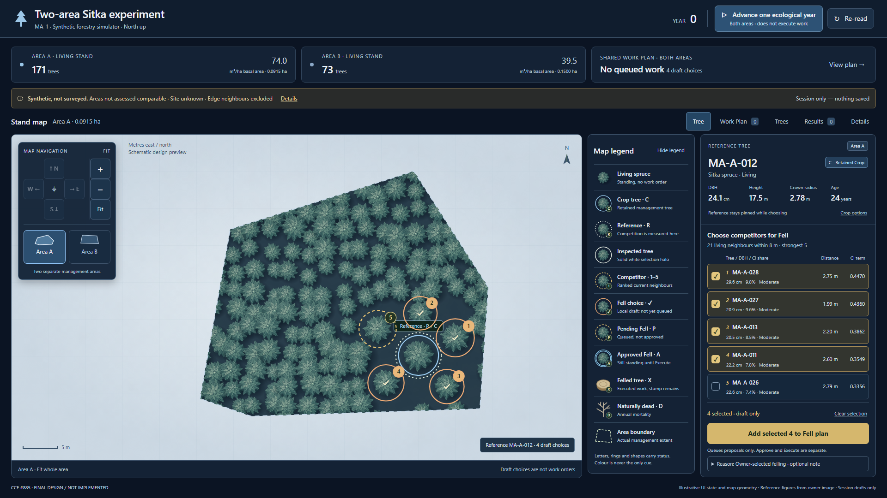

# CCF #885 — Final Astra design and complete Opus 5.5 implementation packet

**DESIGN CHOSEN · 2026-11-22. IMPLEMENTED: NO. RUNTIME VERIFIED: NO. OWNER ACCEPTED: NO.**

The owner requests a polished two-area forestry interface: the first concept's overall composition with the second concept's compact navigation. Latest direct amendments choose **less green, more blue/navy, better individual trees, a map that matches the palette, and a much lighter area surrounding the stand**. The final references below incorporate these amendments. The owner also explicitly asks **Astra to dispatch one Claude Opus 5.5 implementation and review it afterwards**, replacing the older separate Sol 6.1 review route. Astra remains the design author and reviewer, never the production-code writer. This is not a main integration grant.

## Final design references

- [1920 × 1080 desktop](astra-final-design-20261122/final-desktop.png)
- [1280 × 720 compact desktop](astra-final-design-20261122/final-1280.png)
- [640 px narrow layout](astra-final-design-20261122/final-narrow.png)
- [Approved work plan / separate Execute state](astra-final-design-20261122/final-work-plan.png)
- [Downloadable interactive design HTML](astra-final-design-20261122/final-design.html) — open locally; GitHub source view does not run it.

These are original deterministic HTML/SVG design renders, **not screenshots of the implemented simulator**. The geometry is illustrative; the principal example IDs and figures come from the owner screenshot. No production coordinates, ecological measurements or results are inferred from this drawing. The prototype illustrates local selection, area navigation and legend visibility; its other actions explain intended behaviour. It has no API, authoritative state, persistence or simulation. Its inline convenience markup is **not production-ready code**. Do not transplant its hardcoded trees, counts, geometry or mock actions.

Graphics provenance: original procedural SVG spruce studies authored for this design; no downloaded textures, third-party asset family, Unity export or new dependency. Four PNGs and one HTML are a small design-reference bundle, not a runtime asset requirement. Tree art depicts stylised top-down Sitka crowns, not a measured species classifier. Crown radius, stem location, age and state must remain the real data. Original owner attachment: `Forestry Simulator Dashboard_ Sitka Experiment.png` in the Astra session. The individual earlier concept images have no verified public artifact URL in the controlling brief; the owner-selected composition is carried forward here without inventing such a URL.

## Authority and source truth

1. Latest direct owner instructions in this session control palette and Astra-after-Opus review routing.
2. [Controlling Astra design brief and linked requirements](https://github.com/jermur788/CCF/blob/docs/multi-885-astra-design-to-opus55-sol61-route-20261122-v1/Docs/Handoffs/MultiRack-Simulation-20261116/885-owner-ux/Multi-885-ASTRA-DESIGN-DECISIONS-TO-OPUS55-IMPLEMENTATION-AND-SOL61-REVIEW-20261122.md).
3. [F1–F4 specification](https://github.com/jermur788/CCF/blob/docs/multi-885-owner-followup-multi-fell-rack-map-ux-20261122-v1/specs/multi-885-multi-fell-rack-map-ux-v1/spec.md), with its [plan](https://github.com/jermur788/CCF/blob/docs/multi-885-owner-followup-multi-fell-rack-map-ux-20261122-v1/specs/multi-885-multi-fell-rack-map-ux-v1/plan.md), [tasks](https://github.com/jermur788/CCF/blob/docs/multi-885-owner-followup-multi-fell-rack-map-ux-20261122-v1/specs/multi-885-multi-fell-rack-map-ux-v1/tasks.md) and [requirements](https://github.com/jermur788/CCF/blob/docs/multi-885-owner-followup-multi-fell-rack-map-ux-20261122-v1/specs/multi-885-multi-fell-rack-map-ux-v1/checklists/requirements.md).
4. [U01–U11 owner backlog](https://github.com/jermur788/CCF/blob/docs/multi-885-owner-ux-corrections-20261122-v1/Docs/Handoffs/MultiRack-Simulation-20261116/885-owner-ux/Multi-885-OWNER-REQUESTED-OUTSTANDING-2D-CHANGES-AND-INTENT-20261122.md) and [existing U01–U09 implementation result](https://github.com/jermur788/CCF/blob/feat/multi-885-owner-ux-20261122-v1/Docs/Handoffs/MultiRack-Simulation-20261116/885-owner-ux/Multi-885-OWNER-UX-IMPLEMENTATION-HANDOFF-20261122.md).
5. Exact implementation baseline: branch `feat/multi-885-owner-ux-20261122-v1`, commit **`a692e1bf5d21304d06e696db1f47d1988ff80ee1`**. [Exact source](https://github.com/jermur788/CCF/blob/a692e1bf5d21304d06e696db1f47d1988ff80ee1/Tools/MultiRackSitkaP1Lab/src/Ui/PlayerMultiApi.cs).

The real `/multi` page is inside **`MultiAreaPage.Html`, `.Css`, `.Js` in `Tools/MultiRackSitkaP1Lab/src/Ui/PlayerMultiApi.cs`**. `wwwroot` serves the other, single-area page and is out of scope. The existing source already has deterministic spruce rendering, eleven zoom levels, any-living-tree competition reads, fenced commands and separate approval/execution/year transitions. Preserve those working foundations. The unclickable overview, scattered controls, single competitor choice and collapsed text legend need this UI change.

## Chosen layout, colour and drawing rules

**DESIGN CHOSEN:** navy structural surfaces, cool natural tree detail, pale blue-grey map exterior, slate forest ground. Green is restricted to restrained natural needles. Avoid green panels and green page backgrounds. Amber signifies a choice or unexecuted work, never an ecological judgement.

| Role | Final reference token / rule |
|---|---|
| Page / top bar | `#0b1523` / `#101d2e` |
| Panels / borders | `#152438` / `#33475e` |
| Main / secondary text | `#e2ecf7` / `#b6c6d8` |
| Active blue control | `#2c4f70`, edge `#91c6fa` |
| Map exterior | Soft `#e4ecf2` to `#cbd8e3`; unobtrusive metric grid |
| Actual stand interior | Slate `#263b49`; subtle texture, no invented terrain meaning |
| Spruce tiers | `#315657`, `#3f6967`, `#507b75`, `#6a9185`, `#8da99a` |
| Crop / reference | Pale blue C ring / white dashed R ring |
| Draft / pending | Warm `#f2ad76` solid check ring / amber `#edc774` dashed P ring |
| Approved | Blue `#88c5e8` double A ring; remains a standing crown |
| Execute action | Warm brown `#704c36`, readable ivory label; separate confirmation |
| Focus | Clearly visible pale-blue outer outline with offset; never colour-only state |

Use the real area boundary as the clipping path between light exterior and dark interior. Ground grid and scale must follow the current transform; never copy the mockup's illustrative 5 m scale literally. Dark compass/scale text is required on the light exterior. Shadows remain subtle and do not enlarge hit geometry.

At 1920 px, use a flexible dominant map, approximately 232 px legend and 380 px inspector, 12 px gaps and 24 px page gutters. Header is about 82 px; three compact area/plan summaries sit above a single short synthetic/session notice. Tabs sit above the inspector region: Tree, Work Plan, Trees, Results, Details. Map, legend and inspector align at the top. The map navigation dock is approximately 212 px wide, top-left in reserved plot space. Keep the stand visible beside it at Fit. The north indicator and metric scale are passive orientation aids, not additional controls.

At 1280 × 720, use approximately 176 px legend and 310 px inspector, 8 px gaps, 16 px gutters. Keep navigation targets at least 44 × 44 px. All legend states are visible in the compact reference; shorter captions may have accessible descriptions. Inspector facts remain at the top; competitor rows can scroll; the count/Clear/Add block remains reachable and visible. Do not shrink text or controls until unusable to eliminate scrolling. At narrow widths or 200% zoom, stack map → inspector → expanded legend; avoid horizontal page overflow. Let content grow vertically. A narrow viewport is not a reason to silently hide the legend.

### Tree quality and status semantics

Use the existing deterministic ID-seeded renderer as the basis. Improve crowns with multiple irregular whorled bough tiers, feathered needle sprays, lighter upper-left tips, dark interior depth and soft ground shadows. Preserve each authoritative `crownRadiusM` footprint; the screenshot's **2.78 m is crown radius, not diameter**. At overview scale reduce fine detail/cull invisible branches; cache or reuse stable geometry where appropriate within the existing JS. Do not create per-frame random trees or alter map/hit transforms. At useful zoom, individual crowns must read as layered spruce rather than uniform stars, circles or fluffy blobs. No new external bitmap/dependency is required.

Use one shared renderer/style mapping for map and legend. Status overlays are independent of life-state shape: living crown, felled stump X, naturally dead snag D. Crop C, inspected selection, reference R, competitor 1–5, draft check, pending P and approved A remain distinguishable by letter/number/ring pattern. Crop and reference can coexist; selecting competitors must not move reference. Pending and approved trees remain standing. A naturally dead tree must not look like an executed stump. Rank is current competition rank, not health or an automatic felling recommendation.

## Element → behaviour specification

**OWNER PRODUCT REQUIREMENT:** F1–F4 and U01–U09. **ENGINE AVAILABLE** means an existing endpoint/data model can support the action; **UI NEEDS IMPLEMENTATION** covers layout and added local interaction. No row authorises a new backend contract.

| Element | Reads / local state | Behaviour / real command | Availability |
|---|---|---|---|
| Area A/B summary cards | Actual `view.areas` living count, area and basal area | Display truthful per-area summary; no inferred comparability | Engine available; restyle |
| Shared Work Plan summary / View plan | Actual pending/approved orders across areas; separate unsent draft count | Opens Work Plan tab; draft count never increments pending count | Engine available; UI update |
| Synthetic / session notice and Details | Existing area provenance, caveats and persistence limits | Compact notice always visible; Details expands full caveats, no treatment transfer | Engine available; restyle |
| Area thumbnails in dock | Actual area IDs and boundary shapes, active area | Semantic buttons with `aria-pressed`; pointer/Enter/Space invoke existing `showArea(actualId)`; switch map/table/inspector together | F2 UI implementation |
| N/W/E/S compass | Current area bounds and viewport | Existing cardinal pan, clamped to active area; disabled when no pan possible at Fit; no map-click bubbling | Engine available; F3 grouping |
| + / − / Fit | Existing eleven graded zoom levels | Preserve all eleven levels; +/− disable at bounds; Fit fits whole current boundary in usable map rectangle | Engine available; F3 grouping |
| Map crown / accessible Trees list | Actual area and exact tree ID | Existing guarded hit-test/select; clicking any living tree immediately reads its competition. Crop marking remains separate | Engine available; preserve U04 |
| Reference facts | Exact current reference ID, species, living state, DBH, height, radius, age | Remain pinned during competitor checkbox and batch operations | Engine available; F1 context |
| Crop options | Actual designation / editable plan state | Explicit `crop/mark` or `crop/unmark`; never auto-mark on inspection. Never offer current retained Crop as a Fell draft | Engine available; preserve |
| Competitor rows / numbered map rings | Server current `topFive`, DBH/distance/contribution/share/strength | Native checkboxes toggle exact IDs locally. Four or more can be chosen when eligible. Row toggles do not call `chooseTree` or replace reference | F1 UI implementation |
| Ineligible competitor row | Actual dead/felled/Crop/pending/approved state and global lock | Show reason and status; disable invalid/duplicate choices; no hidden substitution of ID | Engine available; UI update |
| Selected count / Clear selection | Current area/reference draft Set | Clear only this draft; no pending removal, no server command; zero count disables Add | F1 UI implementation |
| Add selected N to Fell plan | Snapshot current eligible exact IDs + latest fence | Sequential existing `pending/add` calls; retain reference; stop on first refusal/uncertainty; report partial outcomes honestly | Engine available; F1 orchestrator needed |
| Reason details | Optional note and explicit release checkbox | Note trimmed if supplied; otherwise explicit contextual release if chosen; otherwise exact `Owner-selected felling`. No required typing or fabricated diagnosis | Engine available; preserve `reasonToSend()` semantics |
| Competition details | Current `currentTotal`, `hypotheticalTotal`, neighbours and exclusion facts | Display server values. Hypothetical reflects queued/approved removal, **not unsent draft choices**. Never fabricate a draft improvement total | Engine available; preserve |
| Hide legend / Show legend | Boolean initially visible, retained in memory | Hide frees legend column and expands useful map; Show remains reachable near right of map; area switch never resets deliberate preference | F4 UI implementation |
| Illustrated legend | Same renderer and state patterns as map | All eleven sample states with short labels; distinct from navigation; visible by default | F4 UI implementation |
| Trees tab / exact-ID search | Current area's real tree records | Preserve accessible list/table and existing exact-ID selection; no schematic IDs from reference | Engine available; preserve |
| Pending order Remove | Exact area/tree order and fresh fence | Existing `pending/remove`; removes only that pending order, never a draft-only checkbox | Engine available; preserve |
| Approve N Fell orders | Actual shared pending plan and current fence | Existing `plan/approve`; **fells zero trees**, locks editing. Label actual count; show per-area IDs | Engine available; preserve |
| Cancel approved plan | Actual approved orders | Explicit confirmation with Keep as safe focus; `plan/cancel` **discards orders**, does not put them back in pending | Engine available; preserve |
| Execute N approved Fell orders | Actual approved plan, exact IDs, opaque execution identity | Separate confirmation shows actual area/ID list; Back gets initial focus. Existing `plan/execute`; only confirmed work changes trees, year unchanged | Engine available; preserve |
| Advance one ecological year | Actual year and unexecuted work in both areas | Separate `year/advance`, **does not execute work**. If work remains, require explicit consent to cancel it in both areas before advance; show Keep/stay versus Cancel unexecuted work and advance | Engine available; preserve |
| Results | Actual receipts/history by area | Display execution and annual results only from server; no fabricated improvements | Engine available; preserve |
| Technical reference | Actual PlanId / execution key where applicable | Collapsed details only; preserve internal opaque identities/fences; no machine strings in routine UI | Engine available; preserve |
| Re-read / error status | Latest authoritative view | Existing `api/multi/view`; reconcile local draft against real current state; never replay an uncertain write automatically | Engine available; UI reconciliation |

### Exact local-state and command decisions

1. Keep area-local reference ID, inspected ID and draft choice set. Reference/draft context survives A→B→A. `showArea` retains its existing Fit reset; zoom persistence is not required. On an intentional **reference change within an area**, clear that reference's unsent draft with a visible announcement, so unrelated old candidates cannot be added accidentally. Returning to the other area restores its own reference/draft. Retain a single global in-memory legend preference.
2. Competitor selection changes only the local draft. Exclude the reference itself, retained Crop, dead/felled, duplicate pending/approved and invalid IDs. Reconcile after every authoritative view update. If an order was added, remove that ID from draft only once confirmed; keep remaining eligible failed/unattempted selections for deliberate retry after reconciliation. Do not re-add a tree silently.
3. Take an immutable ordered snapshot for Add (current ranked row order with exact area/IDs). Hold a **single operation-wide busy guard** across the entire sequence. Freeze area/reference switches, plan edits, year advance and competing writes for the duration; retain current displayed context. Recompute the next fence from each confirmed response. Never send in parallel and never reuse the initial fence.
4. Inspect existing `call`, `currentFence`, `applyPayload`, `run` before implementation. **Do not simply loop `await run(...)`: existing `run()` returns no structured success and clears busy per command.** Within allowed JS, implement explicit success/failure handling while preserving current auth, request identity, fence, render and stale-response guards. Prevent async competition results from resetting the batch context.
5. On a definite refusal, stop and show confirmed IDs, refused ID/reason and unattempted IDs. On timeout/transport ambiguity, label that ID **unconfirmed**, stop and offer Re-read. A read showing a now-pending order can reconcile presence; it must not invent a missing command receipt. Never label unattempted IDs failed or claim all-or-nothing rollback. No automatic write retry.
6. After successful additions, keep reference pinned and refresh actual competition once safe. Pending badges and shared plan count come from real payloads. Approved plan disables all editing with an explanation. Pan/zoom and read-only inspection remain usable outside an in-flight command.
7. Re-read/annual updates discard invalid draft IDs with a visible summary. Before a user-triggered year change, also warn that unsent local drafts will be cleared and offer stay/discard. This local warning is separate from the server's explicit consent to cancel pending/approved orders. A failed advance does not claim the year changed.
8. Keyboard focus must remain understandable after rerender: preserve checkbox focus, restore appropriate action focus, announce selection count and batch results via a restrained live status region. Buttons use real disabled semantics; dialogs trap focus and close via explicit cancel/Escape where appropriate. No colour-only status. No duplicate decorative area switch remains.

## Contract boundaries and deferred product direction

**NEW CONTRACT NEEDED / BLOCKED in this scope:** atomic multi-add, new routes or payload fields, API/C# security changes, ecological rule or data changes, save persistence, cross-area ecological transfer. None is necessary for this design. Report a genuine dependency rather than modifying outside the literal scope.

**NOT MODELLED / DEFERRED — U10/U11:** light, seed, regeneration, browsing/protection, Oak/Beech parity, economics and genuine surveyed/multi-rack forestry data. Keep these honestly labelled in Details if mentioned; never draw them as current measurements. The two authored synthetic areas are not assessed scientifically comparable. Site is unknown, edge neighbours excluded, no treatment transfer, session only/nothing saved. Visual spruce variation conveys graphics, not invented genetics, health or habitat scores.

## One complete implementation packet — Claude Opus 5.5

**Recipient:** one Claude Opus 5.5 source author. **Dispatcher/design authority and subsequent reviewer:** Astra in the owner session. Latest direct owner instruction replaces the earlier Sol review route. Do not launch a reviewer or second author yourself.

**Direct design URL:** https://github.com/jermur788/CCF/blob/docs/multi-885-astra-final-forest-ui-20261122-v1/Docs/Handoffs/MultiRack-Simulation-20261116/885-owner-ux/Multi-885-ASTRA-FINAL-DESIGN-AND-OPUS55-IMPLEMENTATION-PACKET-20261122.md

**Objective:** implement this final design on the real two-area `/multi` page, including F1–F4 and preservation/refinement of U01–U09. Match the final light-surround navy/blue references, detailed trees, compact grouped navigation, default-visible illustrated right legend and retained-reference competitor multi-selection. Source truth and behaviours take priority over illustrative mock values.

**Baseline:** `a692e1bf5d21304d06e696db1f47d1988ff80ee1` on `feat/multi-885-owner-ux-20261122-v1`. Preferred candidate branch `feat/multi-885-astra-opus-ui-20261122-v1`; use the exact branch/path assigned by the fresh D-091 custodian receipt. No stale-main or docs-branch implementation. Do not create a checkout yourself through a shell to evade tool binding.

**Read first:** repository AGENTS.md and required AgentWorkflow/decision-log/current-milestone/game-brief/unity-project-overview; current live GitHub active-tasks and #885 claims; this entire document, its linked owner specs and all four visual references; exact baseline source. State actual requested/selected/executed model identity honestly. Use Claude Opus 5.5; no silent substitution.

### D-091 admission before any source write, build or runtime

Astra's docs publication is **not physical source permission**. Obtain the existing appointed custodian's fresh named exclusive receipt. It must refresh live GitHub board and #885 claims, inspect actual physical lane/branch/HEAD/status, filesystem capacity and live processes, exclude competing writers, and name this one Opus child with the exact source range. Record any granted build/runtime and private evidence paths separately. No fabricated expiry; release on documented completion/cancellation or genuine conflict.

The established custodian issued [D-091 pre-admission](https://github.com/jermur788/CCF/blob/docs/multi-885-astra-d091-admission-20261122-v1/Docs/Handoffs/MultiRack-Simulation-20261116/885-owner-ux/Multi-885-D091-ASTRA-OPUS-UI-PREADMISSION-RECEIPT-20261122.md). Its initial revision reserves source-only work and forbids build/runtime; a narrow extension has been requested for the necessary embedded-UI compilation and disposable runtime. Follow the latest actual receipt, never treat this packet as a runtime grant. Preferred exact-base binding is Astra `t3_worktree_handoff` with `runSetupScript:false`, then one shared Opus child after clean exact-HEAD verification. Record the tool-returned path and actual child identity with custody before dependent work. The original OwnerUX source lane is not reusable by assumption: it now hosts an owner runtime. Protect it, #877/#882 listeners, previous owner demo, integration, author/reviewer lanes and the dirty primary checkout. Do not kill, clean, reset or build in them. Parent checkout currently predates the baseline and has 559 unrelated tracked changes; `delegate_task` defaults must not accidentally seed that commit. Use the custodian-approved tool-supported exact-base binding, then verify HEAD before editing. A past released receipt is not a new grant.

### Exclusive writable scope

- **Only the interiors of `MultiAreaPage.Html`, `MultiAreaPage.Css`, `MultiAreaPage.Js` raw string literals** in `Tools/MultiRackSitkaP1Lab/src/Ui/PlayerMultiApi.cs`.
- One new result file: `Docs/Handoffs/MultiRack-Simulation-20261116/885-owner-ux/Multi-885-ASTRA-OPUS-UI-IMPLEMENTATION-RESULT-20261122.md`.
- Generated build/evidence artifacts only where specifically admitted; never commit them.

All C# bytes outside the three literal interiors must remain **byte-identical** to baseline, including delimiters/line endings. No full-file formatter. No `wwwroot`, Core, tests/fixtures/goldens, AnnualRules, save/schema, API security/fences, Unity/Assets/packages, P0 or main changes. Pinned P0 SHA-256: `9a99f78131a348032a0342b2ec3dc2b671c0455ab60fee504761e0e82e1934b3`; do not rebuild or replace it. No new dependencies, asset imports or broad qualification programme.

Retain production CSP discipline: no inline HTML style/event handlers/scripts, no `innerHTML`, no CDN/external libraries or fonts. Use the existing served CSS/JS and safe DOM/SVG creation. The downloadable prototype uses convenience inline markup only for reference and is not exempt from these production restrictions.

### Implementation sequence and bounded acceptance

1. Prove exact baseline and named custody; inspect real source. Preserve old source bytes for the outside-literals guard. Implement layout/palette/tree refinements within current renderer and three literals.
2. Implement F1 with safe sequential handling as specified, F2 real area buttons, F3 grouped controls and F4 true matching legend with default-visible/session toggle. Preserve existing lifecycle and reason semantics.
3. Do narrow syntax/ordinary UI compilation only as needed and admitted. If compiling, use the project's documented pinned .NET route (prior receipt used `/home/jer/.dotnet/dotnet`, SDK 8.0.134), verify current guidance rather than selecting system PATH blindly. No P0 build, Unity, Windows build, full regression matrix or extended tests. Inspect any harness before use.
4. Capture the real served **`/multi`** in a fresh admitted disposable session. Record exact candidate SHA, browser/viewport and route, keep capability secret. Check desktop 1920×1080, 1280×720 and narrow/200% layout without horizontal overflow. Inspect actual trees, light exterior, map/legend symbol parity, dock hit areas, visible Add and all legend states. A prototype screenshot does not satisfy this step.
5. Exercise one focused flow: inspect any living non-Crop and obtain real competition; mark/retain a reference; choose ≥4 eligible competitors when present; uncheck/Clear/reselect; Add; verify exact sequential fenced orders and retained reference; A→B→A; hide/show legend and persistence; pan and all zoom levels. Verify duplicate/locked choices cannot submit.
6. Exercise a bounded failure case with controlled browser-side refusal or transport interception only if available in the admitted disposable session: confirm sequence stops, report confirmed/refused-or-unconfirmed/unattempted IDs and reread without replay. No permanent test/API changes. If unavailable, explicitly report not runtime-tested and provide source evidence; do not claim it passed.
7. In the disposable session verify Approve fells zero, Cancel discards, confirmed Execute affects only actual approved IDs without year change, and year advance remains separate with explicit unexecuted-work cancellation consent. One small representative flow suffices; no broad ecological qualification.
8. Verify exact changed-file allowlist, `git diff --check`, JS syntax and **byte identity outside the three literals**. Include the exact versioned masking script as a code block in the one result Markdown and equal before/after masked SHA-256 values, so Astra can rerun it independently. Compare P0 hash before/after only if admitted/readable; never infer preservation from compile success. No sensitive capabilities in logs/screenshots/Markdown/Git.
9. Commit candidate source plus one result Markdown on the assigned feature branch. Freeze exact SHA and report to Astra. Publish/transport via the custodian-authorised credential route; do not merge main or open an unsolicited PR. Release only owned source/process custody with evidence. Do not stop other listeners.

### Required implementation result

Direct GitHub source/result URLs; exact baseline and candidate SHA; actual actor/model; D-091 receipt and claimed/released resources; file diff and outside-literals proof; F1–F4 and U01–U09 DONE/PARTIAL mapping; final UI screenshots/evidence paths; exact checks actually run and failures; sequential-add outcome semantics; remaining limitations, deferred U10/U11 and deviations. Distinguish **implemented / tested / reviewed / owner accepted / integrated**. Do not self-approve or call unrun checks verified.

**Stop conditions:** wrong model/base, custody absent/conflict, unexpected changes outside allowlist, need for API/Core contract change, source fence uncertainty, inability to protect live owner sessions or capability secrecy. Stop the affected action and return a concrete blocker to Astra; continue independent permitted documentation where possible. Do not replace the project with a mock interface.

## Astra review after Opus freezes the candidate

Latest owner direction authorises Astra to review the Opus result here. This is a separate actor/model from the author, but **not the originally planned separate Sol session**, and Astra also designed the target; record that provenance plainly. No source fixes by Astra. Review exact diff and result evidence, outside-literal byte identity, actual `/multi` renders, F1 failure/fence semantics, F2 area isolation, F3 targets, F4 visibility/icon fidelity and work-plan/year truth. Any additional local execution needs its own applicable custody. Publish one GitHub-tracked verdict **APPROVED / NEEDS CHANGES / REJECTED** with concrete findings and verification limits. If fixes are required, send them to the same Opus writer under renewed/retained valid custody; no overlapping author. Approval is not owner visual acceptance or main integration.

## Publication and verification provenance

Astra docs-only claim: https://github.com/jermur788/CCF/issues/885#issuecomment-7076897286 . Branch: `docs/multi-885-astra-final-forest-ui-20261122-v1`; base main `3a67d0987be0cf40d007892739d2ad295c84f0e0`; live board blob at claim `9124d7854d071d2b612de91608ed64d35c1773b7`. That initial comment's older green-palette wording is superseded by the owner's blue/navy and light-surround amendments recorded above.

Only this Markdown and its five design references are published by the design lane. The dirty local repository was preserved; design artifacts were authored outside it. Edge rendered four sizes/states; all four reference images were visually inspected, and prototype JS syntax checked. This is design verification only. No production source edits, build, live runtime or ecological qualification occurred in the design lane. Opus dispatch/admission and later implementation/review are subsequent records, not facts implied by this publication.
