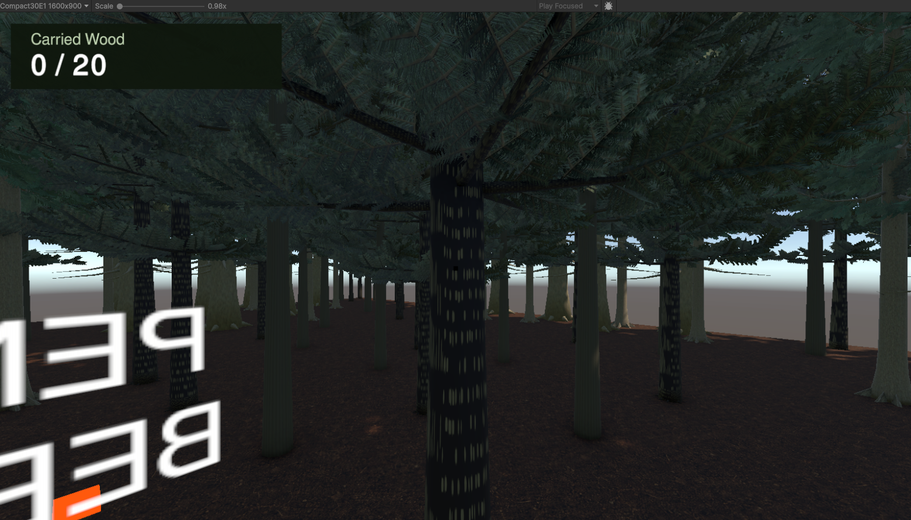

# Sen-1 #809 — E1 Minimum Compact30 Linux Unity Editor Playtest Result

**Date:** 19 November 2026 UTC. **Parent:** [#809](https://github.com/jermur788/CCF/issues/809). **Scene lane:** [#718](https://github.com/jermur788/CCF/issues/718). **Owner permission:** signed E1 instrument, 19 November 2026 10:51Z.

## Verdict

**`E1 EDITOR PREVIEW BUILT — SMOKE PASS — READY FOR OWNER PERSONAL TEST`**

This is a **local provisional preview**, not the signed production world, not E2, and not a Windows build. The owner still personally walks it and accepts or requests one targeted correction.

## Exact candidate

| Item | Value |
|---|---|
| Scene branch | `sen-1/718-compact30-e1-scene-20261119-v1` |
| HEAD | `36e32aa952f4fe41ca666fca578bad83b5a4bee4` |
| Base | `origin/main` `159f0ff8` |
| Worktree | `/media/jer/ZX20/CCF-Sen1-718-Compact30-Content-20261117` |
| Scene | `Assets/ForestPrototype/Scenes/ScenarioOneCompact30.unity` |
| Scene SHA-256 | `3982719eaf460c78cbdaa78ef1640a681da902d24441d4a6e39b78d51717ae2a` |
| Placement JSON SHA-256 | `08c4ab09617fd91fd1575fd2b9d1c0376e2ca1555bdc3465c5765329cd56b46a` |
| Unity | `6000.6.0f1` (Linux) |

Five and only five files were committed:

1. `Assets/ForestPrototype/Scenes.meta`
2. `Assets/ForestPrototype/Scenes/ScenarioOneCompact30.unity`
3. `Assets/ForestPrototype/Scenes/ScenarioOneCompact30.unity.meta`
4. `Assets/ForestPrototype/Scenes/ScenarioOneCompact30Placement.json`
5. `Assets/ForestPrototype/Scenes/ScenarioOneCompact30Placement.json.meta`

No runtime script, save source, historical scene, package, prefab or material was changed. The temporary local-only authoring/smoke tool was used under D-089, archived outside the repository, and removed with its `.meta`; its hash is in the evidence root. Unity's auto-attempted Linux SDK/toolchain package bump was reverted and never committed.

## What is in the preview

- 30 × 30 m flat continuous ground, top exactly `y = 0`, closed `[−15,+15)`, invisible containment at the edge.
- The **#676 candidate 175-row Sitka roster** (`sha256 dac06a3b…`, **UNSIGNED**) at exact `x/z` and height, using the four existing first-party Sitka pruning prefabs with the manifest's deterministic FNV base selection and height scaling.
- H1 opening `x[−9,+3] z[−15,−5]` (12 × 10 m) as a visually distinct worn-earth apron; no stumps, vehicles or props.
- Original **C0** footpath A0–A8, 1.2 m core + 0.2 m verge, provisional worn-earth surface; the ~0.625 m A7 bend is preserved and flagged for the owner's visual judgement.
- Four empty intended **G1** sites O1/O2 (sessile Oak) and B1/B2 (European Beech) at exact manifest coordinates, marked by stone posts and `PENDING — OAK/BEECH` labels. **No juveniles, no planting, no Oak/Beech simulation.**
- Player spawn `(2.0, 0.1, −8.0)`, yaw `16.94°`, existing `ForestPlayer` + `CharacterController` + camera `(0, 1.65, 0)`, existing New Input System.
- Existing first-party `Forest Ground`, `Forest Path` and `Stone` materials, unmodified.

## The three E1 checks

### M1 — Import/compile: **PASS**

- Exact candidate compiled and imported in Linux Unity `6000.6.0f1` after the temporary tool was removed.
- Batch exit code `0`; **0** `error CS`; **0** missing scripts.
- Scene contains **0** `m_Script: {fileID: 0}` references; **1,255** scene objects; **175** tree roots; **4** G1 site groups; `Ground`, `Player`, `Main Camera`, `Sun`, `H1`, `PathVisualMask`, `Boundary_30x30` all present.
- One pre-existing Editor-only `UnityEditor.Search.SearchDatabase` `ArgumentOutOfRangeException` appears on GUI startup; it is not from this scene and does not affect compile or Play. Recorded, not waived as a scene defect.
- Evidence: `m1-final-compile.log`, `unity-build-hublicense.log`, `build-receipt.txt`.

### M2 — Basic hands-on Play smoke: **PASS**

Actual GUI Editor Play mode, real OS keyboard/mouse events via `xdotool`, external screenshot:

| Check | Observed |
|---|---|
| Ground under spawn | `Ground` ray hit at `y = 0.000`, distance 5.000 |
| Spawn safe | start `(2.00, 0.03, −8.00)`, standing |
| Movement | `W` held 1.6 s → end `(3.87, 0.03, −1.87)`, moved ≈ **6.1 m** |
| Look | mouse movement → yaw change **31.95°** |
| Bounded ground | within `[-15.1,+15.1]`, `y > −0.5` |
| Crash | none |
| Screenshot | 1920 × 1008 full Editor; cropped Game view 1560 × 892 |

**Known appearance imperfections, recorded honestly:** the immediate view after walking north is dense and dark, as an unthinned 20-year Sitka stand should be; the `PENDING` labels are single-sided TextMesh, so they read mirrored when viewed from behind (the owner's spawn view looks at the front faces); the screenshot shows neither H1 nor the path because the camera had walked north of them. None is a hard failure.

Evidence: `smoke-receipt.txt`, `unity-smoke3.log`, `compact30-e1-late.png`, `compact30-e1-view.png`.



*Actual Play-mode render after walking north: continuous needle-litter ground, Sitka trunks and canopy, visible sky at the 30 m edge. The `PENDING` label in the lower left is seen from behind, so its single-sided text is mirrored; from the southern spawn side it reads normally.*

### M3 — Isolated/harmless: **PASS**

- Scene contains **no** `ForestSaveController` and **no** `ScenarioOneManager`; no save can be written by this preview.
- Production save slot `~/.config/unity3d/DefaultCompany/CCF/forest-save.json` was **absent** before and after; the complete save-directory listing and every file hash are identical (only the capture timestamp differs). `forest-save.json.bak` and the archived 2026-11-04 backup are unchanged.
- Deployed `/media/jer/ZX20/CCF-Ops/scripts/unity-lock status` remained **free** with no Editor PID; the installed lock/board/ledger was not mutated.
- No historical scene, Legacy40, Enlarged80 or Reference Future v1 file changed. Worktree is clean at the candidate commit.
- Evidence: `m3-save-baseline.txt`, `m3-save-final.txt`, `m3-save-after.txt`.

## How to open the candidate (Linux Editor)

The native Editor could not see the Flatpak Unity Hub's entitlement. The tested route uses the Hub's own licence store **for this process only**; nothing was copied or moved globally:

```bash
cd /media/jer/ZX20/CCF-Sen1-718-Compact30-Content-20261117
XDG_DATA_HOME="$HOME/.var/app/com.unity.UnityHub/data" \
XDG_CONFIG_HOME="$HOME/.var/app/com.unity.UnityHub/config" \
/media/jer/ZX20/Unity/6000.6.0f1/Editor/Unity -projectPath "$PWD"
```

Then open `Assets/ForestPrototype/Scenes/ScenarioOneCompact30.unity` and press **Play**.

- Unity Hub must be signed in / hold an active Editor entitlement. If the Editor reports `No valid Unity Editor license`, sign in to Unity Hub first.
- Play enters directly; the automatic session menu self-dismisses because this preview deliberately has no save controller or Scenario One UI.
- `Esc` releases the cursor; `Play` again / stop Play ends the test.
- The installed machine-wide `unity-lock` is **not** required for this owner walk; no other Unity Editor should be open at the same time.

## Owner's 5–10 minute E1 walk checklist

Adapted from the #765 E1 checklist (not duplicated as a second QA document):

| ✓ | Action | What should happen | Your note |
|---|---|---|---|
| ☐ | Open the exact scene above and press Play. | No new Console error or missing-script problem; player appears above solid ground inside the wood. | ______ |
| ☐ | Look around with the mouse and take a few steps. | Camera turns normally; walking is controllable and does not snag immediately. | ______ |
| ☐ | Turn south and walk into the **H1 clearing**. | Open 12 × 10 m worn-earth clearing is recognisable and accessible; no hole or invisible wall. | ______ |
| ☐ | Follow the **winding C0 footpath** north, then return. | Path is visible and traversable; ground stays continuous; judge the sharp A7 bend. | ______ |
| ☐ | Look at the four **pending G1 sites** (2 Oak, 2 Beech). | Stone posts and `PENDING` labels are visible; they do **not** look like completed planting. | ______ |
| ☐ | Look at the Sitka woodland and the 30 × 30 m edge. | Reads as a bounded, plausible original Sitka wood; invisible edge keeps you in. | ______ |
| ☐ | Stop Play. | Test ends normally; no save or existing world changed. | ______ |

**Owner result:** ☐ accept preview for continued development ☐ targeted fix needed ☐ stop — isolation/Unity issue.

**Scope:** visual/physical E1 walk only. This is not E2 gameplay, save compatibility, external beta or Windows acceptance.

## Deferred to E2 (unchanged)

Full Sitka/Oak/Beech Work Plan, 2 Oak + 2 Beech planting, stock/cost/€12k budgeting, regeneration/browsing, annual change and review, S1-C/S1-D, M-A/OD-16 completion, Compact save identity/persistence, signed world/digest, guards and final art, full compatibility/perf/Tier-3 and Windows build. None of these was attempted or claimed here.

## Lease release and preservation

- Human-supervised exclusive Unity use for this E1 build/test is **released** at the end of this result: no Unity Editor process remains; deployed `unity-lock` is still free and untouched.
- The owner's seven dirty files in `/media/jer/Files/CCF-Primary` were not touched. `#690` save lane, `#765`/`#807` browser lanes, Multi `#730` and Ops `#652` were not touched.
- Evidence root: `/media/jer/Files/CCF/Verification/Sen1-809-E1-Compact30-Editor-20261119/`.
- Scene branch (public, five files): https://github.com/jermur788/CCF/tree/sen-1/718-compact30-e1-scene-20261119-v1/Assets/ForestPrototype/Scenes
