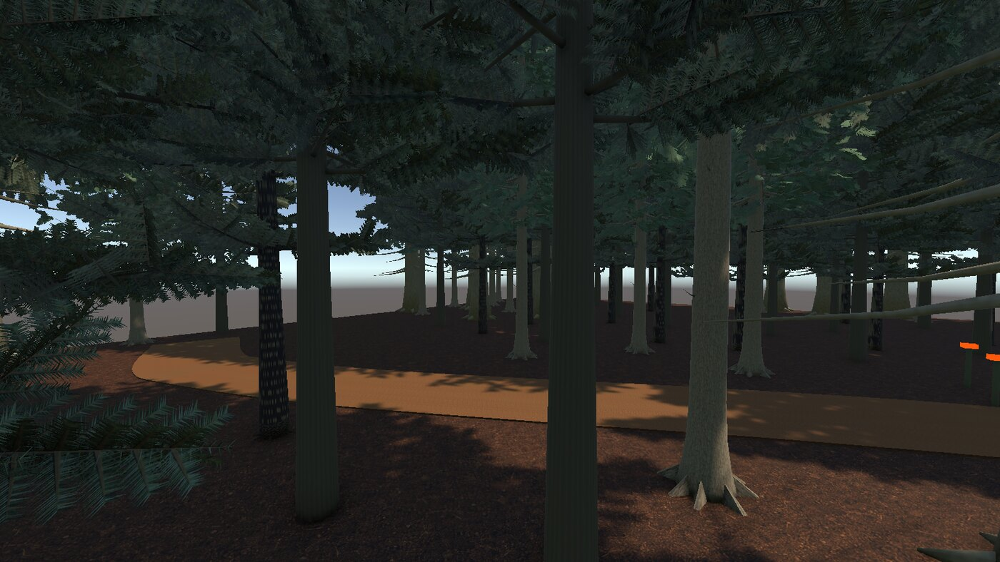
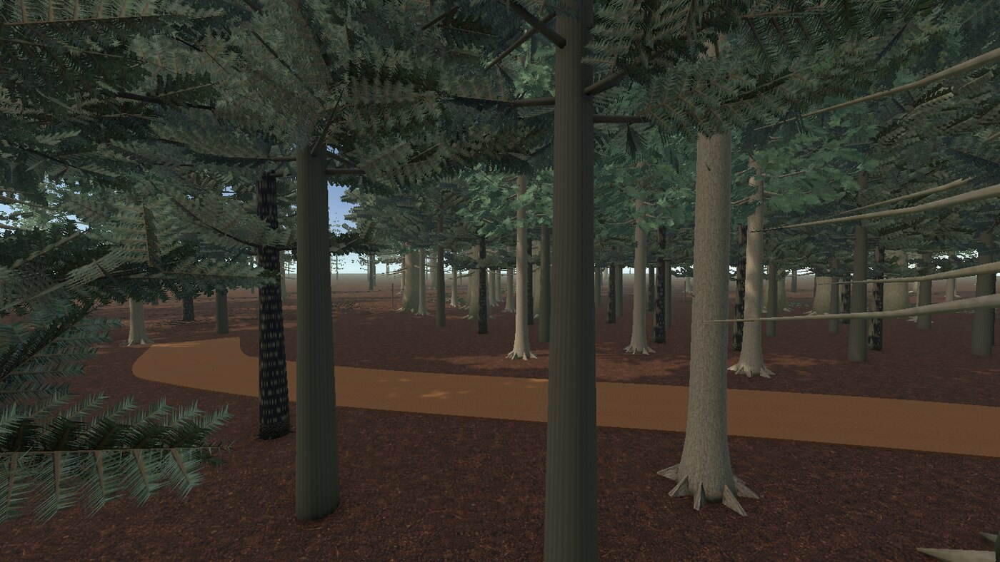
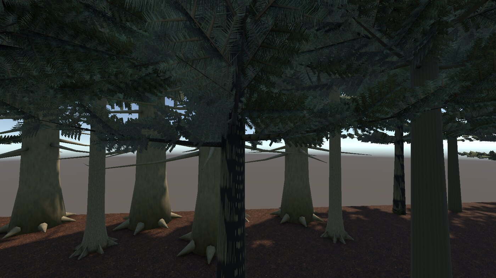
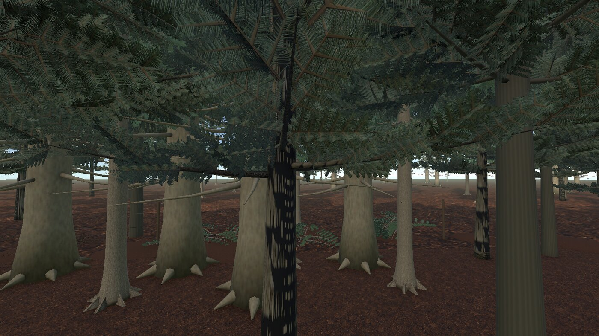
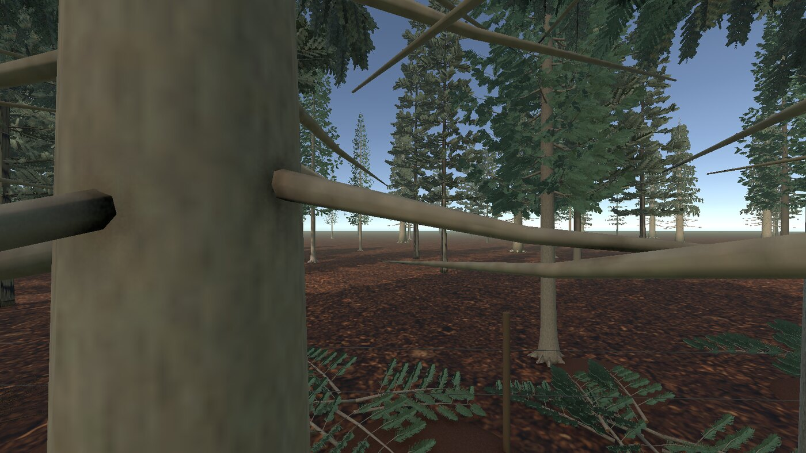
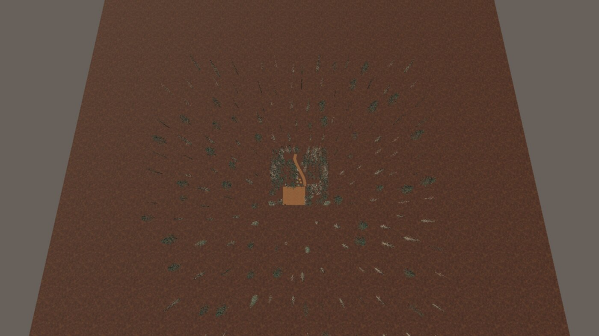
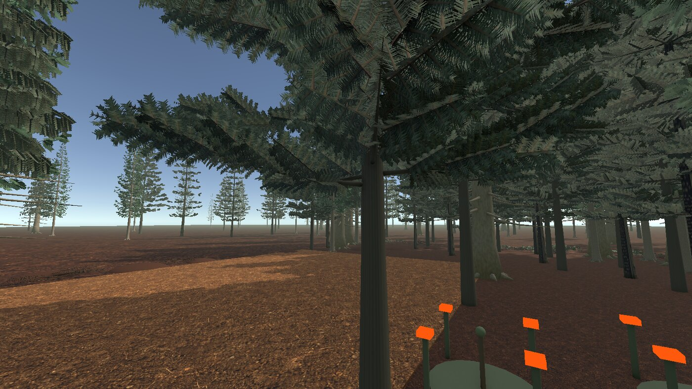
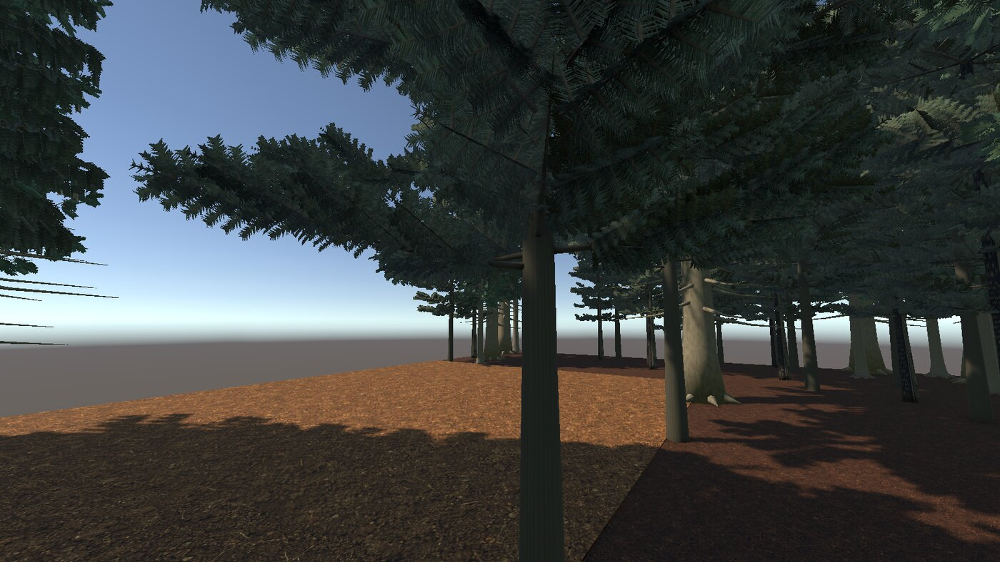
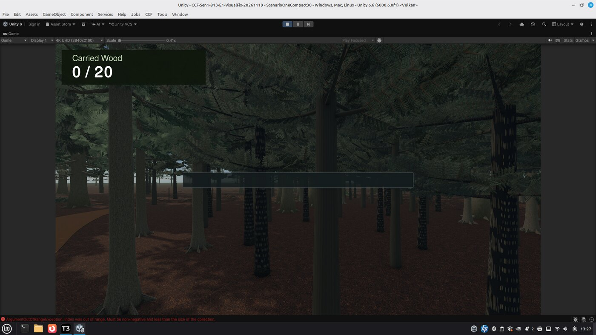

# Sen-1 #813 — Compact30 E1 Visual and Layout Correction Result

**Date:** 19 November 2026 UTC. **Parent:** [#813](https://github.com/jermur788/CCF/issues/813). **Scene lane:** [#718](https://github.com/jermur788/CCF/issues/718). **Prior build:** [#809](https://github.com/jermur788/CCF/issues/809).

## Verdict

**`E1 VISUAL/LAYOUT CORRECTION BUILT — M1/M2/M3 PASS — READY FOR SECOND OWNER WALK`**

This is a corrected **local provisional E1 preview**, not the signed production world, not E2 and not a Windows build. The owner still walks it and accepts or reports what remains. **No acceptance is claimed here** — `OWNER E1 ACCEPTED` is reserved to the owner.

## Exact candidate

| Item | Value |
|---|---|
| Scene branch | `sen-1/813-compact30-e1-visual-layout-fix-20261119-v1` |
| HEAD | `be60c174f8609107447c6cbf4dd223da8d7b8cdf` |
| Base (unmodified #809 tip) | `36e32aa952f4fe41ca666fca578bad83b5a4bee4` |
| Worktree | `/media/jer/ZX20/CCF-Sen1-813-E1-VisualFix-20261119` |
| Scene | `Assets/ForestPrototype/Scenes/ScenarioOneCompact30.unity` |
| Scene SHA-256 | `5e948e68fad41a0e9669bf0d18efe73aab2e8d2dd2148b2ab2824f4915c17806` |
| Placement JSON SHA-256 | `aeaf2302a23ad11c3077d9dae3071f5b6af672e9b5cedfb26f8c2860763e942f` |
| Unity | `6000.6.0f1` (Linux, Vulkan) |

Branch: https://github.com/jermur788/CCF/tree/sen-1/813-compact30-e1-visual-layout-fix-20261119-v1/Assets/ForestPrototype/Scenes

**Exactly two files changed**, inside the authorised Tier S ceiling:

1. `Assets/ForestPrototype/Scenes/ScenarioOneCompact30.unity`
2. `Assets/ForestPrototype/Scenes/ScenarioOneCompact30Placement.json`

The three `.meta` files are untouched, so GUID relationships are preserved.

---

## 1. Under-canopy lighting — fixed

**Diagnosis first.** At player eye level the interior was genuinely unreadable: trunks resolved as black silhouettes against a bright sky, the litter floor was near-black, and there was no post-processing or exposure to rescue it. The cause was low ambient relative to a bright sky, plus a dense closed canopy, plus hard shadows (the URP asset has soft shadows disabled and one shadow cascade, which is a *project* setting this task may not change).

**Smallest scene-local fix, applied in the scene only:**

| Setting | Before | After |
|---|---|---|
| Ambient mode | Trilight, intensity 1.0 | Trilight, intensity **1.50** |
| Ambient sky | (0.52, 0.65, 0.76) | (0.60, 0.70, 0.80) |
| Ambient equator | (0.34, 0.40, 0.30) | (0.45, 0.50, 0.40) |
| Ambient ground | (0.18, 0.20, 0.14) | (0.29, 0.31, 0.22) |
| Sun | 1.6, colour (1, 0.94, 0.82) | **1.75**, raised to 46°, shadow strength **0.72** |
| Fog | off | Exponential-squared, density 0.0125, colour (0.56, 0.61, 0.55) |

No material asset, prefab, renderer asset or `ProjectSettings` file was changed, and **no tree was thinned** to fake illumination — all 175 Sitka roots remain.

**Measured, not asserted.** Mean luminance over the central band of the same fixed viewpoint:

| View | Before | After | Change |
|---|---|---|---|
| Under canopy (02) | 0.157 | 0.221 | **+40 %** |
| East edge (03) | 0.139 | 0.200 | **+44 %** |
| C0 path (04) | 0.241 | 0.274 | +13 % |

Contrast deviation fell slightly (0.144 → 0.127 under canopy), i.e. the shadow floor lifted rather than the image being flattened into grey. The result still reads as a dense, unthinned 20-year Sitka stand.

**Before:** 
**After:** 

## 2. Boundary — hybrid screen plus woodland continuation

The owner's complaint was that the whole 30 × 30 m rectangle ended in nothing. It did: the ground stopped at ±15 m and the procedural skybox showed underneath.

A single visual-only root, **`E1_Outside_VisualOnly`**, now carries:

- a **260 m ground continuation** at `y = −0.02` (2 cm under the playable top, so the authoritative ground always wins the depth test inside the stand), using the existing `Forest Ground` material with `_BaseMap_ST` set per-renderer via a MaterialPropertyBlock to keep the same 2.5 m per tile as the playable ground;
- **226 background Sitka instances** from the same four first-party prefabs as the real stand — a denser near band (≈6 m spacing to 34 m) and a cheap sparse backdrop to 78 m, with shadow casting disabled beyond the near band;
- **32 brash clusters** plus low perimeter cover, deliberately irregular with gaps, so it screens without becoming a wall;
- short **post-and-wire runs on the east and north edges only** — a plausible forestry boundary where one makes sense.

**Scope discipline:** the shell contains **zero colliders** (verified), is not a stand expansion, adds no ecology cells, no Sitka roster rows, no Work Plan markers, no save or world-identity change. Playable bounds stay `±15 m` and the **175 actual Sitka are untouched and separate** from the 226 exterior visual-only instances. The southern H1 arrival is deliberately left open — no fence across it.

**Before (edge):** 
**After (edge):** 
**Looking outward from the boundary:** 
**Plan view of the shell:** 

## 3. Planting sites — the actual coordinates moved

The owner was right, and it was not a labelling problem. Recomputed from the published anchor chain, **all four sites failed full-footprint clearance against the rendered C0 envelope** — even against a conservative 0.5 m footprint.

**Test used:** distance from site centre to the C0 polyline, minus the rendered path half-width (0.8 m = 1.2 m core + 0.2 m verge, confirmed by the 1.6 m C0 segment meshes) minus a 0.6 m juvenile-shelter footprint radius. Pass requires a positive result.

| Site | Species | Old x,z | Old clearance | New x,z | New clearance | Cell |
|---|---|---|---|---|---|---|
| O1 | sessile oak | (1.17, −0.47) | **−0.342 m** | (0.65, −2.65) | **+0.774 m** | 15 → 15 |
| O2 | sessile oak | (1.57, −2.73) | **−0.137 m** | (0.20, −1.10) | **+0.767 m** | 15 → 15 |
| B1 | European beech | (3.43, −0.07) | **−0.177 m** | (−1.20, −2.45) | **+2.492 m** | 15 → **14** |
| B2 | European beech | (3.83, −2.33) | **−0.379 m** | (−0.45, −4.30) | **+1.996 m** | 15 → **14** |

Worst case improved from **−0.379 m (inside the path)** to **+0.767 m clear**. Minimum separation between any two sites is 1.61 m; nearest Sitka is ≥ 1.40 m; none sits in H1, on the A7 bend, or on a root.

**Why cell 14.** Compact30 uses 6 × 6 cells of 5 m (`index = floor((z+15)/5) * 6 + floor((x+15)/5)`), so cell 15 is `x[0,5), z[−5,0)`. That cell physically cannot hold four clear sites: the path cuts diagonally through it, P0710 sits at (4.79, −1.08), and the only off-path pockets are a ~1 m strip west of the path and a ~0.3 m sliver east of it. B1 and B2 therefore moved one cell west into the adjacent stocking gap, and the **cell change is recorded honestly** in the placement JSON (`correction_20261119`). This is a provisional E1 layout delta and **does not amend the frozen #676 production planting manifest**.

The markers moved with the coordinates — the underlying `G1` positions themselves changed, not just the signs.



## 4. Floating labels — removed, not shrunk

All four `TextMesh` `PENDING` objects were **deleted** (`remaining_scene_textmesh = 0`). They are not rotated, darkened or scaled.

Each site now carries three small, ground-anchored, **collider-free** survey items:

- a **0.56 m timber stake** at the centre;
- a **cap** giving the species by colour — **ochre = sessile oak, sage = European beech**;
- a **0.55 m radius footprint ring** on the ground, which also makes the clearance claim visible while walking.

Nothing stands on the walking surface, nothing can snag the `CharacterController`, and there is no 3D text anywhere in the forest. The sites read as *proposed future planting positions*, not planted juveniles.

**Before:** 
**After:** 

---

## Gates

### M1 — Import/compile: **PASS**

- Exact committed candidate imported in Linux Unity `6000.6.0f1`; batch exit `0`.
- **0** `error CS`, **0** missing-script references, with the temporary tool already removed.
- Scene audit after build: **175** trees under the `Trees` root, **0** `TextMesh`, outside shell present with **0** colliders.
- Unity's auto-attempted Linux SDK/toolchain package bump was reverted both times and never committed.

### M2 — Real Play-mode walk and visual inspection: **PASS**

Genuine GUI Editor Play on the real host, real OS input via `xdotool`:

| Check | Observed |
|---|---|
| Start | (2.00, 0.09, −8.00), standing in H1 |
| Movement | `W` held 2 × 2 s → (6.80, 0.03, 7.76), **≈ 15.8 m** travelled |
| Ground | continuous throughout, `y` stayed 0.03–0.09, no fallthrough |
| Look | mouse movement turned the camera |
| Crash | none |
| Capture | real Editor window at 1920 × 1080, Game view 4K UHD |

The walk crosses H1, the path corridor and past the relocated G1 sites, so the new stakes were traversed without snagging.



### M3 — Isolation: **PASS**

- `git status` in the scene worktree shows **exactly the two permitted files**; no untracked file remains under `Assets/`.
- Temporary D-089 tool and its `.meta` removed after the final build, with a hash receipt and an archived copy in the evidence root.
- `forest-save.json` **absent** before and after; every pre-existing file in the save directory is hash-identical. The scene contains no `ForestSaveController` and no `ScenarioOneManager`, so it cannot write a save.
- **No Unity Editor process remains**; exclusive custody released.
- Deployed `/media/jer/ZX20/CCF-Ops/scripts/unity-lock` untouched (`mtime` 15 Oct).
- Historical Legacy40 / Enlarged80 / Reference Future v1 and every other lane untouched. The seven pre-existing dirty files in `/media/jer/Files/CCF-Primary` were not touched.

## Known artefacts and limits (stated, not hidden)

1. **The GUI Play captures contain a translucent grey band across the middle of the Game view.** It appears identically before and after, is absent from a direct camera render, and is an **Editor-side overlay artefact**, not scene content — most likely the same GUI/QuickSearch overlay area that emitted the pre-existing `ArgumentOutOfRangeException` recorded in #809. It does not exist in the scene and will not follow the owner into a build. The clean comparison images in this document are direct camera renders and contain no UI.
2. A pre-existing Editor-only `UnityEditor.Search.SearchDatabase` exception still appears on GUI startup. It is not caused by this scene and is not waived as a scene pass.
3. The horizon at ~60–80 m is hazy and the sky is visible low between distant trunks. That is a normal woodland-edge read and is far from the previous hard platform edge, but it is a simplification, not a solved distance landscape.
4. The exterior shell is **scenery only**. It exists to make the property look embedded in a landscape. Nothing outside ±15 m is simulated and nothing there is walkable.
5. B1/B2 moved from cell 15 to cell 14 (see §3). This is a provisional E1 layout decision for owner review, not a change to the signed production planting manifest.

## How to open the candidate (Linux Editor)

```bash
cd /media/jer/ZX20/CCF-Sen1-813-E1-VisualFix-20261119
XDG_DATA_HOME="$HOME/.var/app/com.unity.UnityHub/data" \
XDG_CONFIG_HOME="$HOME/.var/app/com.unity.UnityHub/config" \
/media/jer/ZX20/Unity/6000.6.0f1/Editor/Unity -projectPath "$PWD"
```

Then open `Assets/ForestPrototype/Scenes/ScenarioOneCompact30.unity` and press **Play**.

Unity Hub must be signed in and hold an active Editor entitlement. No other Unity Editor should be open at the same time.

## Your second E1 walk — what to judge

| ✓ | Action | What should now be true |
|---|---|---|
| ☐ | Press Play at spawn. | You can see trunks, root flares, the litter floor and the C0 path **without leaning into the screen**. Still clearly a dense Sitka stand. |
| ☐ | Turn south and walk into **H1**. | The clearing reads as an open arrival apron and the entrance is **not** fenced off. |
| ☐ | Follow **C0** north, including the A7 bend. | Path is obvious underfoot; **no stake, ring or marker sits in the walking line** in either direction. |
| ☐ | Look at the four **proposed** sites (2 oak, 2 beech). | Low stakes with ochre (oak) and sage (beech) caps and subtle ground rings. **No floating words anywhere.** |
| ☐ | Turn east/north and look past the stand edge. | Ground continues and the wood continues past the property; brash, low cover and a short fence line break the edge. **No square platform ending in nothing.** |
| ☐ | Check you still cannot leave the 30 × 30 m stand. | Invisible containment still holds you in. |

Reply **`E1 accepted`**, or a short targeted list of what still looks wrong. E2 gameplay, planting, Work Plan and save persistence remain deliberately out of scope.

## Evidence root

`/media/jer/Files/CCF/Verification/Sen1-813-E1-Compact30-VisualCorrection-20261119/`

Contains before/after Play captures, clean before/after renders, the top-down shell plan, the M2 walk log, the build verification dump, the lighting before/after settings, the M3 isolation receipts, and the archived temporary tool with its hash.

## Not done, and not claimed

E2 loop, real Oak/Beech juveniles, planting, Work Plan, annual simulation, regeneration/browsing, save or world identity, signed world digest, W§12 signature, art acceptance, performance qualification, multi-resolution testing, Tier 3, independent review programme, and any Windows build.
