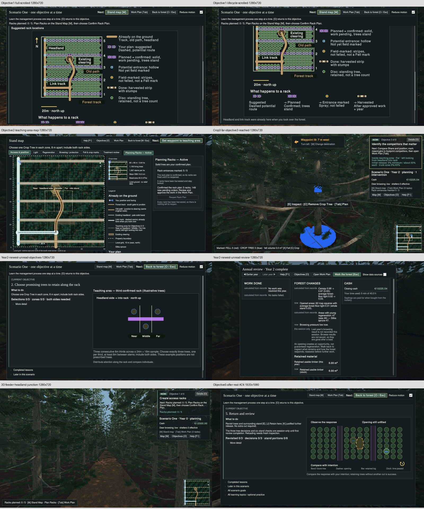

# #369 runtime UX coverage completion — handed off to Manager #200

10 November 2026. **Worker recommendation: NOT QUALIFIED / NEEDS CHANGES.** Genuine progression reached Objective 5; a later-year Annual Review acknowledgement/guidance defect was observed. Remaining unexercised requirements stay NOT VERIFIED. This is a qualification handoff, not acceptance or an integration instruction.

Operator: OpenAI gpt-6.1-sol, medium, Codex harness / T3 Code. Exact source `85568c4f60b09279a2e1692bd0e7f8593e1b9a0d`, warm `/media/jer/ZX20/CCF-U3`, branch `qualify/scenario-one-player-feedback-368-20261110`. Unity 6000.6.0f1, graphical Linux Editor. One admitted session, 2017.4 seconds, normal exit 0, no forced kill, no leftover harness/meta. Provider interruption occurred during the session; continuation reused that same live Editor. No production changes, source-review delegation, offline suite repeats, main merge or Player/Windows build.

## Portable evidence

[Contact sheet](Evidence369/contact-sheet.jpg) contains genuine rendered frames; use the original PNG links below for readable pixels. [Evidence SHA-256 manifest](Evidence369/evidence-sha256.txt), [runner receipt](Evidence369/runner-result.json), [protection receipt](Evidence369/protection-after.json), [lease release](Evidence369/release.json), [final free lock/no Editor receipt](Evidence369/lock-after.json). Runner PASS means normal session completion and nonblack captures, **not feature qualification**.

All raw PNGs, per-frame UI TSV and state dumps, input receipts, played-world readbacks, `PLAN.md`, disposable driver, log and disk monitor remain durably at `/media/jer/Files/CCF/Verification/CCF-369-RuntimeCoverage-20261110/`. Actual screenshots passed the >1% nonblack guard. The report's filenames containing `newest-unread` describe the attempted check; their state readbacks actually say `unread=False`. They must not be cited as passing unread-state evidence.

## Actual progression and input boundaries

The finite plan preceded lease acquisition. #368 screenshots/logs were inspected first; retained #368 feeder-visibility PASS was not treated as complete parity qualification. Fresh isolated Enlarged80 world began with 1,344 trees and five rack suggestions. Confirmed five racks, deliberately marked entrances, reviewed 149 pending jobs, approved through the Work Plan and advanced to Year 1. Actual Year 1 review acknowledgement restored Objective 2. Advanced another year with no new work while still on Objective 2. Chose three actual Crop Trees (`P0710`, `P1305`, `P1315`) across the three thirds and both sides; genuine scoring reached Objective 3. Negative outside/duplicate/spacing/extra selection feedback was exercised and extra marks removed/recovered before continuing.

Deliberately marked 21 actual competitors with native X input; actual credited release reached Objective 4. The Work Plan displayed €2,500 total contractor charge, €2,452.70 minimum adjustment, €93.94 initial timber quote and the warning that approval commits all eligible pending jobs. Changed P1405 to deadwood using the actual UI; approved the mixed-disposition plan and advanced to Year 3. The Annual Review reported 21 trees processed, €86.32 timber income, €2,500 cost and €7,811.86 closing cash. Actual review acknowledgement restored Objective 5 inspection/retain/release and six-portion instructions, with the session-only warning. Stopped at the planned maximum third annual cycle; no speculative full-loop campaign.

Native OS keys/mouse exercised marking, movement and some UI (including source toggle and deadwood choice). The disposable driver also dispatched production UI Button Clickable callbacks for navigation, confirmation, approval, year advance and ACK; this proves callback/gameplay behavior, **not native mouse/keyboard coverage of every button**. Camera position/aim aids and direct production entrance action were available and logged. Teleports are not physical walking evidence. Native walking samples exist separately. No teaching index, stage facts or saved history was forced or edited. No synthetic lesson progression was used.

## Bounded defect: newest report is already treated as seen

Reproduction on the exact candidate: execute racks in Year 1 → read and acknowledge Year 1 → remain at Objective 2 without Crop selections → advance to Year 2 with no new work → inspect HUD, Objectives, Map, Work Plan and latest Annual Review **before any Year 2 acknowledgement**.

Observed: Year 2 retains `annualReviewSeen=true` in the genuine world readback; UI `NeedsAnnualReview` is false. Objectives still instruct three Crop Tree selections, and Annual Review has Walk as primary with no acknowledgement action. This fails the requested newest-unread Review-first combination. [Objectives 720p](Evidence369/Year2-newest-unread-objectives-1280x720.png), [Annual Review 720p](Evidence369/Year2-newest-unread-review-1280x720.png); equivalent 1080p raw frames/state dumps are in the durable evidence directory. Year 1 acknowledgement and Objective 5's separate teaching acknowledgement do work; they do not repair this later-year failure.

Suggested bounded repair for Manager assignment: make the latest newly generated Annual Review enter the existing unread/acknowledgement flow, preserving historical browsing and accepted persistence semantics. Verify Year1 ACK → Year2 while Objective2 → Review-first on all surfaces → explicit ACK → Crop instructions, including isolated save/reload. Production was not modified. Do not add a new schema without separate justification.

## Requirement outcomes

UNITY PASS below applies only to the stated exercised slice. PARTIAL means other clauses remain NOT VERIFIED; it is not full requirement acceptance.

| Requirement | Actual Unity outcome and boundary |
|---|---|
| FR-Z1 | PASS default confirmed third-rack sample in this played world. Rotated layouts / unconfirmed negative NOT VERIFIED. |
| FR-Z2 | PASS teaching polygon/third labels and waypoint action at 720p; later 1080p map captured. Grayscale independently NOT VERIFIED. |
| FR-Z3 | PARTIAL: native walking samples and HUD zone/side/action; three selections reached Objective3. Exhaustive HUD spacing/pair rendering NOT VERIFIED. |
| FR-Z4 | PASS exercised outside, duplicate/too-close and fourth-selection feedback with actual marks. Every invalid-condition combination NOT VERIFIED. |
| FR-Z5 | PARTIAL: Objective2 diagram at both sizes, actual three selections; Legacy40/preview guards NOT RUN. |
| FR-N1 | **FAIL** later Year2 Review-first while Objective2, as above. PASS Year1 ACK, authentic Objectives3/4/5 own guidance. Stages6–8/MFM NOT RUN. |
| FR-N2 | NOT VERIFIED animation cadence/single-target/Reduce motion and all forbidden-target cases; static safe Next outlines visible. No animation PASS inferred from still PNGs. |
| FR-N3 | PARTIAL active walking instructions visible; pulse and full prerequisite/focus/insufficient-cash negatives NOT VERIFIED. |
| FR-N4 | NOT RUN Objective6/MFM checklist. |
| FR-N5 | PARTIAL Year1/Year3 ACK vs secondary Walk, Objective5 session-only warning PASS; later Year2 lacks ACK (FAIL); historical browsing/Enter double activation NOT VERIFIED. |
| FR-R1 | PASS native source disclosure on/off at 720p after correcting initial unmapped click attempts. Initial frames named on/off are not alone proof. |
| FR-R2 | PARTIAL: on/off played-world readbacks retained bytes; plain uncertainty such as “calculated from records”, “now”, “this session only” remains visible. Historical reconstructed storm case NOT RUN. |
| FR-R3 | PASS rendered Work done / Forest changes / Cash hierarchy and retained details in actual reviews; full historical drilldown NOT VERIFIED. |
| FR-M1 | PASS unobstructed feeder Full map at both sizes, minimap/3D junction frames plus native walk. Source-exact endpoint numerical parity NOT VERIFIED by pixels alone; no invented topology. |
| FR-M2 | PARTIAL grouped legend and distinct named path sections visible; complete grayscale/swatch audit NOT VERIFIED. |
| FR-M3 | PARTIAL draft/confirmed/field-marked/harvested states captured during real progression; all minimap/legacy/frozen combinations NOT VERIFIED. |
| FR-M4 | PASS production/asset protection checks; no topology edits. Exhaustive clearance/mask/footpath behavioral equivalence NOT RUN. |
| FR-D1 | PASS diagram and full lifecycle reached by scrolling at 720p/1080p; no essential navigation blockage observed. |
| FR-D2 | PASS inspected direct labels, tan track and existing-headland/link copy; full figure and lower lifecycle require separate scroll positions at 720p. |
| FR-D3 | PASS five uneven dashed suggestions and hollow entrances in initial 0/5 figure; no claim schematic disc count equals world population. |
| FR-D4 | PARTIAL four-state lifecycle and honest approval/year timing visible; exact complete grouped-key contract and old-world guards NOT VERIFIED. |
| FR-D5 | PASS genuine nonblack Unity pixels, not concept art. |
| FR-C1 | PASS actual nonzero quote/minimum before deliberate approval; invalid/cash refusal and alternate minimum parameters NOT RUN. |
| FR-C2 | PARTIAL headland entrance guidance and actual field marking; every duplicate string/Legacy40 NOT VERIFIED. |
| FR-C3 | PASS current Objectives1–5 short action/key and reachable detail; Objective6 checklist NOT RUN. |
| FR-C4 | PARTIAL first and release-review ACK and Objective5 warning PASS; latest Year2 ACK FAIL; save/reload and full completion chronology NOT RUN. |

Original [720p diagram](Evidence369/Objective1-full-scrolled-1280x720.png), [720p complete lifecycle](Evidence369/Objective1-lifecycle-scrolled-1280x720.png), [Objective5 after actual ACK](Evidence369/Objective5-after-real-ACK-1920x1080.png). Remaining late-loop, old-world, save/reload and motion checks require an explicit next bounded task; cheapest route is a user-assisted played-world fixture at Objective5/6 after the review defect is addressed, not another broad smoke campaign.

## Protection and adverse evidence

All 36 valued original save/prefs files, 5,732 Workbench files, 27 ignored licensed assets and six protected archive/meta paths match trusted hashes. U3 original eight dirty generated material/settings files restored byte-exact and initial status reproduced. Primary's unrelated AGENTS.md and StorageArchitecture.md edits preserved. Staged harness/meta and copied licence removed. Actual isolated persistentDataPath, F5/F9 save and prefs paths were proven before Play (`run/evidence/paths.txt`). Disk stayed above the 35 GiB admission requirement with 20-second monitor; final 35.934 GiB. Lease released only by own ID; final status free/no Editor.

Known UI renderer stack traces remain in the raw log; no C# error or C369_FAIL occurred. Normal exit alone does not waive these diagnostics. Source remains AUTHOR-CHECKS PASS (prior reported 189-source compile/379 checks), independent review USER-DEFERRED / NOT RUN, **not independently reviewed**. Historical strict Workbench exit1, old StandMapParity×2, save03b FAIL, UxPedagogy38 FAIL and #360 synthetic171/2 FAIL remain adverse evidence; none was rerun or erased.

Return to Manager #200 for separate verdict and repair scope. #369 closes as HANDED-OFF, not accepted. Manager owns live coordination edits; dashboard ingestion/audit/published-state synchronization is **NOT VERIFIED and outstanding**, not silently claimed complete.
