# #391 Unity qualification — F391-01 fixed; remaining gates incomplete

**Attempt 4: F391-01 PASS on `a314d308315b5894263d30461a1e8b52ca0f3605` (NEW).** Real-Editor compilation has zero errors; the unmodified P3 gate passes; both clearance labels and complete values are readable at 1280×720 and 1920×1080. This bounded re-verification resolves the rendered finding. It does not close the separately unrun saved-world/first-reached variants or classify the old nursery failure. The updated overall verdict table and full Attempt-4 receipts follow the historical record below.

## Attempts 1–3 record — historical verdict on 868643a1

Candidate **868643a1311ad79a759dbe18d4353f1b928ce2a7**, baseline game source **2aaacad68ed186dbe14531f31ce5bb3a87811441** (the #381 report/evidence snapshot is `b62446caf40fc2ac939d55a6bea6e201f41de700`). Unity **6000.6.0f1**. Test worker: **GPT-6.1 Sol, high reasoning effort, T3 Code/Codex**, no subagents. Attempt 3 is the final bounded attempt in this packet.

**FAIL — rendered Work Plan clearance layout finding.** Rendering recovered on the first warm sanity session. Directly inspected Help, goals, curriculum Topic 2, map.regeneration and the real Lesson 3 “Why it matters” at **1280×720 and 1920×1080**: those changed passages fully visible, with no overlap or cut-off. The accepted Reference gate passed and its printed anchors exactly match #381. Those early states passed, but the later scrolled clearance rows expose a product readability defect at both sizes: their location label collapses to a few pixels and wraps almost one character per line beside the longer changed value. The unrun baseline-save CurrentWorldHash comparison remains a separate gap. The old nursery-warning failure remains **UNDETERMINED**, not waived or counted as a product PASS.

No production source, scene/prefab, package, project settings, frozen archive, issue, active-tasks or protected lane changes. No Player/Windows build, merge or feature-branch commit. The test lane remains pinned to the candidate; Library is retained.

## Attempts 1 and 2 (history retained)

**Attempt 1 — BLOCKED before Unity:** operational acquisition refused the unregistered lane; no lease or Editor. The lane was subsequently registered by the coordinator. Original detail remains in report history and durable `qualification-report.md`.

**Attempt 2 — PARTIAL / failed teaching harness:** real Editor cold import/compilation reached Play Mode with zero `error CS`; old `ScenarioOneTeachingCopyVerification` failed `nursery warning visible` at line 198 after five black 1280 captures. No readability PASS. Lease `c72e3e0fce27404b88df38b3f3daa146` released normally after recorded Editor PID 113621 was killed only after its shutdown markers. Disk 24,676,139,008 → 17,661,034,496 bytes. Disposable scripts/metas/licence removed, known import side effects restored byte-exact, nine host save/Prefs hashes unchanged, final FREE. Other gates NOT RUN. The five black originals remain in durable `teaching/evidence/`; their report copies are replaced by contentful Attempt-3 evidence below. **Correction:** Attempt 2's description of “UI Toolkit render-chain exceptions” was inaccurate; see the log analysis below.

## Attempt 3 — evidence and black-frame diagnosis

Durable root: `/media/jer/Files/CCF/Verification/CCF-391-ResearchCopy-Qual-20261112/`; this attempt's scripts, full logs, command acknowledgements, paths, leases and originals are under `attempt3/`. `published-images.json` records original/published SHA256 and pixel equality for the twelve losslessly compressed PNGs (11,496,840 bytes total). Every image used for a judgement was opened and read by this worker; marker counts are not readability evidence.

Read first: `git -C /media/jer/Files/CCF-Primary fetch origin` (exit 0), then `git -C /media/jer/Files/CCF-Primary show origin/report/scenario-one-research-copy-v1-unity-qual-20261112:Docs/Handoffs/ScenarioOne-Research-Implementation-20261112/SOL-C01-RESEARCH-COPY-V1-UNITY-QUALIFICATION-RESULT.md` (exit 0). Workflow, decisions, milestone, game brief, Unity overview and live active-tasks inspected. Primary's unrelated `AGENTS.md` and `Docs/Operations/StorageArchitecture.md` modifications were preserved. Report checkout was clean on feature branch before switching to the existing report branch at `a962e14679fb70d8e4df01989aa9612afd4678f9`.

Compared #379/#381 reports, `Ccf381.cs`, launchers and `continuation/next_phases.py`/`sessions.py` with attempt 2 before starting Unity:

| Factor | Observed comparison / conclusion |
|---|---|
| Display and geometry/depth | Same launcher command `Xephyr :89 -screen 1920x1080 -ac -noreset`, with openbox and owned-window focus/size keeper. Attempt-3 `xdpyinfo` proves 1920×1080, root depth 24. No display/depth change was required. Historical launchers request the same geometry and no explicit depth override. |
| Graphics backend | #381, attempt 2 and attempt 3 select NVIDIA GeForce GTX 980M / Vulkan, driver 580.178.04. No forced OpenGL/software-renderer flag or GL/Mesa override was added; current inherited graphics override inventory was empty. Saved log extracts: `381-graphics.txt`, `attempt2-graphics.txt`, `attempt3-graphics.txt`. |
| Game view | Both use UnityEditor.GameView reflection to add/select fixed sizes and focus/repaint. Old S1A starts at 1600×900 then loops 1280→1920; Ccf381 starts at 1280×720 and changes on command. `CCF_UI_SIZES=1920x1080,1280x720` was supplied in capture sessions, but these two harnesses select sizes in code and **do not consume that variable**. No claim that the environment size order fixed S1A. |
| Capture/settle | Both use `WaitForEndOfFrame` + `ScreenCapture.CaptureScreenshotAsTexture`. S1A waits five real seconds, then .4 seconds + 12 frames per panel, checking texture dimensions only. Ccf381 waits 100 startup frames, then 25 capture frames, records nonblack pixel counts and stops if fewer than 1% are positive. First sanity was requested only after READY; its PNG was inspected before any B credit. |
| Alleged render-chain exceptions | `teaching/Teaching.log:16570` starts `S1A_RENDERED_PASS`; its following **Debug.Log stack** runs through coroutine → GameView.OnGUI → UIElements RenderChainCommand. The same stacks accompany contentful Ccf381 captures. These are not independent thrown render exceptions. The actual `ArgumentOutOfRangeException` at Teaching.log:16523 is UnityEditor.Search.SearchDatabase startup indexing; it also appears in #381 and the successful warm sessions. Licence access-token warnings also recur while entitlement resolves. |
| Cold import versus stale harness | Attempt 2 was the cold import; attempt 3 succeeds warm with the historical contentful capture route and the same graphics/display setup. Cold startup/capture timing is a plausible transient contributor, **not an isolated/proven root cause**, because warmth and harness timing changed together. The old S1A's dimension-only capture assertion allowed black images to be labelled rendered PASS; that is a measurement weakness. Its nursery/layout assertion is a separate unresolved failure. |

**Diagnosis:** real black frames in the cold S1A capture run; recovered with warm, on-demand #381 captures; no persistent display/backend fault demonstrated, no render-chain exception established, exact transient cause unproven. The old S1A was not rerun for credit.

## Sessions, commands and actual results

`R=/media/jer/Files/CCF/Verification/CCF-391-ResearchCopy-Qual-20261112`, `A=$R/attempt3`, `L=/media/jer/ZX20/CCF-S1-ResearchCopy-V1-Qual` below. No `environment.sh` was sourced. Every session has fresh disposable config, `CCF_TEST_DIRECT_ENTRY=1`, `TMPDIR=/tmp/`, the same exact candidate, and its own lease. `CCF_UI_SIZES` does not override hard-coded harness size order.

| Session | Lease / Editor PID | Disk bytes before → after | Editor / launcher result |
|---|---|---|---|
| capture | `15d08622b6b240ddaef69372d6590459` / 126448 | 17661034496 → 17661820928 | Editor 0; runner PASS; 408.3 s; reaped=False |
| lesson | `34334b43ff7e4c3cbf39289e8cbea96d` / 133494 | 17661952000 → 17660379136 | Editor 0; runner PASS; 136.1 s; reaped=False |
| reference | `ca2a2ab1c49645b0917148fcb91b331f` / 136011 | 17660510208 → 17658937344 | Editor 0; runner PASS; 155.7 s; reaped=False |
| residual | `66c906df8ab3440ba8d583ad5034d29c` / 138796 | 17659068416 → 17659068416 | Editor 0; runner PASS; 62.0 s; reaped=False |
| clearance | `2cbd8caf8e48424caaf5cb56e8d9ea59` / 141331 | 17659199488 → 17657888768 | Editor 0; runner PASS; 354.3 s; reaped=False |

All five normal releases succeeded without force; each release/status receipt records no Editor. Disk stayed above **16,106,127,360 bytes** at every observed check; no LOW SPACE response, deletion to make room or baseline-lane switch. `capture` initial acquire command and exact ISO ETA are in `capture-acquire-command.json`; later command receipts are `<session>-acquire-command.json` and `<session>-release-command.json`.

Acquisition used this exact form (session-specific ETA/notes and lease IDs recorded in those JSONs), exit 0 each:

```bash
python3 -B /media/jer/ZX20/CCF-Ops/scripts/unity-lock acquire --owner Sol391 --task-id CCF-391-UI-QUALIFICATION --lane "$L" --branch qualify/scenario-one-research-copy-v1-20261112 --head 868643a1311ad79a759dbe18d4353f1b928ce2a7 --eta <recorded-ISO-ETA> --notes <recorded-session-note> --json
```

The five actual test commands, with these path variables expanded when executed:

```bash
CCF_GATE_LANE="$L" python3 -B "$R/run391.py" --name Ccf391Capture --method Ccf381.Begin --ext-files "$A/Ccf381.cs" "$R/PathGuard381.cs" --out "$A/capture" --display :89 --screen 1920x1080 --sizes 1920x1080,1280x720 --timeout 1200 --pass-token C381_SESSION_ENDED --fail-token C381_FAIL
CCF_GATE_LANE="$L" python3 -B "$R/run391.py" --name Ccf391Lesson --method Ccf381.Begin --ext-files "$A/continued/Ccf381.cs" "$A/continued/EarlyProgress391.cs" "$R/PathGuard381.cs" --out "$A/lesson" --display :89 --sizes 1920x1080,1280x720 --timeout 600 --pass-token C381_SESSION_ENDED --fail-token C381_FAIL
CCF_GATE_LANE="$L" python3 -B "$R/run391.py" --name Reference --method ScenarioReferenceVerification.Begin --files ScenarioReferenceVerification.cs ScenarioOneRepeatedInterventions/TeachingCapGateSetup.cs --ext-files "$R/PathGuard381.cs" --out "$A/reference" --display :89 --timeout 600 --env CCF_STAND_GEOMETRY=0 CCF_T03_LEGACY=1 --pass-token REFERENCE_FUTURE_V1_PASS --fail-token REFERENCE_FUTURE_V1_FAIL
CCF_GATE_LANE="$L" python3 -B "$R/run391.py" --name Residual --method WorkPlanResidualVerification.Begin --files ScenarioOneCompletion/P3/WorkPlanResidualVerification.cs ScenarioOneRepeatedInterventions/TeachingCapGateSetup.cs --ext-files "$R/PathGuard381.cs" --out "$A/residual" --display :89 --sizes 1920x1080,1280x720 --timeout 600 --env CCF_STAND_GEOMETRY=0 CCF_T03_LEGACY=1 --pass-token P3_WORKPLAN_VERIFY_PASS --fail-token P3_WORKPLAN_VERIFY_FAIL
CCF_GATE_LANE="$L" python3 -B "$R/run391.py" --name Ccf391Clearance --method Ccf381.Begin --files ScenarioOneRepeatedInterventions/TeachingCapGateSetup.cs --ext-files "$A/clearance-driver/Ccf381.cs" "$A/clearance-driver/WorkPlanResidualVerification.cs" "$R/PathGuard381.cs" --out "$A/clearance" --display :89 --timeout 600 --env CCF_STAND_GEOMETRY=0 CCF_T03_LEGACY=1 --pass-token C381_SESSION_ENDED --fail-token C381_FAIL
```

The launcher spawns `/media/jer/ZX20/Unity/6000.6.0f1/Editor/Unity -projectPath "$L" -job-worker-count 2 -logFile <session-log> -executeMethod <method>`; no batchmode or build. Candidate harness bytes and SHA256 are in each `staged-sources.json`. Reference and TeachingCapGateSetup hashes exactly equal the #381 staged hashes (`cf62aee9…` and `3716b40a…`). The legacy fixture/env is confined to Reference/P3 and does not rebaseline a default new world.

`capture` is the unmodified evidence copy of Ccf381; normal entry points open the panels. Native `DISPLAY=:89 xdotool key F1` opened Walking Help, `key e` inspected the aimed P0707, and F1 closed first-use Help/reopened full Tree Inspection Help. The first misleadingly named `help-share-1280x720.png` is an inspection card, not credited as Help; the later `help-share-passage-*` images are the full Help paragraph.

`lesson` adds one command calling the **early portion of accepted #381 ResidualProgress381**: production AddRack for PO0203/PO1204/PO2003/PO2803/PO3803 → ConfirmRackPlan → MarkRackEntrance for each rack → real Work Plan approval/year advance → production annual-review acknowledgement → production Crop Tree marks P0810/P1206/P1214. It then stops before release planning and asserts live `CurrentTopicIndex==2`. Fourteen progression markers pass; Year1 cash €10,225.54. No progress/cash/objective/lesson-index injection, cached-fact fixture or save editing. This is API/callback automation, not a native player-path qualification.

Real operational/harness errors retained: one early `command391.py capture sanity` before the commands directory existed returned FileNotFoundError/exit1 (nothing sent). Two readiness `test`/`cat READY` probes returned nonzero while loading; retried only after READY. All three `exit` commands were consumed, printed C381_SESSION_ENDED and caused normal Editor0, but their waiting command clients timed out/exit1 because process exit precedes `.done` rename; the three `.json.running` files and client traceback are retained. No behavioural PASS comes from those client exits. A read of the wrong `MenuHelpView.Content.cs`/old report location and guessed old log filenames returned “not found”; corrected to `MenuHelpView.Text.cs` and candidate/history paths. One image-open attempt preceded the 720 image's creation; it was subsequently opened and inspected. The grep against guessed `UI/*.uss` failed because the stylesheet is under `UI/Resources/`; the corrected search found the actual rules. No Editor was killed in attempt 3; no Scene Backup dialog occurred. No retry of a failed gameplay gate.

Disposable `session391.py` runs `df -B1 /media/jer/ZX20`, exact HEAD/clean status and free-lock/no-Editor checks before acquire; audits the nine host files; after exit preserves `git diff --binary`, restores each whitelist path from `git show HEAD:<path>` and proves clean status before normal release. The first capture used the same inspected operations inline. These commands all exited 0. Source restoration receipts and process paths are retained per session. `git status --porcelain -uall`, `git rev-parse HEAD`, `git branch --show-current`, final `unity-lock status --json`, host re-enumeration/SHA256 equality, staged-script/meta absence and licence-copy absence checks all exited 0 after the last session. Final ZX20 free space:17,657,888,768 bytes; all five leases released, FREE, no Editor, exact candidate clean, Library kept.

## Rendered readability (AC-7)

PASS below means **the named changed passage is fully visible and readable with no overlap/cut-off in both inspected images**, not that every unrelated panel line is on screen. Ordinary scroll boundaries intentionally hide other text. Initial Topic2 framing clipped the opening line at 1080; the worker scrolled upward and recaptured `learning-topic2-full-*`, which exposes the complete paragraph. This was capture framing, not a persistent changed-text clipping defect. Original framing images remain durable.

| Passage / panel | 1280×720 image and reading | 1920×1080 image and reading |
|---|---|---|
| Help competition/Share paragraph | `help-share-passage-1280x720.png` — PASS, full long paragraph through neighbour keys1–5 | `help-share-passage-1920x1080.png` — PASS, full paragraph |
| Help wind limitation | `help-walking-passages-1280x720.png` — PASS, full sentence | `help-walking-passages-1920x1080.png` — PASS, full sentence |
| Help canopy / gap edge / open space | same Walking image — PASS, whole added sentence | same Walking image — PASS, whole added sentence |
| Goals young-tree area count | `objectives-goals-1280x720.png` — PASS layout; actual “Young trees present in 0 areas (at least12 needed)” | `objectives-goals-1920x1080.png` — same PASS/read |
| Goals Oak/Beech | same goals image — PASS, both “Plant, with species present — …” rows intact | same goals image — PASS, both rows intact |
| Curriculum Topic2 | `learning-topic2-full-1280x720.png` — PASS, complete measured-Share paragraph | `learning-topic2-full-1920x1080.png` — PASS, complete paragraph |
| Curriculum map.regeneration | `learning-regeneration-1280x720.png` — PASS, whole Explore Regeneration card including tallest naturally seeded group and empty-square caution | `learning-regeneration-1920x1080.png` — PASS, whole card |
| Teaching sequence Lesson3 why it matters | `lesson-release-why-1280x720.png` — PASS, whole changed paragraph in real lesson | `lesson-release-why-1920x1080.png` — PASS, whole changed paragraph |
| Work Plan clearance wording | **FINDING / FAIL layout** — `before-fix-clearance-young-1280x720.png`, `clearance-empty-1280x720.png`: location labels collapse to vertical character stacks; changed values are visible. `clearance-density-1280x720.png`: full density prose is readable after scrolling | **FINDING / FAIL layout** — corresponding `*-1920x1080.png` files show same collapse; density paragraph separately readable |
| Annual Review removal job(s) completed | `annual-clearance-outcomes-1280x720.png` — PASS, “2 young-tree removal job(s) completed”, actual resolved Year5 | `annual-clearance-outcomes-1920x1080.png` — PASS, full line |
| Annual Review Objective first reached | `annual-young-objective-1280x720.png` — PASS, historical Year1 “Objective first reached: Areas with young trees”; Year5 commissioned-thinning line also readable in annual-clearance-outcomes | `annual-young-objective-1920x1080.png` — PASS, full changed young-tree label; Year5 line also readable |

**Exact-wording limit:** the goals list does not literally print “Areas with young trees”: `ScenarioOneUiFacts.ObjectiveLine` has an unchanged special regeneration branch emitting “Young trees present in … areas”. `ObjectiveName` returns “Areas with young trees” for other consumers. Both-size list captures prove the actual dynamic line, not the absent literal heading. This is an existing presentation path, not a new clipping finding; literal-heading acceptance is not claimed.

### WorkPlanResidualVerification actual outcome

Runner **PASS**, Editor exit 0. Actual verdict lines:

```text
P3_READONLY_PASS empty plan; world hash unchanged 164D2F4F2727961B
P3_RESIDUAL_PASS T2 336->306 BA 41.10->36.23 vol 39.87->34.68 pattern NoLabel (54/81)
P3_WARNING_PASS H cash 473450 expected 248474 < minimum 250000
P3_WARNING_CLEARS_PASS
P3_CLEARANCE_F_PASS Clearance, square A1 cohorts 3 density 0.053->0.000 saplings 0 bramble 0.112 bracken 0.112 taller 0
P3_CLEARANCE_E_PASS Clearance, square A2 cohorts 0 density 0.000->0.000 saplings 0 bramble 0.066 bracken 0.066 taller 0
P3_RENDERED_PASS 1280x720
P3_RENDERED_PASS 1600x900
P3_RENDERED_PASS 1920x1080
P3_WORKPLAN_VERIFY_PASS
```

The **unmodified candidate P3 gate passed with normal Editor 0**. Its three JPGs at 1280/1600/1920 were all personally inspected: contentful, but only the top of Work Plan is exposed, so they do not establish readability of clearance text farther down the scroll view. No marker-based readability PASS is claimed.

A final bounded **capture-only continuation** used the same existing accepted P3 fixture. Its evidence copy changes only `private IEnumerator Start()` to callable `public IEnumerator Run()` and replaces final Editor exit with propagation of any failure, leaving the completed fixture available for scrolling. Every assertion remains unchanged; `clearance-capture-harness.diff` shows both edits. Ccf381 gains a command calling that coroutine. All P3 assertions pass again; the unmodified gate's separate exit 0 remains the behavioral receipt. This is a Legacy40/model0 fixture with real production purchases, marks, four ecological advances and clearance designation; it is not a claim of normal Enlarged80 beginner progression.

### F391-01 — Work Plan clearance row readability defect (candidate product finding)

At Year4, the real fixture contains A1 (3 naturally regenerated group portions) and A2 (no young trees), 32 pending orders and cash €4,734.50. After normal Work Plan opening, scrolling to the two changed clearance rows exposes the location label “Clearance, square A1/A2” wrapped almost one character per line. The longer value sits right-aligned beside the character stack. This is not a black-frame or harness execution failure.

- At1280×720 the A1 label is **5.00 layout units wide ×361.25 high**, next to a 500.00-wide value; A2 is 17.50 wide ×341.25 high. At1920×1080 the corresponding A1 label is **3.33 ×361.67**, A2 **16.67 ×341.67**. Bounds are in `clearance-before-scroll-ui.tsv` and `clearance-young-1920x1080-ui.tsv`; PNGs show the actual vertical stacks. The shared UI scale means these layout units are not a claim of the same number of physical screen pixels.
- Both changed “affects 3 natural young-tree group portions…” and “no natural young-tree groups…” values are visible. The “Relative young-tree density…” paragraph is fully visible and readable in separate `clearance-density-*` captures. There is no observed overlap in that paragraph. The **row as a usable label/value presentation fails** at both sizes; a PASS for the intact value alone would conceal the defect.
- Source matches the symptom: `WorkPlanOverview.BuildClearance` calls `UiKit.Line` with its default `valueBelow=false`; UiKit's own comment reserves `valueBelow` for sentence values to prevent squeezing the name. `.cell-name` has flex-basis0 and `.line-value` flex-shrink0. No production fix was authorised or made.
- Existing P3 fit assertions check horizontal containment and card widths, not label minimum width or character-per-line wrapping. They pass even with this visible defect. Gate PASS and rendered-readability FAIL are deliberately separate results.
- This is a verified **candidate product defect** and blocks rendered qualification. The longer patch text uses this existing layout, but a rendered baseline counterfactual was not run; whether the old shorter wording already squeezed the label is **not isolated**. No regression-causation claim or rebaseline.

### Authentic Annual Review continuation

From that accepted P3 fixture, clicked the normal latest-review acknowledgement, Work Plan **Approve Work Plan**, then **Advance one year** buttons. No disabled button was enabled, no cached progress/cash/objective state was injected. The actual Year5 review reports **2 young-tree removal jobs**, no task failures, and closing cash €2,603.97. Opened Detailed annual records and scrolled the real review: both-size `annual-clearance-outcomes-*` show the full removal line and “Objective first reached: Carry out a commissioned thinning”. Four normal Earlier-year clicks then show real historical Year1 beside current Year5; both-size `annual-young-objective-*` expose **“Objective first reached: Areas with young trees”**, fully readable. Historical navigation does not acknowledge or advance the world. Oak/Beech first-achievement variants were not reached and remain NOT RUN; no planting was injected for them.

All these review/scroll/capture commands and results are in the UI ledger below. The final capture session printed C381_SESSION_ENDED and exited normally0; the launcher PASS means session completion, not visual acceptance. All five Editor logs contain zero `error CS` diagnostics; pre-existing obsolete-API warnings/Search startup diagnostics are retained.

## World identity (AC-6)

`ScenarioReferenceVerification.Begin` **PASS**, Editor0, no reaper. All nine #381 reference success lines match exactly (`reference-anchor-comparison.json`); the original historical expected values were not changed.

| Printed anchor | #381 at 2aaacad6 | Candidate 868643a1 |
|---|---|---|
| Frozen Y0 / preview (336 trees) | A564039D9B7CE31D | A564039D9B7CE31D |
| Frozen Y20 / preview (352) | F7DF7DAB53B6FD32 | F7DF7DAB53B6FD32 |
| Frozen Y50 / preview (401) | D5E75D6D21D631AC | D5E75D6D21D631AC |
| Frozen Y100 / preview (517) | 7AD177B3CC2F73C7 | 7AD177B3CC2F73C7 |
| Schedule | 56C8B99FA1E8DDD1 | 56C8B99FA1E8DDD1 |
| Archive file FNV | 1A42C7BD0439E72F | 1A42C7BD0439E72F |
| Current v24 continuation Y50→100 | EBD49ADEF18C3F36 | EBD49ADEF18C3F36 |
| Legacy-v15 layout continuation | BFFF66015A6619DA | BFFF66015A6619DA |

Tampered-Year100 negative control detected; preview restored player world; two continuations deterministic. Current continuation's divergence from the frozen authored future is an existing diagnostic/contract boundary, not a failure or a rebaseline.

**Authentic baseline-save CurrentWorldHash comparison — NOT RUN.** The inspected #381 continuation loop records WorldHash `014F5F543BC0B328`, but its disk save fixture is not retained there. A first-run `run/config/.../forest-save.json` exists, without a matching established recorded WorldHash for that file. No unsupported fixture substitution, fresh-value rebaseline or baseline checkout/import was performed. The Reference comparison above is the cheap accepted compatibility route, not proof that this separate saved-world check ran.

## Nursery-warning failure classification — UNDETERMINED

The old S1A harness was **not rerun**. Evidence establishes:

- The candidate still creates `nursery-warning-` + offer.itemId in `WorkPlanView.BuildNursery`; the requested `nursery-warning-sessile-oak-sapling` name has not disappeared. The WorkPlanView file SHA256 is `3b361aac1d1ebfe73c7c73b7670877fa37bed01a1bae12a04a156ff60c5008ce` at both 2aaacad6 and candidate; WorkPlanFocus also has no diff. WorkPlanOverview's patch is clearance prose; the old failure occurs before any clearance is designated.
- The assertion is a bounds-overlap check after `scroll.ScrollTo(warning)`, not an assertion of nursery economics or copy. Its code is unchanged since 43cfebf6; the only teaching-harness diff is the intentional Help substring pin. The old harness buys25 oak stock through production purchase (after temporary cash mutation), restores cash but retains stock; **owned stock keeps planting/nursery offered**. Therefore “the nursery was simply locked” is not an established explanation.
- The #164 reconciliation handoff, after 43cfebf6, records `S1A_TEACHING_VERIFY_PASS checks=61`, Editor0, at exact c838aca0… with the reconciled copied harness. It does not prove this later UI layout passes. No TeachingCopy run/PASS was found in the inspected #376–#381 reports/receipts. Later Work Plan composition changed at 749c5c4f and c683e9ee.
- Attempt2 evaluated the assertion after five unusable black captures; no nursery screenshot or recorded bounds survived to distinguish layout, scheduling, stale harness or product causes. The alleged render exceptions were Debug.Log stacks, but the unusable frames remain a real confound. No exact baseline reproduction was authorised/performed (lane stays pinned), and no counterfactual comparison isolates the text patch.

Thus neither **PRE-EXISTING** nor **CAUSED BY PATCH** is proved. A stale layout/scroll expectation or transient capture/layout condition is plausible; it is not promoted to a finding or an excuse. Attempt2's FAIL remains recorded. No product defect is hidden as a harness PASS.

## Custody, restoration and final state

Fresh config for each session is `<durable-root>/attempt3/<session>/config`; actual `Application.persistentDataPath` is `<config>/unity3d/DefaultCompany/CCF`, actual F5/F9 is `<persistent>/forest-save.json`, and actual prefs file is `<persistent>/prefs`. `process-paths.txt` separately proves each process; PathGuard saves a harmless isolated Prefs sentinel and checks that the real prefs file exists before interaction. Reference/P3 and the clearance continuation operate only in their disposable slots. All 27 licensed ignored asset hashes still match the provisioning manifest (`provisioned-asset-audit.json`). Host paths were never used for saves or preferences.

Newest installed licence was seeded into each fresh config and removed after its Editor exit. `licence-copy-removed.json` retains filenames and SHA prefixes only (UnityEntitlementLicense.xml prefix `63c1ddbf`); no licence is published. No auto-start script/meta remains in Assets. Six known import paths (shared .vscode settings and five SectionFive materials) were backed up as per-session binary patches and restored from exact candidate blobs; no git clean or broad reset. No generated Library/Temp/obj/Logs cache was deleted or archived. Library kept. Protected UI playtest lane, U3, CCF-Ops config, Reference Future and Legacy40 received no writes from this worker.

Before first start and after last, all nine host save/Prefs files were independently hashed; the inventory and SHA256 values are identical:

| Host file | Before = after SHA256 |
|---|---|
| `/home/jer/.config/unity3d/DefaultCompany/CCF/prefs` | `c16ff426930f16c4c74b52a2b0ecd259142599943484b44de1164841f560d71e` |
| `/home/jer/.config/unity3d/DefaultCompany/CCF/forest-save.json.bak` | `c0169790c8bba169ffd27c486e6a83bf67d6c938e170da58d42031bbcdf862a3` |
| `/home/jer/.config/unity3d/DefaultCompany/CCF/prefs.bak-20261017-before-resolution-fix` | `2af15cebc666fa5c5bccd103c8dd4f6e367653c060e5c710f9c20b53a23b5307` |
| `/home/jer/.config/unity3d/DefaultCompany/CCF/save-backup-20261104/forest-save.json` | `7effe9b72c741d372efbb8acc1115d7be57a3514300da1d3d2de42801e565075` |
| `/home/jer/.var/app/com.unity.UnityHub/config/unity3d/prefs` | `4c6dcd791400d33826c1f2761a34b59778f786bc334d78b816c66d7d16e50154` |
| `/home/jer/.var/app/com.unity.UnityHub/config/unity3d/DefaultCompany/CCF/prefs` | `bc21c9ae8cac040981b99c6e989546343ae1443ab45d9cb34de79061b034e708` |
| `/home/jer/.var/app/com.unity.UnityHub/config/unity3d/DefaultCompany/CCF/forest-save.json` | `ccb01a0125d4d55174b073cc7a0b45221b4e9e2f17bce6f8f0c4820914c5d303` |
| `/home/jer/.var/app/com.unity.UnityHub/config/unity3d/DefaultCompany/Setup Guide In-Editor Tutorial/prefs` | `176d7a3fc2179a959633b91ac3cd7268715a418d6082dac49d070491f0541984` |
| `/home/jer/.var/app/com.unity.UnityHub/config/unity3d/DefaultCompany/My project/prefs` | `ec704d4085921e975a254821be98a99c4b4284ac8185e212258d15be6b7aa47b` |

Final custody audit, exact HEAD/branch, clean lane and FREE/no-Editor receipts are in `attempt3/final-state.json`, `custody-after.json` and `final-lock.json`. Primary unrelated edits remain untouched. Report publication is documentation/evidence only, through the authorised Files source worktree; feature branch gets no commit. No issue/active-tasks edit; dashboard ingestion/audit/published readback **NOT VERIFIED**, coordinator follow-up.

## Remaining NOT RUN / limits

- Authentic baseline disk fixture load and CurrentWorldHash comparison: NOT RUN, no matching retained fixture with recorded hash established.
- Annual Review first-reached Oak/Beech planting-label variants: NOT RUN, no authentic planting-achievement state reached. Regeneration “Areas with young trees” and the removal-job result were directly verified at both sizes.
- Old S1A rerun: NOT RUN as instructed; attempt2 FAIL remains. Nursery failure causation: UNDETERMINED. No baseline repro or rebaseline.
- Windows/Player build and platform/native full-loop smoke: NOT RUN, outside this packet. No qualification or integration claim from this documentation commit.
- Dashboard synchronization: NOT VERIFIED; issues and active-tasks were intentionally not edited under this packet.

Reproduce F391-01 with the recorded clearance-session command and JSON ledger in a fresh disposable slot under the normal lease: run the accepted P3 fixture, open Work Plan, scroll “What you are leaving” to Clearance square A1 and A2 at each size. Expected acceptable presentation is readable location labels beside or above the full changed sentence values. Actual candidate behavior is a vertical character stack, as published below. No production correction was made by this test worker.

## Per-command UI ledger

Each line is the exact JSON argument passed to `python3 -B <session-command391.py> '<JSON>'`; `done` means the actual harness acknowledged it. Three exit commands are `running` on disk because normal Editor exit prevents the final rename (client exit 1, as explained above). All other 100 command-stream entries are acknowledged (103 total); zero `.failed` commands. The separate pre-READY FileNotFoundError is not part of this stream. Native key commands are listed above. Complete originals: `ui-command-results.json` and each `evidence/commands/`.

```text
capture {"action": "capture", "arg": "sanity"} → done
capture {"action": "size", "width": 1920, "height": 1080} → done
capture {"action": "capture", "arg": "help-walking-top"} → done
capture {"action": "scroll", "arg": "menu-help-text", "y": 650} → done
capture {"action": "capture", "arg": "help-walking-passages"} → done
capture {"action": "size", "width": 1280, "height": 720} → done
capture {"action": "scroll", "arg": "menu-help-text", "y": 650} → done
capture {"action": "capture", "arg": "help-walking-passages"} → done
capture {"action": "dismiss"} → done
capture {"action": "aim", "arg": "P0707"} → done
capture {"action": "dump", "arg": "inspection-help-context"} → done
capture {"action": "capture", "arg": "help-share"} → done
capture {"action": "scroll", "arg": "menu-help-text", "y": 250} → done
capture {"action": "capture", "arg": "help-share-passage"} → done
capture {"action": "size", "width": 1920, "height": 1080} → done
capture {"action": "capture", "arg": "help-share-passage"} → done
capture {"action": "dismiss"} → done
capture {"action": "show", "arg": "objectives"} → done
capture {"action": "dismiss"} → done
capture {"action": "foldout", "arg": "All scenario goals", "width": 1} → done
capture {"action": "scroll", "arg": "scenario-success-objectives"} → done
capture {"action": "capture", "arg": "objectives-goals"} → done
capture {"action": "size", "width": 1280, "height": 720} → done
capture {"action": "scroll", "arg": "scenario-success-objectives"} → done
capture {"action": "capture", "arg": "objectives-goals"} → done
capture {"action": "foldout", "arg": "All scenario goals", "width": 0} → done
capture {"action": "foldout", "arg": "All learning topics", "width": 1} → done
capture {"action": "foldout", "arg": "2. Tree inspection", "width": 1} → done
capture {"action": "scroll", "arg": "learn-tree.read", "y": -230} → done
capture {"action": "capture", "arg": "learning-topic2"} → done
capture {"action": "size", "width": 1920, "height": 1080} → done
capture {"action": "scroll", "arg": "learn-tree.read", "y": -230} → done
capture {"action": "capture", "arg": "learning-topic2"} → done
capture {"action": "foldout", "arg": "2. Tree inspection", "width": 0} → done
capture {"action": "foldout", "arg": "5. Stand Map", "width": 1} → done
capture {"action": "scroll", "arg": "learn-map.compare", "y": -650} → done
capture {"action": "capture", "arg": "learning-regeneration"} → done
capture {"action": "size", "width": 1280, "height": 720} → done
capture {"action": "scroll", "arg": "learn-map.compare", "y": -650} → done
capture {"action": "capture", "arg": "learning-regeneration"} → done
capture {"action": "foldout", "arg": "5. Stand Map", "width": 0} → done
capture {"action": "foldout", "arg": "2. Tree inspection", "width": 1} → done
capture {"action": "scroll", "arg": "learn-tree.read", "y": -350} → done
capture {"action": "capture", "arg": "learning-topic2-full"} → done
capture {"action": "size", "width": 1920, "height": 1080} → done
capture {"action": "scroll", "arg": "learn-tree.read", "y": -400} → done
capture {"action": "capture", "arg": "learning-topic2-full"} → done
capture {"action": "exit"} → consumed; Editor0; client timeout1
lesson {"action": "progress"} → done
lesson {"action": "dismiss"} → done
lesson {"action": "foldout", "arg": "More detail", "width": 1} → done
lesson {"action": "scroll", "arg": "current-objective-concept", "y": -40} → done
lesson {"action": "capture", "arg": "lesson-release-why"} → done
lesson {"action": "size", "width": 1920, "height": 1080} → done
lesson {"action": "scroll", "arg": "current-objective-concept", "y": -40} → done
lesson {"action": "capture", "arg": "lesson-release-why"} → done
lesson {"action": "exit"} → consumed; Editor0; client timeout1
clearance {"action": "p3"} → done
clearance {"action": "size", "width": 1280, "height": 720} → done
clearance {"action": "show", "arg": "workplan"} → done
clearance {"action": "dismiss"} → done
clearance {"action": "dump", "arg": "clearance-before-scroll"} → done
clearance {"action": "scroll", "arg": "workplan-leaving", "y": 510} → done
clearance {"action": "capture", "arg": "clearance-young"} → done
clearance {"action": "scroll", "arg": "workplan-leaving", "y": 1010} → done
clearance {"action": "capture", "arg": "clearance-empty"} → done
clearance {"action": "size", "width": 1920, "height": 1080} → done
clearance {"action": "scroll", "arg": "workplan-leaving", "y": 510} → done
clearance {"action": "capture", "arg": "clearance-young"} → done
clearance {"action": "scroll", "arg": "workplan-leaving", "y": 1010} → done
clearance {"action": "capture", "arg": "clearance-empty"} → done
clearance {"action": "scroll", "arg": "workplan-leaving", "y": 850} → done
clearance {"action": "capture", "arg": "clearance-density"} → done
clearance {"action": "size", "width": 1280, "height": 720} → done
clearance {"action": "scroll", "arg": "workplan-leaving", "y": 850} → done
clearance {"action": "capture", "arg": "clearance-density"} → done
clearance {"action": "show", "arg": "review"} → done
clearance {"action": "dismiss"} → done
clearance {"action": "click", "arg": "annual-review-acknowledge"} → done
clearance {"action": "show", "arg": "workplan"} → done
clearance {"action": "dump", "arg": "before-real-clearance-approval"} → done
clearance {"action": "click", "arg": "workplan-approve"} → done
clearance {"action": "click", "arg": "workplan-advance"} → done
clearance {"action": "show", "arg": "review"} → done
clearance {"action": "dismiss"} → done
clearance {"action": "foldout", "arg": "Detailed annual records", "width": 1} → done
clearance {"action": "dump", "arg": "resolved-clearance-review"} → done
clearance {"action": "scroll", "arg": "management-history", "y": -900} → done
clearance {"action": "capture", "arg": "annual-clearance-outcomes"} → done
clearance {"action": "size", "width": 1920, "height": 1080} → done
clearance {"action": "scroll", "arg": "management-history", "y": -900} → done
clearance {"action": "capture", "arg": "annual-clearance-outcomes"} → done
clearance {"action": "click", "arg": "◀ Earlier year"} → done
clearance {"action": "click", "arg": "◀ Earlier year"} → done
clearance {"action": "click", "arg": "◀ Earlier year"} → done
clearance {"action": "click", "arg": "◀ Earlier year"} → done
clearance {"action": "dump", "arg": "annual-year1-outcomes"} → done
clearance {"action": "scroll", "arg": "management-history", "y": -450} → done
clearance {"action": "capture", "arg": "annual-young-objective"} → done
clearance {"action": "size", "width": 1280, "height": 720} → done
clearance {"action": "scroll", "arg": "management-history", "y": -450} → done
clearance {"action": "capture", "arg": "annual-young-objective"} → done
clearance {"action": "exit"} → consumed; Editor0; client timeout1
```

## Representative images — personally inspected

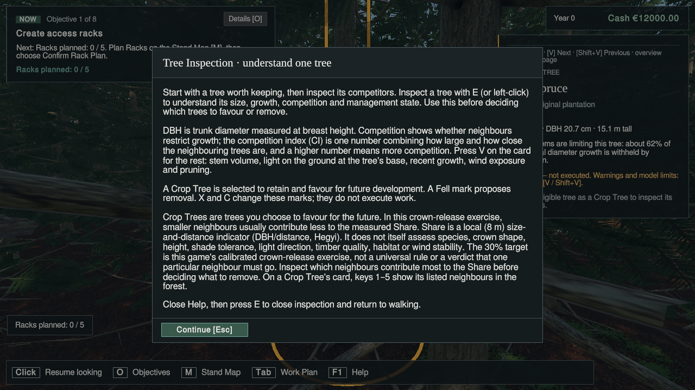

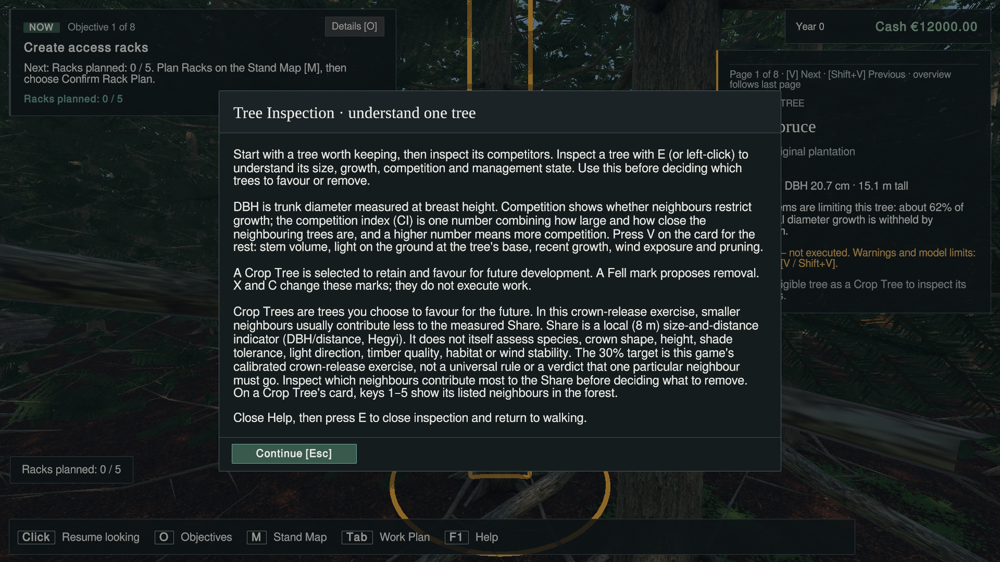

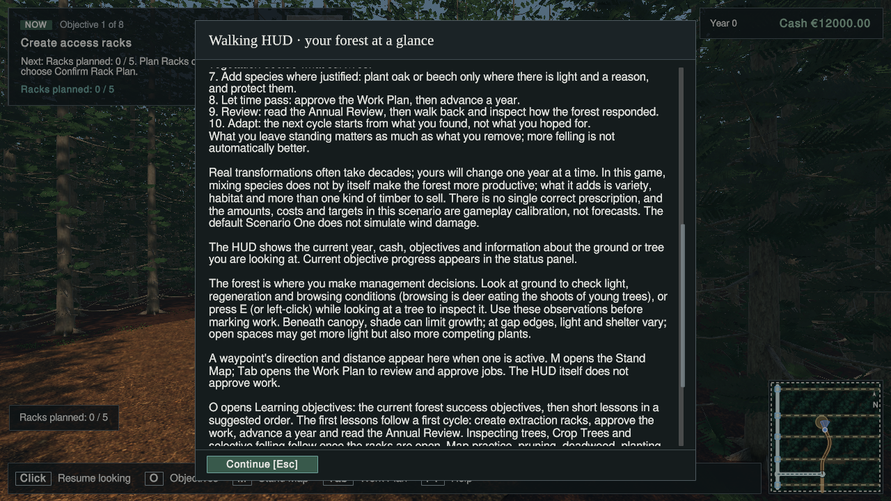

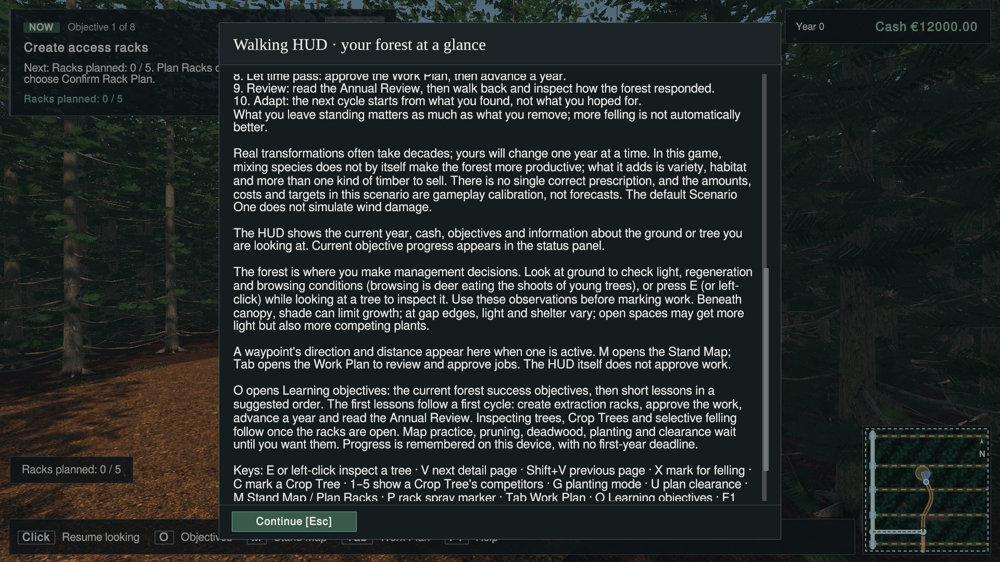

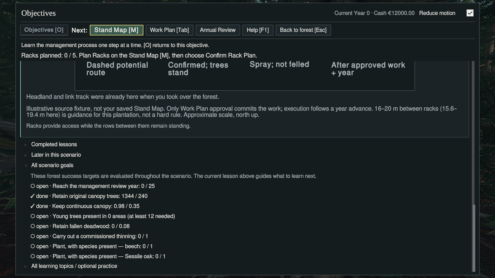

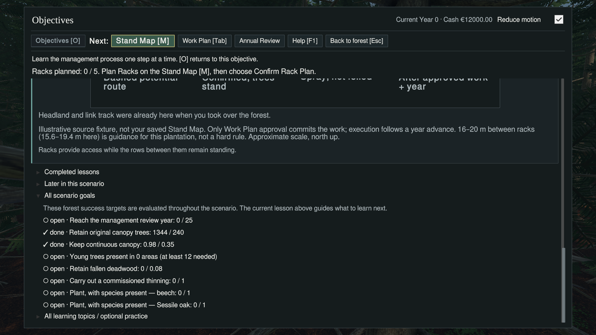

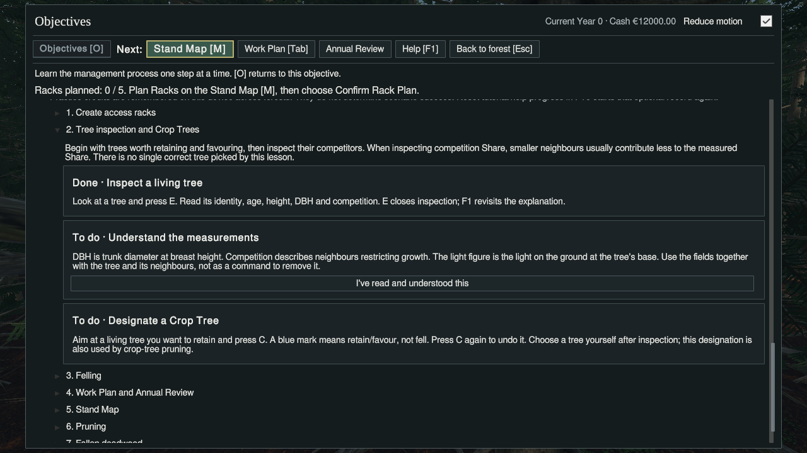

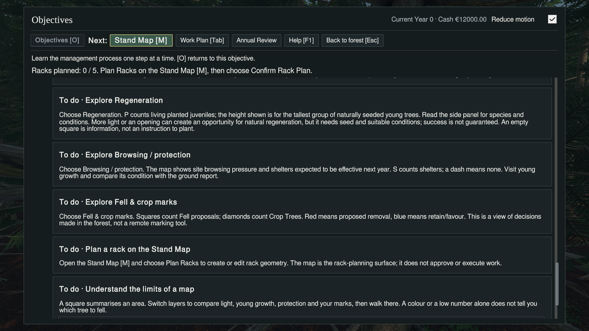

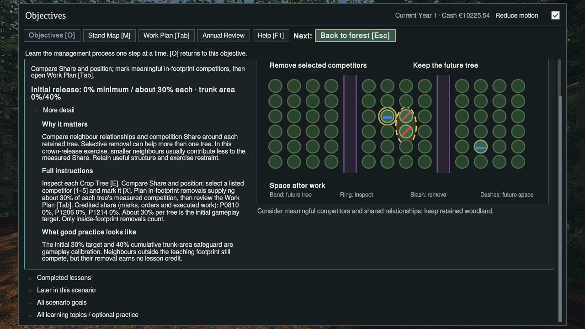

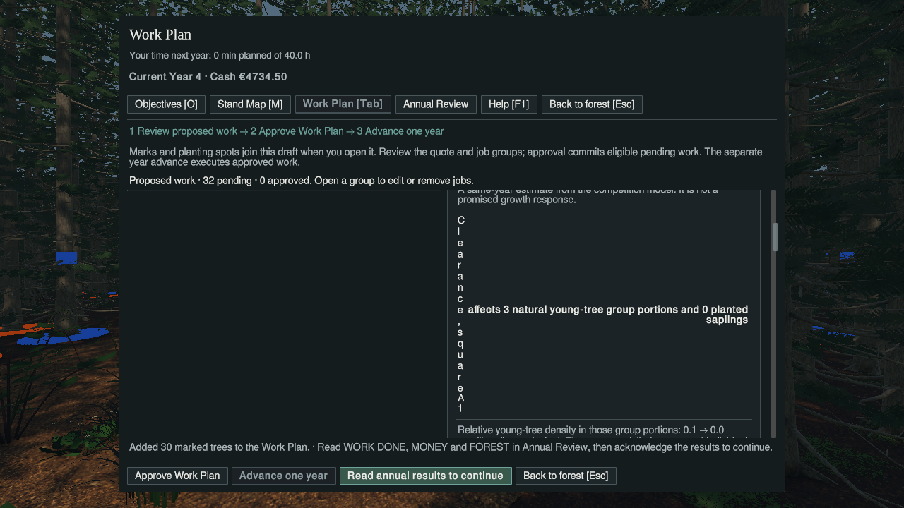

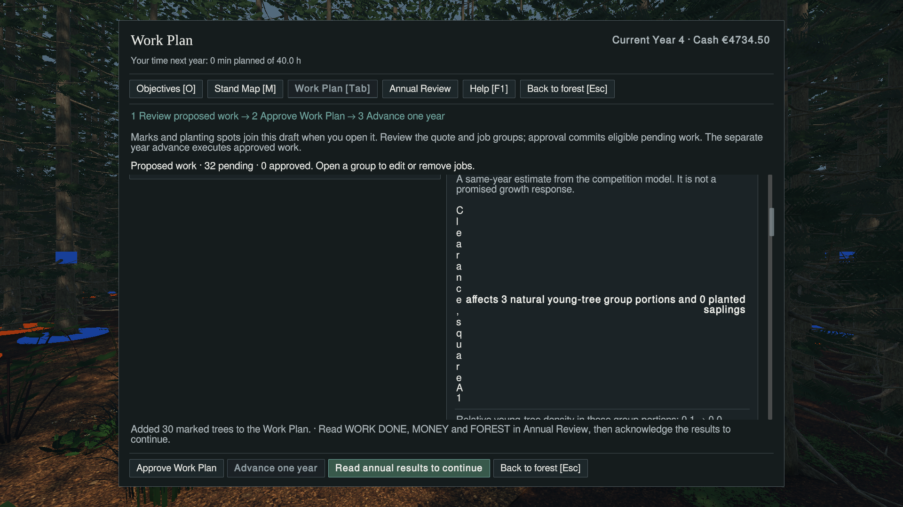

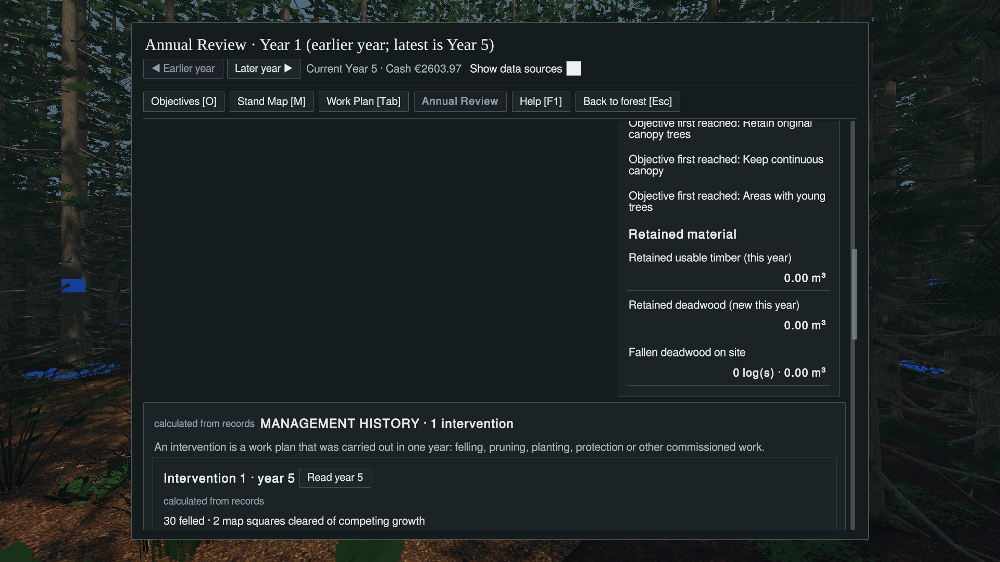


## Attempt 4 — F391-01 fix verification on a314d308315b5894263d30461a1e8b52ca0f3605

Date: **2026-11-12**. Implementation and Unity worker: T3 Code / Codex, GPT-6.1 Sol high, no subagents. User's bounded rework packet is authority; no issue/active-tasks edits, integration, Player/Windows build or unrelated product change.

### Commits and scope

- Starting feature/lane head: `868643a1311ad79a759dbe18d4353f1b928ce2a7`.
- Source fix: `a9eef4da85e3b7ea4bd13172ff0b5daf9f4371d6` — `copy(#391): stack Work Plan clearance row so its label stays readable (F391-01)`.
- **NEW feature head: `a314d308315b5894263d30461a1e8b52ca0f3605`** — includes the dated Rework 2 implementation report; push and `git ls-remote origin refs/heads/feature/scenario-one-research-copy-v1-20261112` confirm this exact head.
- Starting report branch: `f757a72e0ca5e1def353c2bc56ba118596221274`. Report publication SHA is supplied by the final Git publication receipt / handoff (not self-embedded).
- Source diff from 868643a1: only `WorkPlanOverview.BuildClearance` adds **`valueBelow: true`** to its one `UiKit.Line` call. Approved wording is byte-for-byte unchanged. This is an expressly authorised **one-argument presentation-layout change beyond pure string edits because the rendered check failed**. UiKit/USS and every verifier remain unchanged. `UiKit.Line`/USS already implement the stacked sentence-value row, also used by another row in the same card. No file under `Assets/ForestPrototype/ScenarioOne`, no save/objective/Share/storm/MFM/Rack/ecology, scene/prefab/asset/meta/package change.

Read the requested origin report first, then workflow/decisions/milestone/game brief/Unity overview and live coordination. Primary's unrelated AGENTS.md and StorageArchitecture.md changes were preserved. Source worktree was clean at 868643a1. No conflicting writer was inferred from historical coordination rows; this direct packet assigns the two named lanes. The Unity lane was fetched and moved by `git merge --ff-only a314d308315b5894263d30461a1e8b52ca0f3605` on its existing `qualify/scenario-one-research-copy-v1-20261112` branch, then exact head/clean status proved before acquire. No Library copy/deletion, branch reset or integration merge.

### Updated overall verdict table

| Check / passage | Directly verified on 868643a1 (Attempt 3) | Directly verified on NEW (Attempt 4) | Current interpretation |
|---|---|---|---|
| Offline UI presentation / compile | Prior source receipts | PASS 157; five mutants killed; contracts PASS; 191 sources / 116 refs / 0 errors | PASS for bounded source change |
| Real-Editor compile | Zero compiler errors in five sessions | Zero `error CS` in both sessions; real script compilation completes and gates execute | PASS on NEW |
| Unmodified WorkPlanResidualVerification | PASS, Editor 0 | PASS, Editor 0, all existing assertions; 1280/1600/1920 checks | PASS on NEW |
| Clearance A1 and A2 label/value rendering | FAIL F391-01 at 1280×720 and 1920×1080 | **PASS at both sizes**, labels each one line, full values underneath | Finding resolved on NEW |
| Density paragraph / Work Plan top and neighbouring rows | Density readable; top captured by P3 | **PASS at both sizes**, inspected dedicated PNGs | PASS on NEW |
| Help, goals, curriculum Topic 2 / map.regeneration, real Lesson 3 | PASS at both sizes as scoped above | NOT RERUN | Prior evidence retained; inference of no impact from isolated clearance-row argument, not a NEW runtime claim |
| Annual Review removal jobs / first-reached Areas with young trees | PASS at both sizes | NOT RERUN | Prior evidence retained; same limited inference |
| Reference Future gate / #381 anchor comparison | PASS with exact printed anchors | NOT RERUN | Prior evidence retained; inference from presentation-only diff, not a NEW hash claim |
| Authentic baseline-save CurrentWorldHash comparison | NOT RUN | NOT RUN | Gap remains |
| Oak/Beech Annual Review first-reached variants | NOT RUN | NOT RUN | Gap remains |
| Old nursery-warning failure classification | UNDETERMINED; old harness not rerun | UNDETERMINED; not rerun | Neither pre-existing nor patch-caused proved; not waived |
| Windows/Player build, platform/full-loop qualification | NOT RUN | NOT RUN | Outside packet |
| Dashboard ingestion/audit/published readback | NOT VERIFIED | NOT VERIFIED | Coordinator follow-up; issue/active-tasks untouched |

**Verdict: requested F391-01 rework and bounded Unity re-verification PASS. Overall #391 qualification remains incomplete for the explicit gaps above; no integration/acceptance claim.** Help/objectives/curriculum/Reference captures passed on 868643a1 and were deliberately not repeated. The one-row layout argument cannot establish their runtime outcome on NEW; no-impact is a source-scope inference only.

### Offline checks and real-Editor execution

Working directory for offline checks: `/media/jer/Files/CCF/Operations/CCF-S1-ResearchCopy-V1-Sol` on feature branch. Both commands ran with `python3 -I -B`:

```bash
python3 -I -B Tools/Verification/ScenarioOneUiPresentation/run_checks.py --src "$PWD" --out /media/jer/Files/CCF/Verification/CCF-391-ResearchCopy-Qual-20261112/attempt4/offline/presentation
python3 -I -B Tools/Verification/ScenarioOneNonUi/compile_runtime_sources.py --src "$PWD" --out /media/jer/Files/CCF/Verification/CCF-391-ResearchCopy-Qual-20261112/attempt4/offline/compile --extra Tools/Verification/ScenarioOneCompletion/P3/WorkPlanResidualVerification.cs Tools/Verification/ScenarioOneTeachingCopyVerification.cs
```

Actual presentation output: **PASS 157**, all five mutants KILLED, composition/source contracts PASS. Actual offline compile: **sources=191 refs=116 exit=0 errors=0**. Non-Editor route excludes Editor-only verifier sections; runtime claims come from the real sessions below. `git diff --check` PASS; the only production file changed from 868643a1 is WorkPlanOverview.cs.

Durable root `R=/media/jer/Files/CCF/Verification/CCF-391-ResearchCopy-Qual-20261112`, `A=$R/attempt4`, `L=/media/jer/ZX20/CCF-S1-ResearchCopy-V1-Qual` below. Actual commands used those absolute paths (no environment.sh sourced):

```bash
python3 -I -B "$A/session391.py" acquire residual
CCF_GATE_LANE="$L" python3 -I -B "$R/run391.py" --name Residual --method WorkPlanResidualVerification.Begin --files ScenarioOneCompletion/P3/WorkPlanResidualVerification.cs ScenarioOneRepeatedInterventions/TeachingCapGateSetup.cs --ext-files "$R/PathGuard381.cs" --out "$A/residual" --display :89 --sizes 1920x1080,1280x720 --timeout 600 --env CCF_STAND_GEOMETRY=0 CCF_T03_LEGACY=1 --pass-token P3_WORKPLAN_VERIFY_PASS --fail-token P3_WORKPLAN_VERIFY_FAIL
python3 -I -B "$A/session391.py" release residual
python3 -I -B "$A/session391.py" acquire clearance
CCF_GATE_LANE="$L" python3 -I -B "$R/run391.py" --name Ccf391Clearance --method Ccf381.Begin --files ScenarioOneRepeatedInterventions/TeachingCapGateSetup.cs --ext-files "$R/attempt3/clearance-driver/Ccf381.cs" "$R/attempt3/clearance-driver/WorkPlanResidualVerification.cs" "$R/PathGuard381.cs" --out "$A/clearance" --display :89 --timeout 600 --env CCF_STAND_GEOMETRY=0 CCF_T03_LEGACY=1 --pass-token C381_SESSION_ENDED --fail-token C381_FAIL
python3 -I -B "$A/session391.py" release clearance
```

The existing inspected run391.py was used unchanged. The session wrapper differs from Attempt 3 only in exact head, attempt notes, evidence-directory location and its fresh host-hash inventory. Its underlying lock calls are **`python3 -B /media/jer/ZX20/CCF-Ops/scripts/unity-lock`**, exact lane/branch/head, owner Sol391, task CCF-391-UI-QUALIFICATION, ISO ETA, no force. Exact acquire/release arrays and responses are in `attempt4/*-acquire-command.json` / `*-release-command.json`; final status is FREE.

| Session | Lease / recorded Editor PID | Disk available bytes before → after | Actual result |
|---|---|---|---|
| residual | `e6b25ec3104a40b9abcd12b15826b178` / 151366 | 17659592704 → 17659199488 | PASS, Editor 0, 64.1 s, reaped=False |
| clearance | `b1b0b566ab9548fc814f952ca9912819` / 153016 | 17659330560 → 17659461632 | PASS, Editor 0, 190.2 s, reaped=False |

`df -B1 /media/jer/ZX20` ran before **each** session and after each, captured as `*-disk-before/after.txt`. Both starts exceed **16,106,127,360** bytes; no LOW SPACE refusal, deletion or cache move. Final audited available bytes: **17,659,592,704**. Small filesystem housekeeping changes explain differences between successive observations; these are observations, not reserved capacity.

Both launches use Unity **6000.6.0f1**, Xephyr `:89 -screen 1920x1080 -ac -noreset`, openbox and the unchanged focus/size keeper; NVIDIA GTX 980M/Vulkan, no graphics override. Actual Editor argv/env/PIDs are retained in each `actual-process.json`. No batchmode/build invocation. The residual session provides the required **real-Editor compile**: ScriptAssemblies compilation completes, script compilation time 12.533678 s, gates execute, **zero `error CS`**, normal Editor 0. Clearance independently compiles its staged drivers, also zero compiler errors and normal Editor 0. Existing obsolete API warnings and the known UnityEditor.Search.SearchDatabase startup ArgumentOutOfRangeException recur; neither was relabelled as a thrown render-chain exception or compiler failure.

Unmodified P3 actual markers (same substantive values as Attempt 3):

```text
P3_READONLY_PASS empty plan; world hash unchanged 164D2F4F2727961B
P3_RESIDUAL_PASS T2 336->306 BA 41.10->36.23 vol 39.87->34.68 pattern NoLabel (54/81)
P3_WARNING_PASS H cash 473450 expected 248474 < minimum 250000
P3_WARNING_CLEARS_PASS
P3_CLEARANCE_F_PASS Clearance, square A1 cohorts 3 density 0.053->0.000 saplings 0 bramble 0.112 bracken 0.112 taller 0
P3_CLEARANCE_E_PASS Clearance, square A2 cohorts 0 density 0.000->0.000 saplings 0 bramble 0.066 bracken 0.066 taller 0
P3_RENDERED_PASS 1280x720
P3_RENDERED_PASS 1600x900
P3_RENDERED_PASS 1920x1080
P3_WORKPLAN_VERIFY_PASS
```

The unmodified gate exits normally 0, launcher PASS, no leftovers or reaper. Its existing horizontal-fit checks do not prove clearance readability; personal inspection below provides that evidence. P3's presentation-text determinism hash remains `3488ED795A59C727`; it is not a substitute for the unrun baseline saved-world comparison.

### Clearance capture and personal reading

Used the **unchanged Attempt-3 clearance driver** and the already documented capture-only P3 companion, with the same `CCF_STAND_GEOMETRY=0 CCF_T03_LEGACY=1` fixture. Every assertion remains intact; only the companion entry/exit differs from the production verifier as documented in `attempt3/clearance-capture-harness.diff`. All P3 assertions pass again in this continuation. It leaves authentic Year4 A1 (3 natural group portions, 0 saplings) / A2 (none), 32 pending orders, cash €4,734.50 for ordinary Work Plan opening/scrolling. No new fixture/state injection, enabled-button bypass or save editing. This remains the accepted Legacy40/model0 test fixture, not native beginner progression.

The initial sanity PNG was personally inspected and contentful before crediting the session. The eight new PNGs below were **each opened and read by this worker**, without image resizing/editing. Published files are byte-exact copies; `published-images.json` contains full SHA256 receipts (9,564,605 bytes total). The two previously published failing PNGs are retained under **before-fix-** names; Attempt-3 durable originals keep their original names. No old evidence was replaced with a new frame.

| PNG (prefix `evidence-391-unity/attempt4-`) | Personal reading / verdict |
|---|---|
| `clearance-young-1280x720.png` | PASS: A1 and A2 names each one line; A1 full “affects 3 natural young-tree group portions and 0 planted saplings” below over two normal lines; A2 full “no natural young-tree groups or planted saplings inside” below on one line. No overlap/cut-off in either row. |
| `clearance-young-1920x1080.png` | PASS: same complete labels and values, same normal line counts, clear separation and no overlap/cut-off. |
| `clearance-empty-1280x720.png` | PASS: A2 name one line, full empty value beneath, bramble/bracken text and full general clearance caution visible. Upper density opening is outside this scroll framing and is credited from the density image instead. |
| `clearance-empty-1920x1080.png` | PASS: A2 name one line, full empty value beneath, full adjacent cover/caution text; no overlap/cut-off. |
| `clearance-density-1280x720.png` | PASS: full paragraph from “Relative young-tree density…” through “a portion can remain after clearing.” over normal lines; both clearance rows also intact. General caution continues below the ordinary viewport boundary, not counted as fully visible in this frame. |
| `clearance-density-1920x1080.png` | PASS: complete density paragraph, both label/value rows intact, no overlap/cut-off. |
| `clearance-top-1280x720.png` | PASS: Work Plan title/current year/cash/navigation and Money/What you are leaving headings plus trees/basal-area/volume/removal/Crop Trees/seed rows readable and aligned. Lower rows are intentionally beyond the scroll viewport. |
| `clearance-top-1920x1080.png` | PASS: same Work Plan top/neighbouring rows intact and aligned; no disturbance from the changed row farther down. |

Full captured bounds in `clearance/evidence/clearance-young-*-ui.tsv`; these are UI layout units, not physical pixels. Both rows carry `table-row,table-row-stacked`:

| Size | Label / value / paragraph | Actual worldBound (layout units) |
|---|---|---|
| 1280x720 | Clearance, square A1 | `(x:808.75, y:376.25, width:518.75, height:26.25)` |
| 1280x720 | affects 3 natural young-tree group portions and 0 planted saplings | `(x:806.25, y:408.75, width:521.25, height:46.25)` |
| 1280x720 | Relative young-tree density in those group portions: 0.1 → 0.0 seedlings/ha equivalent. These are modelled groups, not individual seedling counts; a portion can remain after clearing. | `(x:808.75, y:465.00, width:518.75, height:66.25)` |
| 1280x720 | Clearance, square A2 | `(x:808.75, y:592.50, width:518.75, height:26.25)` |
| 1280x720 | no natural young-tree groups or planted saplings inside | `(x:806.25, y:625.00, width:521.25, height:26.25)` |
| 1920x1080 | Clearance, square A1 | `(x:807.50, y:359.17, width:516.67, height:26.67)` |
| 1920x1080 | affects 3 natural young-tree group portions and 0 planted saplings | `(x:805.83, y:391.67, width:518.33, height:46.67)` |
| 1920x1080 | Relative young-tree density in those group portions: 0.1 → 0.0 seedlings/ha equivalent. These are modelled groups, not individual seedling counts; a portion can remain after clearing. | `(x:807.50, y:448.33, width:516.67, height:66.67)` |
| 1920x1080 | Clearance, square A2 | `(x:807.50, y:576.67, width:516.67, height:26.67)` |
| 1920x1080 | no natural young-tree groups or planted saplings inside | `(x:805.83, y:609.17, width:518.33, height:26.67)` |

At 720p the A1/A2 label width is **518.75** (formerly about 5.00 / 17.50), with normal **26.25** height. At 1080p it is **516.67**, height **26.67** (formerly about 3.33 / 16.67 wide and 361.67 / 341.67 high). Both values are below their name; A1 wraps normally over two lines and A2 fits one line. Values/paragraphs remain within the card. Scroll screenshots, not just those numbers, establish the PASS. No second product fix was attempted.

The command ledger has 24 entries: 23 acknowledged done, zero failed, and the final exit consumed as `.running` because normal Editor exit precedes the driver's rename. Unlike Attempt 3, the exit command was submitted once without an awaiting client, so there is no client timeout. `C381_SESSION_ENDED` and actual Editor 0 prove completion; the marker alone does not prove readability. An early read-only bounds probe ran before that dump existed and returned not-found; the completed dump was read afterwards. A loading desktop screenshot was retained to rule out a modal dialog; it shows onboarding before READY, not a test of onboarding. No Scene Backup Detected dialog occurred; no Delete action or process kill was needed.

```text
{"action": "capture", "arg": "sanity"} → done
{"action": "p3"} → done
{"action": "size", "width": 1920, "height": 1080} → done
{"action": "show", "arg": "workplan"} → done
{"action": "dismiss"} → done
{"action": "scroll", "arg": "workplan-leaving", "y": -1000} → done
{"action": "capture", "arg": "clearance-top"} → done
{"action": "dump", "arg": "clearance-before-scroll"} → done
{"action": "scroll", "arg": "workplan-leaving", "y": 510} → done
{"action": "capture", "arg": "clearance-young"} → done
{"action": "scroll", "arg": "workplan-leaving", "y": 650} → done
{"action": "capture", "arg": "clearance-empty"} → done
{"action": "scroll", "arg": "workplan-leaving", "y": 510} → done
{"action": "capture", "arg": "clearance-density"} → done
{"action": "size", "width": 1280, "height": 720} → done
{"action": "scroll", "arg": "workplan-leaving", "y": -1000} → done
{"action": "capture", "arg": "clearance-top"} → done
{"action": "scroll", "arg": "workplan-leaving", "y": 510} → done
{"action": "capture", "arg": "clearance-young"} → done
{"action": "scroll", "arg": "workplan-leaving", "y": 650} → done
{"action": "capture", "arg": "clearance-empty"} → done
{"action": "scroll", "arg": "workplan-leaving", "y": 510} → done
{"action": "capture", "arg": "clearance-density"} → done
{"action": "exit"} → running
```

### Custody and restoration

Fresh config paths are exactly `$A/residual/config` and `$A/clearance/config`. `actual-process.json`, `process-paths.txt` and clearance `paths.txt` prove **actual** XDG_CONFIG_HOME, `Application.persistentDataPath=<config>/unity3d/DefaultCompany/CCF`, F5/F9 `<persistent>/forest-save.json`, prefs `<persistent>/prefs`, `TMPDIR=/tmp/` and direct entry. PathGuard writes/validates an isolated prefs sentinel. Host paths were not used for saves/preferences. Both licences were seeded from the newest installed licence and removed after exit; only SHA256 prefixes are recorded (entitlement **63c1ddbf**, package ACL XML **6fd0b1ff**, etag **d9a351a6**). No licence bytes published.

Both sessions' known import side effects were preserved in `*-import.patch`, restored **by individual path from exact HEAD blobs**, and compared via clean Git status. A final raw-byte audit also compares every restored path directly with `git show HEAD:<path>` (16 session/path comparisons, all equal; `restoration-byte-audit.json`). There were **eight** such paths this time (seven SectionFive materials plus shared settings), rather than assuming the old six-path count. Both restoration receipts list:

- `.vscode/settings.json`
- `Assets/ForestPrototype/Art/SectionFive/Bilberry_Type_Cover_01/Materials/Berry_Calyx.mat`
- `Assets/ForestPrototype/Art/SectionFive/Bilberry_Type_Cover_01/Materials/Bilberry_Berries.mat`
- `Assets/ForestPrototype/Art/SectionFive/Bilberry_Type_Cover_01/Materials/Bilberry_Leaves.mat`
- `Assets/ForestPrototype/Art/SectionFive/Bilberry_Type_Cover_01/Materials/Bilberry_Stems.mat`
- `Assets/ForestPrototype/Art/SectionFive/Woodland_Forbs_01/Materials/Forb_Flower_Centre.mat`
- `Assets/ForestPrototype/Art/SectionFive/Woodland_Forbs_01/Materials/Forb_Leaves.mat`
- `Assets/ForestPrototype/Art/SectionFive/Woodland_Forbs_01/Materials/Forb_Stems.mat`

No `git clean`, broad reset, asset deletion or Library/cache copying/deletion. All staged .cs and generated .meta files were removed after each exit; final direct checks prove absence. Licence directories removed; **all 27 provisioned ignored asset hashes match** the original manifest. The lane is clean apart from ignored cache/assets, exact NEW on its existing branch, Library retained, no Editor, both leases released normally and final **FREE**.

Independent before-first-start and after-last-exit host enumeration found the same **nine** save/Prefs files with identical SHA256 values (also byte-for-byte equal to the Attempt-3 inventory):

| Host path | Before = after SHA256 |
|---|---|
| `/home/jer/.config/unity3d/DefaultCompany/CCF/forest-save.json.bak` | `c0169790c8bba169ffd27c486e6a83bf67d6c938e170da58d42031bbcdf862a3` |
| `/home/jer/.config/unity3d/DefaultCompany/CCF/prefs` | `c16ff426930f16c4c74b52a2b0ecd259142599943484b44de1164841f560d71e` |
| `/home/jer/.config/unity3d/DefaultCompany/CCF/prefs.bak-20261017-before-resolution-fix` | `2af15cebc666fa5c5bccd103c8dd4f6e367653c060e5c710f9c20b53a23b5307` |
| `/home/jer/.config/unity3d/DefaultCompany/CCF/save-backup-20261104/forest-save.json` | `7effe9b72c741d372efbb8acc1115d7be57a3514300da1d3d2de42801e565075` |
| `/home/jer/.var/app/com.unity.UnityHub/config/unity3d/DefaultCompany/CCF/forest-save.json` | `ccb01a0125d4d55174b073cc7a0b45221b4e9e2f17bce6f8f0c4820914c5d303` |
| `/home/jer/.var/app/com.unity.UnityHub/config/unity3d/DefaultCompany/CCF/prefs` | `bc21c9ae8cac040981b99c6e989546343ae1443ab45d9cb34de79061b034e708` |
| `/home/jer/.var/app/com.unity.UnityHub/config/unity3d/DefaultCompany/My project/prefs` | `ec704d4085921e975a254821be98a99c4b4284ac8185e212258d15be6b7aa47b` |
| `/home/jer/.var/app/com.unity.UnityHub/config/unity3d/DefaultCompany/Setup Guide In-Editor Tutorial/prefs` | `176d7a3fc2179a959633b91ac3cd7268715a418d6082dac49d070491f0541984` |
| `/home/jer/.var/app/com.unity.UnityHub/config/unity3d/prefs` | `4c6dcd791400d33826c1f2761a34b59778f786bc334d78b816c66d7d16e50154` |

Final receipts: `attempt4/final-state.json`, `final-lock.json`, `custody-before.json`, `custody-after.json`, `provisioned-asset-audit.json`; full logs/results/commands/staged hashes remain under the durable root. Protected UI playtest lane, U3, other worktrees, CCF-Ops configuration and frozen Reference/Legacy40 paths received no writes from this worker. Operational unity-lock writes were confined to normal lease state/history; no config changes. Primary's two unrelated edits remain preserved.

Report publication uses only the authorised Files source worktree: checkout existing report branch, append this section and copy evidence, commit/push, confirm exact remote SHA, then return to feature branch clean. No issue or active-tasks edit. Dashboard synchronization **NOT VERIFIED**, coordinator follow-up. Baseline-save comparison and Oak/Beech first-reached variants **NOT RUN**; nursery-warning assertion classification **UNDETERMINED**. No further gameplay/layout changes, Windows/Player build, merge or full qualification implied.

### Attempt-4 images — personally inspected


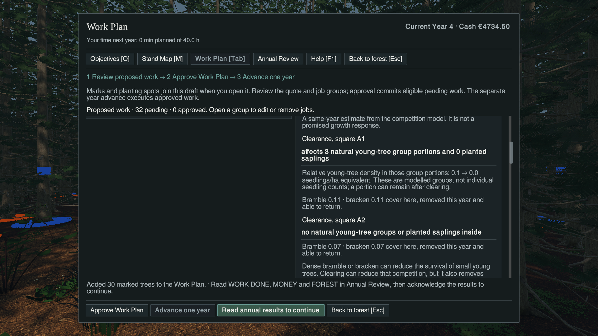

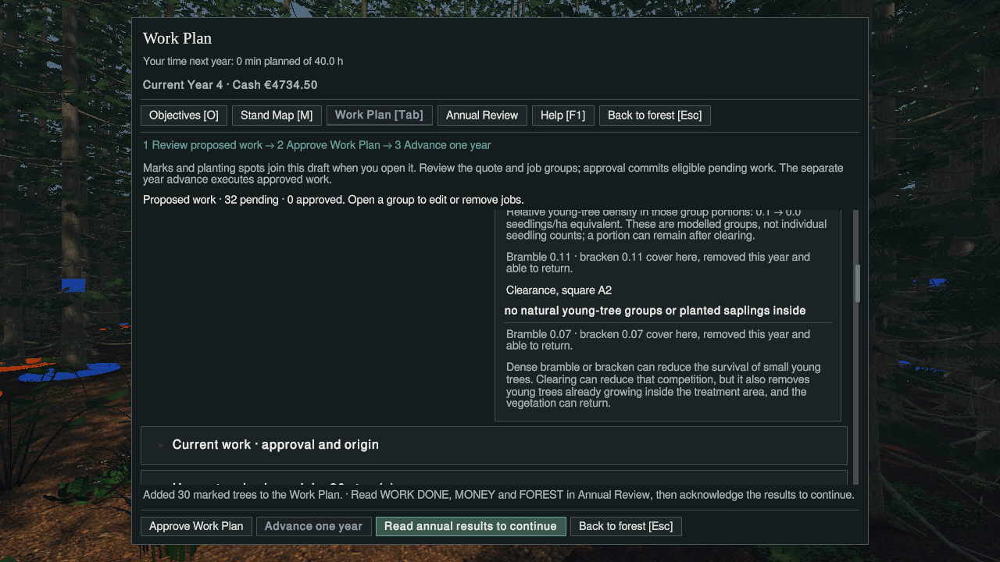

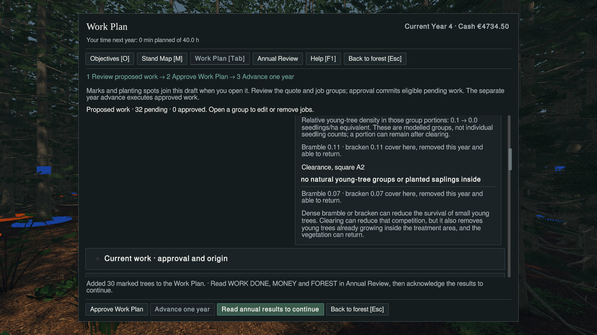

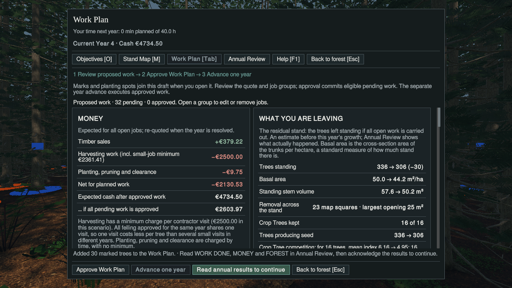

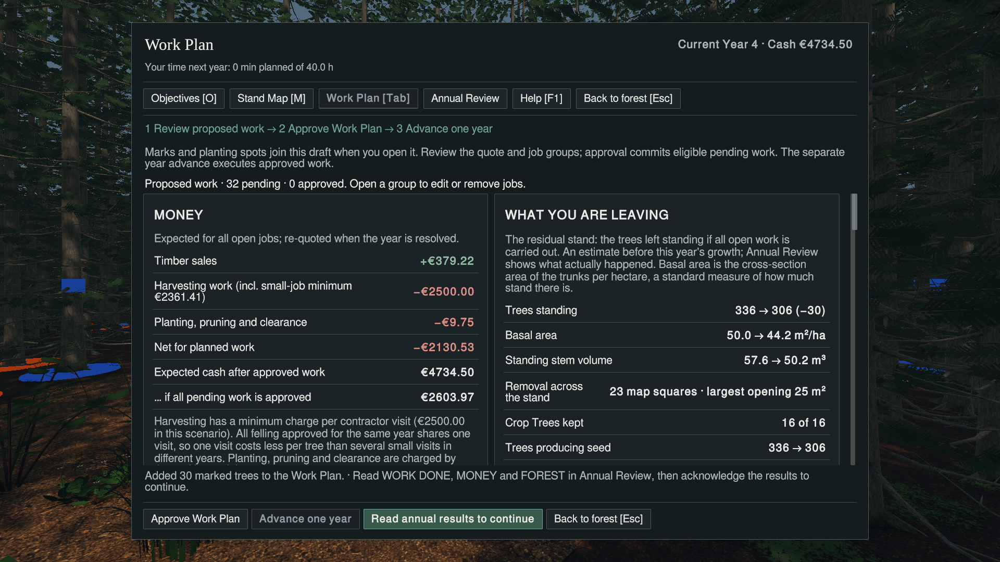

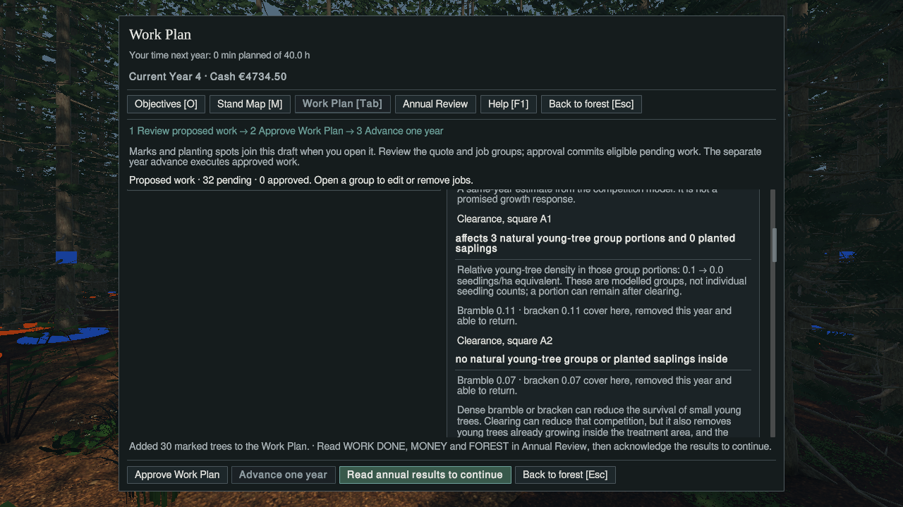


