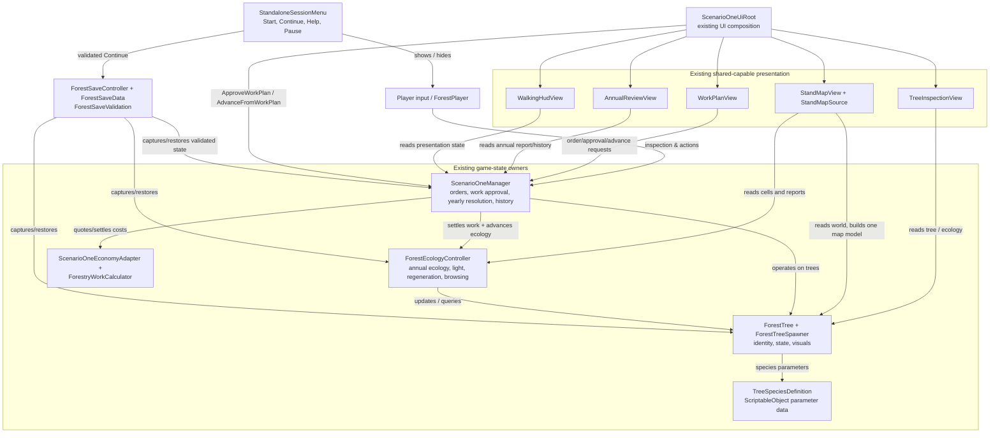
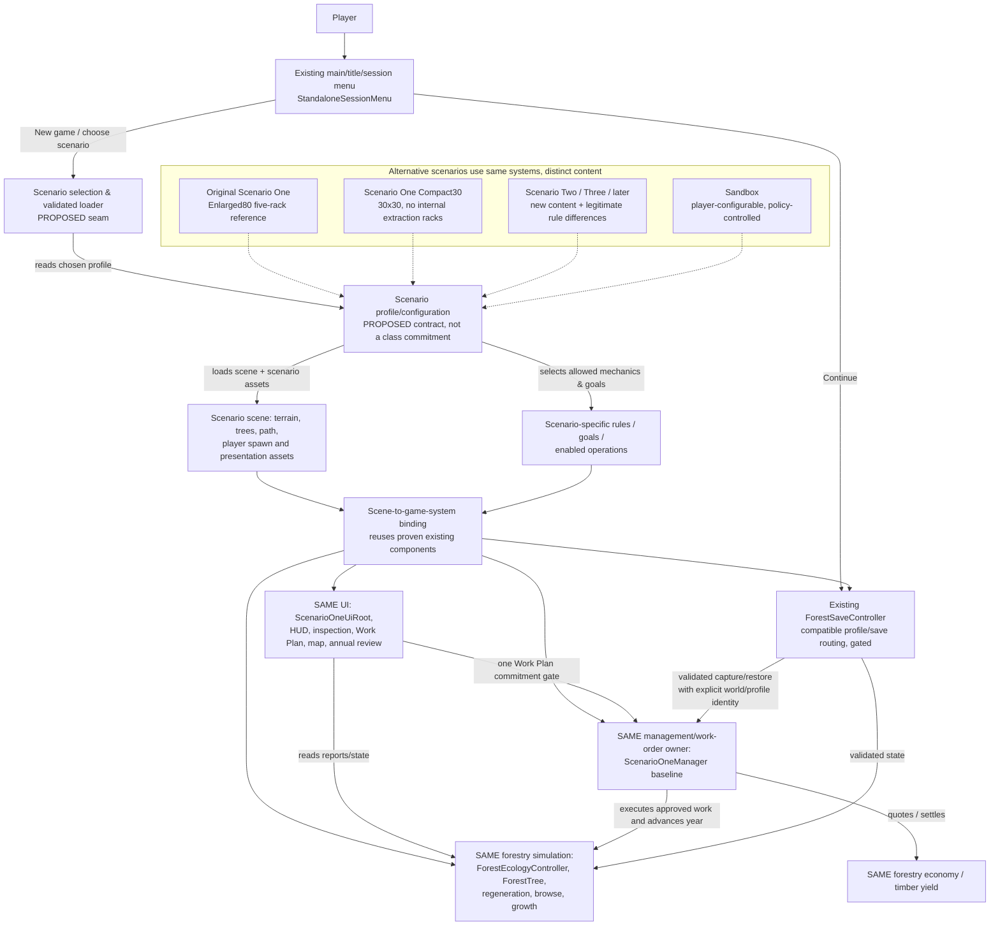

# Scenario-One / CCF Shared Foundation — source-mapped technical architecture (DRAFT)

**20 November 2026 · Owner-requested browser/GitHub-only architecture audit · OpenAI ChatGPT GPT-6 / Scenario One Manager #844 · DRAFT FOR OVERALL MANAGER #425 AND OWNER REVIEW · NO SOURCE OR UNITY IMPLEMENTATION AUTHORITY**

**Authority / product direction accepted by the owner in this chat:** the established **original five-rack Scenario One**, not Compact30's new adapter or immediate-mode GUI, supplies the starting **shared game systems and familiar player UI** for all applicable scenarios. One Unity game, one reusable forestry and management foundation, many configurations/scenes. The historical five-rack world stays protected; Compact30 is a different, no-internal-racks scenario using that foundation. **This direction is owner-approved; the particular classes/diagram/module seams and migration plan below are proposed and not yet an approved technical spec or code change.**

**Evidence:** GitHub source at actual `main` full SHA `7758e17c882fad01970d2f2fb8c09586bbcab5c1` (inspected 20 Nov 2026); #815 implementation handoff, exact #820 native-tested composition `8cb22de077b93b4c7af076e19936f3170d6ab48b`, #830 71-check native result, #836 visual-asset head `9a7e3a0d116302660db9916d49f0eba816ee8e67`; live `Docs/Project/decision-log.md`, `current-milestone.md`, `AgentWorkflow.md`, `coordination/active-tasks.md`. GitHub-only source reads **cannot establish current local worktree cleanliness, exact Unity hierarchy, rendered appearance, licence, physical lock, gameplay acceptance or a main merge**. The user reports five recent ZX20 editor projects showing the historical five-rack forest; their specific local revisions and Editor scene choices have not been re-inspected in this browser.

## 1. How to read the diagrams

- **Solid arrows** = observed code call/data dependency in Diagram A, or **intended** dependency in Diagram B. The diagrams are deliberately different.
- **Large containers** = architectural responsibility groups; a box does **not** equal a C# class, interface, Unity assembly, package, scene, prefab or independent process.
- **Backticked labels** are real source classes/files when marked **EXISTS**; symbolic profile/loader names marked **PROPOSED** do not exist as one shared implementation today.
- **No automatic architecture migration** follows from visual drawings. New interfaces, abstract base classes, ScriptableObjects, registries or duplicated modules must be justified by a concrete reusable need. Existing `ScenarioOne*` names may remain as compatibility seams during incremental extraction.

## 2. Diagram A — the actual five-rack source relationships (verified GitHub C#)

This is a **focused source-derived call/data-flow map**, not a complete class dependency graph. The UI root creates its child views; the UI calls the existing authoritative manager; the manager owns work, year advancement and uses ecology/economy; both the map and save systems read the world. The scene-hosting details beyond inspected source still require native Unity qualification.



**Source witnesses:** [UI root](https://github.com/jermur788/CCF/blob/7758e17c882fad01970d2f2fb8c09586bbcab5c1/Assets/ForestPrototype/UI/ScenarioOneUiRoot.cs) creates `WalkingHudView`, `TreeInspectionView`, `WorkPlanView`, `AnnualReviewView`, `StandMapView` and calls `manager.ApprovePendingWork`/`manager.AdvanceYear`; [Work Plan](https://github.com/jermur788/CCF/blob/7758e17c882fad01970d2f2fb8c09586bbcab5c1/Assets/ForestPrototype/UI/WorkPlanView.cs) labels itself a view over real orders/quotes; [map source](https://github.com/jermur788/CCF/blob/7758e17c882fad01970d2f2fb8c09586bbcab5c1/Assets/ForestPrototype/UI/Map/StandMapSource.cs) produces one read-only `StandMapModel` for full map and HUD minimap; [management](https://github.com/jermur788/CCF/blob/7758e17c882fad01970d2f2fb8c09586bbcab5c1/Assets/ForestPrototype/ScenarioOne/ScenarioOneManager.cs) implements order designation, approval, `AdvanceYear`, history and save DTO capture; [ecology](https://github.com/jermur788/CCF/blob/7758e17c882fad01970d2f2fb8c09586bbcab5c1/Assets/ForestPrototype/ForestEcologyController.cs) owns the annual ecological model; [work economy](https://github.com/jermur788/CCF/blob/7758e17c882fad01970d2f2fb8c09586bbcab5c1/Assets/ForestPrototype/WorkEconomy/ForestryWorkCalculator.cs) computes quotes; [save controller](https://github.com/jermur788/CCF/blob/7758e17c882fad01970d2f2fb8c09586bbcab5c1/Assets/ForestPrototype/ForestSaveController.cs) captures/validates/loads existing world.

These arrows are **representative, not an assurance of clean compile-time boundaries**. E.g. today `ScenarioOneUiRoot` knows about `RackTool`, and `ScenarioOneManager` contains rack-specific partial classes. The shared foundation needs controlled configuration and targeted decoupling, not a claim that this is already architecturally isolated.

## 3. Diagram B — intended connected game architecture (PROPOSAL)

**Reuse the existing source as the baseline; introduce only the smallest warranted scenario-selection/composition seams.** The core box contains ONE implementation of each shared capability, not per-scenario copies. Scenario-specific features/capabilities are *data/rules* used by these systems, not shadow copies of the manager, UI or simulation.



**Legend:** arrows in this Diagram B are **design intentions**, not proven runtime methods. `Select`, `Profile`, `Rules`, and `Bind` are conceptual seams; no concrete C# type name, interface or serialization schema is approved by drawing them. The original five-rack scenario stays intact; the new Compact30 presentation and future scenes are not copies of its UI/controller.

## 4. Diagram C — a management action through the real baseline

```mermaid
sequenceDiagram
  actor P as Player
  participant U as WorkPlanView / ScenarioOneUiRoot
  participant M as ScenarioOneManager
  participant E as ScenarioOneEconomyAdapter / ForestryWorkCalculator
  participant F as ForestEcologyController + ForestTree
  participant R as AnnualReviewView
  P->>U: Inspect orders; approve pending Work Plan
  U->>M: ApprovePendingWork()
  M-->>U: Accepted or refused (authoritative state)
  P->>U: Advance year (separate action)
  U->>M: AdvanceYear()
  M->>E: Quote / settle eligible approved work
  E-->>M: Ledger, cost and work resolution
  M->>F: Apply work consequences + advance ecology
  F-->>M: Actual forest state/results
  M-->>R: Annual report + management history for display
  R-->>P: Review outcome; acknowledgment via manager
```

This simplified sequence separates **approval** from **later execution**. It omits internal method ordering details, save writes, and any hypothetical scene-specific controller; it is neither a claim about an exact chronological sub-call sequence nor a Unity test result.

## 5. Source-to-architecture crosswalk

| Architectural responsibility | Existing relevant source / concrete type | Verified today | Proposed seam (NOT implemented) |
|---|---|---|---|
| Main/title/session navigation | [`StandaloneSessionMenu`](https://github.com/jermur788/CCF/blob/7758e17c882fad01970d2f2fb8c09586bbcab5c1/Assets/ForestPrototype/UI/StandaloneSessionMenu.cs) and [startup partial](https://github.com/jermur788/CCF/blob/7758e17c882fad01970d2f2fb8c09586bbcab5c1/Assets/ForestPrototype/UI/StandaloneSessionMenu.Startup.cs) | Start New currently enters the world already active; Continue uses `ForestSaveController.CanLoad` then `Load`. No general scenario selector is evidenced. | Profile-aware new-game selection without duplicating menu; preserve existing history/refusal paths |
| Player movement and inspection interaction | [`ForestPlayer`](https://github.com/jermur788/CCF/blob/7758e17c882fad01970d2f2fb8c09586bbcab5c1/Assets/ForestPrototype/ForestPlayer.cs), `ForestTreeMarkingManager` | Existing movement, marking and interaction; some keys are currently five-rack/workflow-dependent. | Configure permitted actions by scenario; preserve consistent controls |
| Shared UI host | [`ScenarioOneUiRoot`](https://github.com/jermur788/CCF/blob/7758e17c882fad01970d2f2fb8c09586bbcab5c1/Assets/ForestPrototype/UI/ScenarioOneUiRoot.cs) | Constructs UI Toolkit host/views; forwards approval and annual advance to manager. Some direct rack coupling. | Retain as default; isolate/hide only unsupported features; don't build a per-scenario duplicate UI |
| HUD and tree inspection | [`WalkingHudView`](https://github.com/jermur788/CCF/blob/7758e17c882fad01970d2f2fb8c09586bbcab5c1/Assets/ForestPrototype/UI/WalkingHudView.cs), [`TreeInspectionView`](https://github.com/jermur788/CCF/blob/7758e17c882fad01970d2f2fb8c09586bbcab5c1/Assets/ForestPrototype/UI/TreeInspectionView.cs) | Real view classes that read tree/ecology/manager data. | Use same panels; scenario-specific hints, not new HUD frameworks |
| Work Plan | [`WorkPlanView`](https://github.com/jermur788/CCF/blob/7758e17c882fad01970d2f2fb8c09586bbcab5c1/Assets/ForestPrototype/UI/WorkPlanView.cs) + [`ScenarioOneManager`](https://github.com/jermur788/CCF/blob/7758e17c882fad01970d2f2fb8c09586bbcab5c1/Assets/ForestPrototype/ScenarioOne/ScenarioOneManager.cs) | Existing work quotation/approval and exact planting. | One shared commitment gateway; scene-specific action eligibility is configured/validated by authoritative rules |
| Annual Review and history | [`AnnualReviewView`](https://github.com/jermur788/CCF/blob/7758e17c882fad01970d2f2fb8c09586bbcab5c1/Assets/ForestPrototype/UI/AnnualReviewView.cs), [manager history partial](https://github.com/jermur788/CCF/blob/7758e17c882fad01970d2f2fb8c09586bbcab5c1/Assets/ForestPrototype/ScenarioOne/ScenarioOneManager.History.cs) | UI reads year-indexed reports derived from recorded events, not invented UI state. | Same review UI, scenario-specific objectives and provenance |
| Stand Map + minimap | [`StandMapView`](https://github.com/jermur788/CCF/blob/7758e17c882fad01970d2f2fb8c09586bbcab5c1/Assets/ForestPrototype/UI/StandMapView.cs), [`StandMapSource`](https://github.com/jermur788/CCF/blob/7758e17c882fad01970d2f2fb8c09586bbcab5c1/Assets/ForestPrototype/UI/Map/StandMapSource.cs), [`StandMapModel`](https://github.com/jermur788/CCF/blob/7758e17c882fad01970d2f2fb8c09586bbcab5c1/Assets/ForestPrototype/UI/Map/StandMapModel.cs) | One map data model shared by full map and minimap; existing rack layers/tools are optional in intent but coupled in places. | Preserve map UI; feed correct world bounds/features; don't show rack editor where absent |
| Authoritative work orders / year | [`ScenarioOneManager`](https://github.com/jermur788/CCF/blob/7758e17c882fad01970d2f2fb8c09586bbcab5c1/Assets/ForestPrototype/ScenarioOne/ScenarioOneManager.cs), [`ScenarioOneWorkOrder`](https://github.com/jermur788/CCF/blob/7758e17c882fad01970d2f2fb8c09586bbcab5c1/Assets/ForestPrototype/ScenarioOne/ScenarioOneWorkOrder.cs) | Cash/stock/work statuses, approval, annual resolution, management events; class also owns rack-specific partials. | Reuse management baseline first; extract a separate shared contract only if demonstrated necessary |
| Economy | [`ScenarioOneEconomyAdapter`](https://github.com/jermur788/CCF/blob/7758e17c882fad01970d2f2fb8c09586bbcab5c1/Assets/ForestPrototype/ScenarioOne/ScenarioOneEconomyAdapter.cs), [`ForestryWorkCalculator`](https://github.com/jermur788/CCF/blob/7758e17c882fad01970d2f2fb8c09586bbcab5c1/Assets/ForestPrototype/WorkEconomy/ForestryWorkCalculator.cs) | Current quotes/ledger with shared domain calculator; no new tariffs assumed. | Scenario profile supplies approved costs/operations; one actual ledger owner |
| Forestry ecology and trees | [`ForestEcologyController`](https://github.com/jermur788/CCF/blob/7758e17c882fad01970d2f2fb8c09586bbcab5c1/Assets/ForestPrototype/ForestEcologyController.cs), [`ForestTree`](https://github.com/jermur788/CCF/blob/7758e17c882fad01970d2f2fb8c09586bbcab5c1/Assets/ForestPrototype/ForestTree.cs), [`ForestTreeSpawner`](https://github.com/jermur788/CCF/blob/7758e17c882fad01970d2f2fb8c09586bbcab5c1/Assets/ForestPrototype/ForestTreeSpawner.cs) | Existing cells/annual ecology/tree states, common tree-spawn path for recruitment and restores. | Same causal engine across scenarios with explicit parameters; preserve versioned model behaviour |
| Forestry species parameters | [`TreeSpeciesDefinition`](https://github.com/jermur788/CCF/blob/7758e17c882fad01970d2f2fb8c09586bbcab5c1/Assets/ForestPrototype/TreeSpeciesDefinition.cs) ScriptableObject | Species readiness/individual growth/light/browse parameter data, including explicit newer-species configuration fields. | Different species data, not another growth engine by default |
| Scenario-specific calibration/goal data | [`ScenarioOneDefinition`](https://github.com/jermur788/CCF/blob/7758e17c882fad01970d2f2fb8c09586bbcab5c1/Assets/ForestPrototype/ScenarioOne/ScenarioOneDefinition.cs) ScriptableObject and [stand geometry policy](https://github.com/jermur788/CCF/blob/7758e17c882fad01970d2f2fb8c09586bbcab5c1/Assets/ForestPrototype/StandGeometryModel.cs) | Original manager defined by an actual asset; historical new games choose Enlarged80. | A validated scenario descriptor/allowed-capability/content association. Do not automatically declare exact fields or convert historical saves |
| Save / load and historical preservation | [`ForestSaveController`](https://github.com/jermur788/CCF/blob/7758e17c882fad01970d2f2fb8c09586bbcab5c1/Assets/ForestPrototype/ForestSaveController.cs), [`ForestSaveData`](https://github.com/jermur788/CCF/blob/7758e17c882fad01970d2f2fb8c09586bbcab5c1/Assets/ForestPrototype/ForestSaveData.cs), [`ForestSaveValidation`](https://github.com/jermur788/CCF/blob/7758e17c882fad01970d2f2fb8c09586bbcab5c1/Assets/ForestPrototype/ForestSaveValidation.cs) | Version **24** on pinned main; atomic save+backup, pre-load validation; currently a shared save filename and historical 40/80 model identities. | Explicit profile/world-identity and slot policy through separately owner-approved save spec; never reinterpret old data |
| Unity scene composition | [`ForestTest.unity`](https://github.com/jermur788/CCF/blob/7758e17c882fad01970d2f2fb8c09586bbcab5c1/Assets/Scenes/ForestTest.unity), [`EditorBuildSettings.asset`](https://github.com/jermur788/CCF/blob/7758e17c882fad01970d2f2fb8c09586bbcab5c1/ProjectSettings/EditorBuildSettings.asset) | `ForestTest.unity` is the sole enabled build scene at pinned main and exact #820 gameplay candidate. | Validated scenario-specific loader and scene routing; preserve old ForestTest |
| Compact30 source candidate | [`Compact30Bootstrap`](https://github.com/jermur788/CCF/blob/8cb22de077b93b4c7af076e19936f3170d6ab48b/Assets/ForestPrototype/ScenarioOne/Compact30/Compact30Bootstrap.cs), [`Compact30Session`](https://github.com/jermur788/CCF/blob/8cb22de077b93b4c7af076e19936f3170d6ab48b/Assets/ForestPrototype/ScenarioOne/Compact30/Compact30Session.cs) | These new source files exist only in composed #820 E2, not in pinned main/#836 visual-only head. Bootstrap requires exact scene name; session adds an `OnGUI` management panel. | Retain working code only insofar as necessary; avoid making the duplicate panel new global default |
| Compact30 visual candidate | [#836 visual source candidate](https://github.com/jermur788/CCF/blob/9a7e3a0d116302660db9916d49f0eba816ee8e67/Docs/Handoffs/ScenarioOne-Visual-Implementation-20261119/Sen-1-836-TG-FORK-PATH-SEAM-AND-REUSABLE-DEER-FENCE-IMPLEMENTATION-AND-UNITY-QUALIFICATION-RESULT.md) | Corrected path/H1/fence on divergent visual head, Opus independent geometry APPROVED; native final qualification lease breach disclosed, owner walk/combined integration pending. | Bring into one exact runtime candidate under one authorised scene writer |

**C# classes versus boxes:** `ScenarioOneManager` is one **partial class spread across multiple source files**; `WorkPlanView` is a single view class calling the manager; `TreeSpeciesDefinition` is a `ScriptableObject`; `ScenarioOneUiRoot` is a Unity `MonoBehaviour`. Do not infer C# interfaces from the diagram. Real wrappers/interfaces are added only where required for proven variation, test isolation or architectural coupling.

## 6. What the owner has approved, and what remains proposed

**OWNER-APPROVED DIRECTION (20 Nov conversation):**
1. Mature original five-rack Scenario One's **existing functioning UI and common systems**, not Compact30's less mature panel, are the starting foundation.
2. ONE shared Unity game/programme architecture for original Scenario One, Compact30, future Scenario Two/Three and sandbox; per-scenario forests/rules differ.
3. Preserve the complete historical five-rack scenario, old saves, Legacy40/Enlarged80 and frozen Reference Future v1. Do not cut proven functionality to simplify new scenarios.
4. Consistent default UI/menus/map/controls/management interface; only legitimate unavailable operations disappear or become read-only in specific scenarios.

**DESIGN PROPOSALS — NEED REVIEW / APPROVAL BEFORE PRODUCTION:**
A. Introduce a **thin scenario-selection and validated scene-binding seam** after the existing title menu; exact class/type ownership/name TBD. This is preferable to ad hoc editors opening scene paths by hand. Detect and refuse missing/invalid scene/data instead of defaulting silently to the five-rack world.
B. Define one **scenario descriptor** containing only meaningful, currently proven variable inputs: stable identity, scene reference, physical bounds/stand model, species/assets/starting population, objectives, permitted operations and versioned compatibility rules. Define source-of-truth and validation for each field. Do **not** invent a persisted ID, save field, runtime model default or new API now.
C. **Share UI view classes** rather than cloning them; gate racks, objectives, marks and tutorial copy by explicit allowed capabilities. No `Compact30Session.OnGUI` panel as the global baseline. Any necessary scenario-specific teaching control should be reviewed for presentation in existing UI views.
D. Keep **one causal forestry state** (`ForestEcologyController`/`ForestTree`/juveniles) and **one ordinary work commitment path** (manager/Work Plan), regardless of how 3D/UI/maps display it. Annual Review is a presentation of actual results, not another simulator.
E. Preserve a **save-data safety boundary**. The exact v24 main `ForestSaveData` + `ForestSaveValidation` accept existing historical identities; the current Compact E2 candidate deliberately keeps Compact save/profile integration HELD. Any new save-slot routing, schema or world identity is SPEC REQUIRED and must be owner-approved/independently qualified; never re-baseline old saves merely to pass a new test.
F. **One source-project, multiple scene/content configurations.** Development worktrees/branches are temporary isolated workspaces, **not independently shipped games**. Do not force one enormous scene or permanently fork a full copy of every system.
G. Long-term 2D and 3D views should share an underlying forestry simulator where proven and approved; this document **does not authorise merging separate current Multi #730 and Scenario One #844 engines**, porting code, or overriding current Multi V-01/V-02 gates.

**Review questions for Overall Manager #425 and owner, before locking concrete technical seams:** (1) menu-level scenario switch versus only new-game scenario selection; (2) what separate sandbox defaults are actually desired; (3) exact save-profile namespace/slot/migration policy; (4) when to consolidate current Compact `OnGUI` controls into UI Toolkit; (5) which scenario-specific goals qualify as true game mechanics rather than content. No coder should choose answers by convenience.

## 7. Immediate problem, not speculative refactor

The owner reports the last five opened ZX20 Unity projects showed the old five-rack map. Source inspection clarifies the failure surface:

- At exact #820 tested gameplay candidate `8cb22de077b93b4c7af076e19936f3170d6ab48b`, [`EditorBuildSettings.asset`](https://github.com/jermur788/CCF/blob/8cb22de077b93b4c7af076e19936f3170d6ab48b/ProjectSettings/EditorBuildSettings.asset) includes **only `Assets/Scenes/ForestTest.unity`**. [`Compact30Bootstrap.SceneName`](https://github.com/jermur788/CCF/blob/8cb22de077b93b4c7af076e19936f3170d6ab48b/Assets/ForestPrototype/ScenarioOne/Compact30/Compact30Bootstrap.cs) requires `ScenarioOneCompact30` to actually be loaded. It does nothing in `ForestTest`.
- The [#830 disposable test harness](https://github.com/jermur788/CCF/blob/8cb22de077b93b4c7af076e19936f3170d6ab48b/Tools/Verification/Sen1CompactE2Reuse/Sen1CompactE2ReuseVerification.cs) explicitly calls `EditorSceneManager.OpenScene("Assets/ForestPrototype/Scenes/ScenarioOneCompact30.unity")`. Therefore **71/71 automated PASS proves only the deliberately opened Compact scene on that exact branch**, not a usable new-game menu/ordinary launch flow.
- The latest #836 art branch `9a7e3a0d116302660db9916d49f0eba816ee8e67` has the path/fence scene but no `Compact30Bootstrap.cs`; #820 gameplay and #836 visual branches **must still be reconciled**, along with the distinct owner-confirmed ongoing Sitka floor worker. The final #836 independent review is APPROVED for mesh/source quality; its final Unity Editor sessions after the lease expired are **not compliant qualification**. No automatic graph or current Editor result can be inferred from Git.

**Proportionate first demonstrable goal:** On one explicitly named, lawfully selected and integrated candidate, owner starts CCF through the intended flow and sees the no-racks `ScenarioOneCompact30` scene, familiar UI, actual Work Plan/annual review with planted 2 Oak+2 Beech and annual review, and no rack leakage. Retain existing historic five-rack scene and regression tests. Fix the launch/scene and safe core-UI binding **before** broad scenario abstraction work; do not redesign everything to fix a scene-opening mistake.

## 8. Incremental implementation and verification plan — PROPOSAL, NOT DISPATCH

| Order | Minimal work / bounded acceptance | Gate / owner |
|---|---|---|
| **0. Native truth** | Under *fresh* lawful D-091 Unity custody after floor worker release, inspect actual five local ZX20 worktree HEADs, scenes and Editor route. Distinguish opening `ForestTest` from Compact scene refusal/binding/rack leakage. Preserve dirty state. | Scenario One #844 / existing physical owner; no current lease |
| **1. Correct entry and reuse** | Target a small, source-approved entry/shell binding repair: explicit Compact30 load and reuse original `ScenarioOneUiRoot`, Work Plan, map and Annual Review. Verify no-rack UI and old five-rack untouched. | SPEC REQUIRED where it changes new-player workflow/scene routing; owner/Overall G5 as appropriate |
| **2. One composed playable candidate** | Integrate #820 game source, corrected #836 visual head and floor worker's actual final scene/art only after coordinate/scene conflict resolved. Check scripted and *real GUI* controls, movement, save isolation, exact candidate, and owner walk. | One scene/source writer, machine-wide Unity lease, D-032 graphics and signatures; no unapproved Windows |
| **3. Thin reusable scenario seam** | Only after the owner sees the joined slice, formal spec `spec.md`, `plan.md`, `tasks.md`, `checklists/requirements.md`: decide scenario selection/configuration/capability ownership, retain existing class code before extraction. | Overall Manager #425 + Owner G4/G5; independent review if required |
| **4. Save policy and second scenario** | Explicit profile/load/refusal compatibility approved; build Scenario Two with distinct data/assets/goals reusing proven engine/UI; no separate rewritten workplan/ecology. | Save approval, forestry specs, Tier2 exact branch, historical regression |
| **5. Broader integration** | Future sandbox/2D sharing only after interface and model compatibility evidence; no premature universal interface tree. | Separate future owner gates |

**Completion states must remain distinct:** APPROVED *design direction* ≠ APPROVED *technical spec* ≠ source IMPLEMENTED ≠ independent REVIEWED ≠ INTEGRATED ≠ Unity VERIFIED ≠ owner ACCEPTED. Source links/automated checks prove only their exact scope. Do not use `main` or overwrite existing #815/#820/#836/floor worker claims on the basis of this architecture diagram.

## 9. Owner-visible design acceptance checklist (for next conversation)

- [x] Baseline is the **original five-rack working code**, not the Compact30 `OnGUI` adapter — owner direction.
- [x] One shared UI, Work Plan, Annual Review, map, gameplay/simulation and economy *by default* — owner direction.
- [x] Keep separately authored forest content, objectives and legitimate operation permissions — owner direction.
- [x] Preserve frozen/historical worlds and existing saves — standing authority.
- [ ] Overall Manager #425 verifies proposed module/ownership boundaries and returns clear cross-scenario architecture verdict.
- [ ] Owner approves exact scene-selection/start/Continue UX and Compact panel transition strategy.
- [ ] Formal approved cross-system spec with plan/tasks/acceptance before production.
- [ ] A lawful exact-player-scene Compact30 GUI qualification proves the design actually works.
- [ ] Preserve old five-rack user play mode and saved-world regressions.

**Document disposition:** DRAFT technical architecture with actual source mapping and editable Mermaid diagrams. Publish here only. Route to #425 for G4/G5 and #844 for first playable prioritisation. Not an approved spec, not a commit to `main`, not native inspection or a licence to start a worker. No Dashboard/Drive sync claimed.
