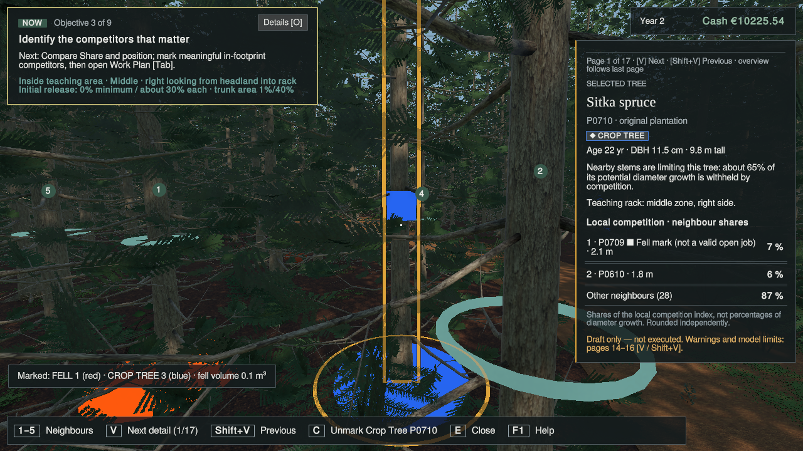
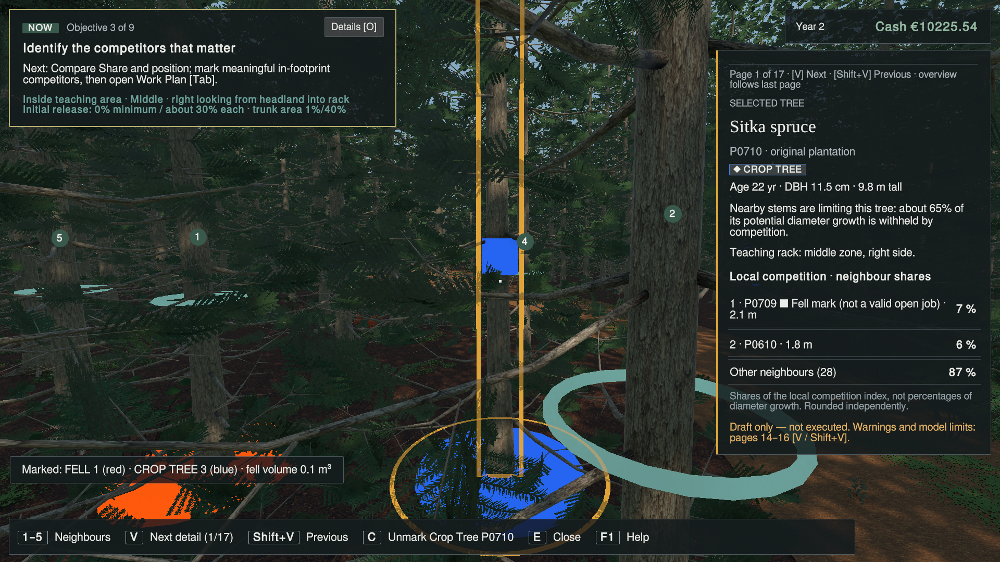
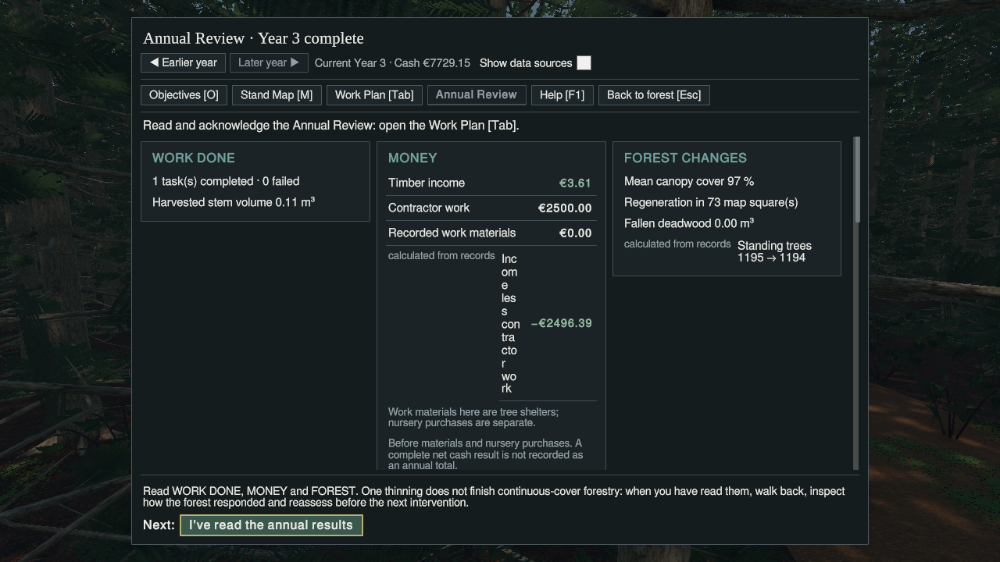
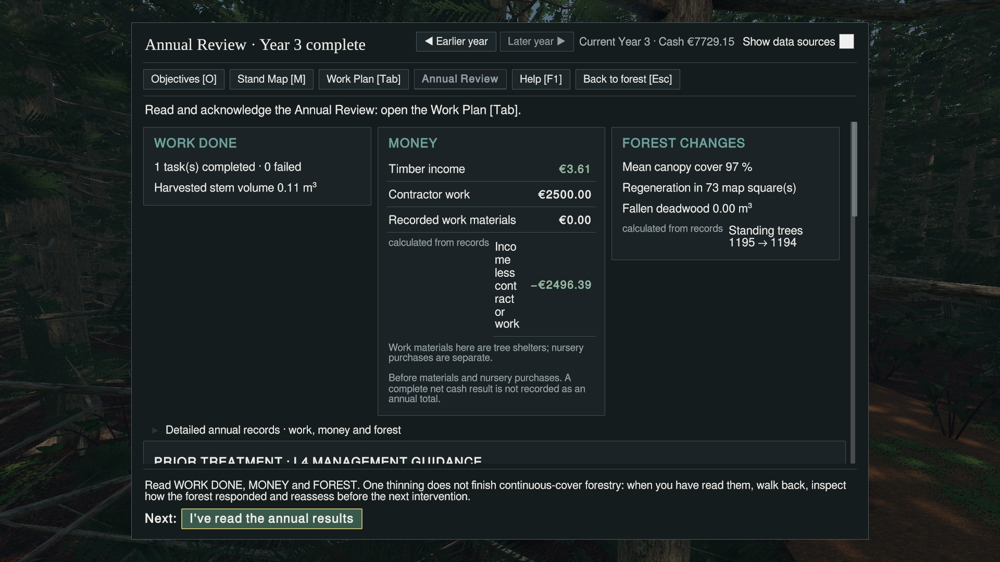

# #377 inspection fit repair and focused Unity continuation

**Worker result: inspection overview repair PASS at 720p and 1080p; overall UI NOT QUALIFIED / NEEDS CHANGES.** Annual Review has a newly observed severe text-wrapping defect. Remaining unverified slices are not waived. Return to Manager [#200](https://github.com/jermur788/CCF/issues/200); acceptance/integration remains Manager-owned.

## Exact source and ownership

- Failing source/base: `c683e9eecdbf87960b591c8acabec3139a8cca57`.
- Repaired, committed and pushed game candidate: **`c9c7d0100c7b8011b69686cdbfce5f2ecc5f0f86`**, branch `fix/scenario-one-ui-inspection-overflow-20261110-v1`.
- Phase A source worktree: `/media/jer/Files/CCF/Operations/CCF-S1-UI-Inspection-Fit-Repair-Sol`. Source writer released/frozen before phase B. Two changed paths only: `Assets/ForestPrototype/UI/TreeInspectionView.cs`; additive `Tools/Verification/ScenarioOneUiPresentation/inspection_fit.py`.
- Phase B existing separate warm lane: `/media/jer/ZX20/CCF-S1-UI-Presentation-V1-Qual`, branch `qualify/scenario-one-ui-inspection-overflow-20261110-v1`, exact repaired SHA above. Unity **6000.6.0f1**. No second launch for this repair qualification.
- Operator: T3 Code / Codex gpt-6.1-sol medium. No delegate or Fable review. Session resumed after provider quota interruption; the same Editor and lease survived. Resume independently checked their identities, storage, paths and protected hashes.
- Exclusive lease `d8d631db7ffc46839ab6b64fa01c461b`, acquired 22:54:57Z, owner `Codex-Sol-CCF377`, task `CCF-377-UI-QUALIFICATION`. Correct mounted exFAT device `/dev/sdd2`, UUID `18D6-896E`, about 28 GiB free. Original clean-lane admission and phase transitions are recorded on [#377](https://github.com/jermur788/CCF/issues/377).
- Editor exited normally with **exit 0**, 909.4 seconds, no reaper. Harness/meta removed by its driver. Lease released normally, not forced; final registry FREE/no Editor. See [release](evidence-377/release.json), [final lock](evidence-377/lock-after.json), [process result](evidence-377/result.json). Driver `PASS` means controlled session completion only: **it is not a UI qualification verdict**.

## What changed and source verification

The default tree page now shows two neighbour rows plus the remaining-neighbour total, a concise draft warning and a calculated route to three detailed draft pages. Full competition estimates, Fell/Storm forecast and proposal-versus-job/model-limit explanation remain on those keyboard-reachable pages. Existing site, condition, neighbour and timber pages remain. No font reduction or overflow hiding was used. No actual control, marking, MFM, ecology, economy, persistence, approval or year-advance rule changed.

Retained phase-A results: runtime compile **189 sources, 0 errors**; focused checks **160**, consumer paths **219**, review-reset lifecycle **18**, presentation source slices **157**, composition contracts, 12 prior repair contracts/10 negative controls, new overview/draft contracts and **61 compiled actual draft-page routes** PASS. New negative controls detect verbose overview restoration, missing route, wrong route and lost wind warning. The prior presentation mutations and omitted-unread-reset mutation were killed. These are source/consumer checks, not pixel-fit proof. Exact logs are in [evidence](evidence-377/), notably [fit-check](evidence-377/fit-check.log).

## New runtime evidence and matrix

The initial fit reproduction used the genuine #369 Year 2 fixture (SHA-256 `c715ea5bfada226ec737386df4f089817eaddec531e84f2cf84f96099ff15ae2`), copied only into the disposable save slot, native F9, native X on P0709, and native E on Crop Tree P0710, with actual first-use help dismissed. No teaching index or money was injected. Initial state: Year 2, Objective 3, one Fell mark, three Crop Trees, Cash €10225.54.

| Slice | 1280×720 | 1920×1080 |
|---|---|---|
| HUD + initial P0710 inspection, page navigation, neighbour shares and warning | PASS | PASS |
| All visible initial-page text inside inspection bounds, no HUD/status/bottom-bar overlap | PASS | PASS |
| Detail-page bounds and native V reachability | PARTIAL: pages 1,2,4–17 observed; Condition/page 3 not captured | PASS: pages 1–17 observed, wrap to overview observed |
| Draft pages 14–16 preserve estimates, forecast and model limits | PASS | PASS |
| Native ranks 1–5 produce distinct real target hints | PASS, bounded test | NOT RUN |
| Native Shift+V reverse | UNVERIFIED | UNVERIFIED |
| Work Plan pending job, quote/minimum and separate Approve/Advance presentation | PARTIAL: initial help overlay still present in captured attempt | PASS after help dismissed |
| Actual approval, then separate year advance | Shared live operation: 1 pending → approved → Year 3, 1 completed felling task | Shared live operation |
| Annual Review WORK DONE / MONEY / FOREST CHANGES, latest unread report | **FAIL readability** | **FAIL readability** |
| Native Back before ACK preserves unread; explicit ACK clears unread | PASS at 720p; production ACK callback invoked by verifier | NOT separately exercised |
| Source toggle, selected historical year and earlier-year read-only behaviour | NOT RUN | NOT RUN |
| Objective 1 locked Planting/Pruning/Nursery notes and pointer restrictions | NOT RUN | NOT RUN |
| Real group edit/remove; negative eligibility/approval cases | NOT RUN | NOT RUN |
| MFM candidate long-action page and native C/N confirm/reject/reopen | NOT RUN: suitable genuine late-stage fixture not established | NOT RUN |
| F5/F9 inside actual isolated destination | Exercised at 720p; Year 3 and three Crop Trees retained after reload; not an exhaustive persistence gate | NOT separately exercised |
| Colour/grayscale review | Bounded review of initial HUD/inspection and failing Annual Review | Same |
| 3D rank occlusion, cursor/focus across all workflows | PARTIAL: several numeric ranks visible; full occlusion/focus gate NOT RUN | Same |
| Legacy40 / frozen Reference runtime compatibility | NOT RUN; protected file hashes only | NOT RUN |

**Evidence-name correction:** capture filenames are attempt labels. The 720p detail sweep began two pages later than intended after a short Shift+V chord advanced rather than reversed. Use [actual-page-map.json](evidence-377/actual-page-map.json), rendered page counters and TSV text, not filename numbers. The short chord did not prove a product modifier defect. A later held-Shift attempt had no active inspection/aim target after reload, so it proves nothing about reverse navigation. Those adverse/inconclusive observations are retained. The missing 720p Condition page is not called PASS. The bounds pass checks geometric containment of visible inspection labels, not every aspect of typography or every UI state.

Initial-page logical bounds: at 720p inspection panel `(1146.25,80,440,643.75)` ends at y723.75; final warning ends at y707.5. At 1080p the warning also fits with padding. Both raw screenshots visibly retain the complete page counter and warning route “pages 14–16”. The page count for this fixture is 17, including timber. See [all detail bounds](evidence-377/detail-bounds.jsonl).

### Initial repair: actual raw screenshots

### New failure: Annual Review narrow money label

After opening Work Plan with native Tab, dismissing its first-use Help, approving the one pending P0709 felling job and separately advancing, the actual Year 3 report records 1 completed task, 0 failures, 0.11 m³ harvested, €3.61 timber income, €2500 contractor work and closing cash €7729.15. The latest review correctly becomes unread and HUD guidance asks for acknowledgement.

However, **“Income less contractor work” is compressed into a very narrow column beside “calculated from records” and the amount**. At 720p its logical label rectangle is `(801.25,400,33.75,236.25)`, producing roughly thirteen short fragments. At 1080p it remains badly fragmented. This is a real player-facing readability failure, although the captured letters remain within the scroll content rather than being truncated by the inspection panel. The two failures are distinct: the original inspection clipping is repaired; Annual Review is still unsuitable for a qualification PASS.

The apparent cause is the provenance tag and a nested name/value line competing for the three-column card's width in `AnnualReviewView.TaggedLine`/`UiKit.Line`; source inspection supports that hypothesis, but no repair was attempted because Annual Review production changes are outside #377's allowed repair scope. The unchecked “Show data sources” control is visible in both failing captures; the calculated-from-records label is still rendered. Manager should assign a bounded Annual Review row-layout repair and targeted requalification.

No broad suite, second review, second Editor launch, merge or Player/Windows build followed this defect. Remaining slices above are explicitly incomplete. This task does not establish overall spec conformance or acceptance.

## Isolation, cleanup and reproduction

[Actual process paths](evidence-377/paths.txt) prove `Application.persistentDataPath`, F5/F9 save and PlayerPrefs all resolve beneath `/media/jer/Files/CCF/Verification/CCF-377-InspectionFit-20261110/run/config/unity3d/DefaultCompany/CCF`. License-copy cleanup is recorded separately. Original save/Prefs files were never reloaded or overwritten.

[Final protection receipt](evidence-377/protection-after.json): all **36** valued origin files hash-identical; personal U3 and dirty Workbench Git status **and binary diffs** unchanged; all **27** licensed manifest entries and **six** frozen protected manifest entries match on both U3 and the qualification lane. Qualification lane clean. Six generated Editor side effects matched the entire previous #376 side-effect patch byte-for-byte, were preserved to the durable evidence root, then only those generated changes were restored to the lane's clean admitted bytes. The tracked shared VS Code settings were not used for local configuration. Primary's unrelated `AGENTS.md` and `Docs/Operations/StorageArchitecture.md` edits remain untouched.

Reproduction for the next authorized isolated session:

1. Admit exact candidate in the separate qualification lane under a new lease; prove isolated paths before loading the genuine fixture above.
2. Native X on P0709, E on P0710: expect the complete concise overview at both sizes. Native V reaches draft pages 14–16; use actual page counters.
3. Native Tab opens Work Plan and queues the marked tree. Dismiss first-use Help. Approve the pending job, then separately Advance one year.
4. Open the latest Year 3 Annual Review. At both sizes inspect the MONEY card's “Income less contractor work” row. Expect the defect shown above on this candidate. Back must leave unread true; the distinct acknowledgement clears it.

The external verifier uses real production callbacks for named UI buttons, native OS keys for X/E/V/ranks/Tab/Escape/F5/F9, and positioning helpers only to establish inspection targets. It is not a fully native pointer test. No stage forcing, save editing to invent late-state progress, production bypass or old-test weakening occurred. [Verifier source](evidence-377/Ccf377.cs), driver, external replay helpers, logs, all textual observations and selected raw PNGs are published. Original PNG bytes are unchanged; SHA-256 manifest: [SHA256SUMS.txt](evidence-377/SHA256SUMS.txt). Grayscale review is a derived local image, not substituted for raw evidence.

Durable complete local evidence: `/media/jer/Files/CCF/Verification/CCF-377-InspectionFit-20261110/` (about 98 MiB runtime evidence; ten raw PNGs plus logs/text published here, about 21 MiB). Local paths are not assumed remotely accessible. Published screenshots are original Unity captures, not mockups or earlier-candidate evidence.

## Handoff boundary

Source writer and machine ownership released; exact repair pushed. **Recommendation NEEDS CHANGES**, with this bounded inspection repair retained as passing evidence. #377 may close as handed off, never as accepted/integrated. Manager #200 owns the separate disposition and next bounded task. No Fable commissioned and no personal environment change, merge or Windows build.

**Operational outstanding issue:** canonical GitHub report/claim publication is separate from downstream dashboard synchronization. No supported dashboard ingestion/publisher CLI was available in the inspected CCF-Ops deployment; automatic GitHub dashboard-audit advance and published-state readback are **UNVERIFIED**. Manager must reconcile the authoritative coordination/dashboard record. No generated dashboard file or single-writer active-tasks record was manually edited.
