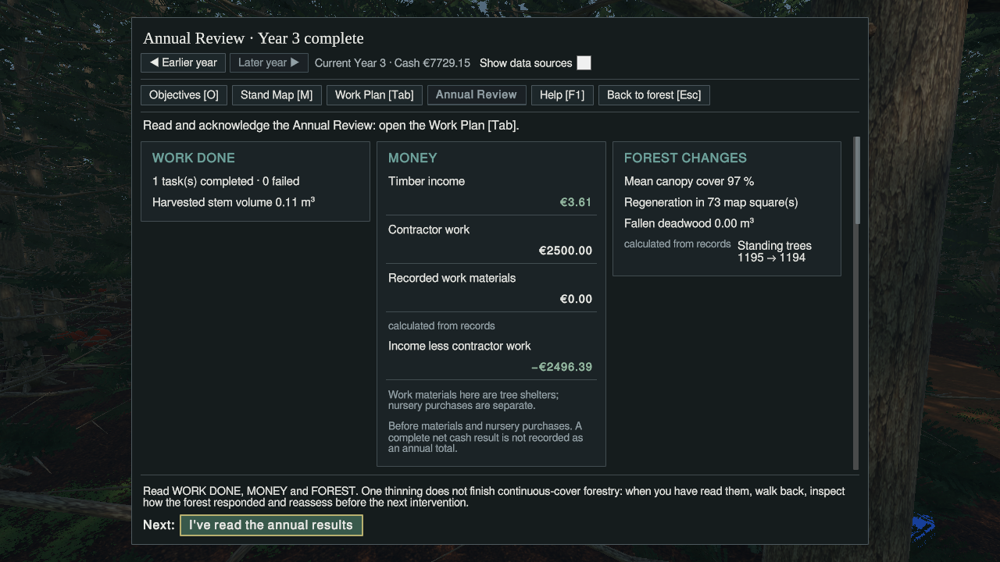
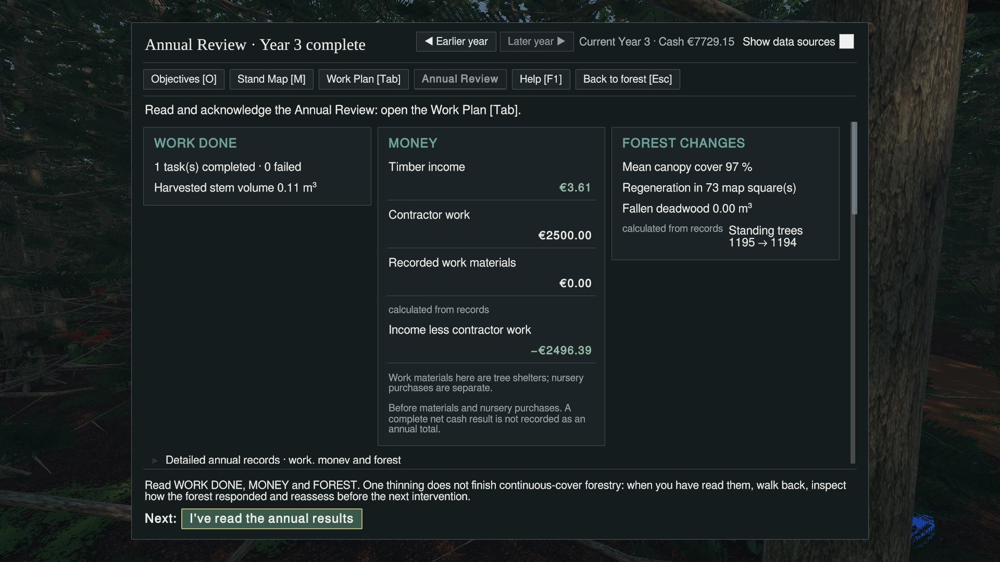
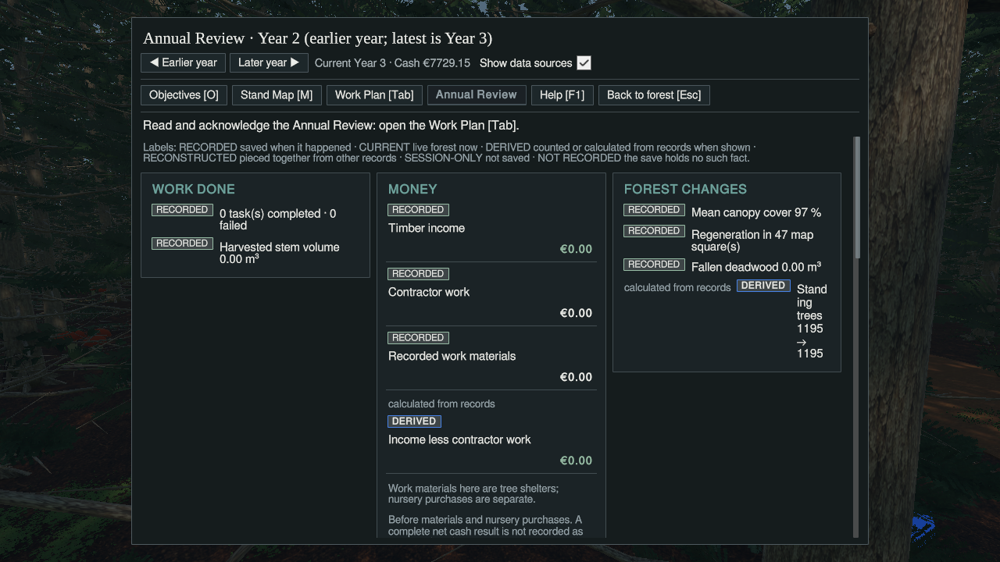
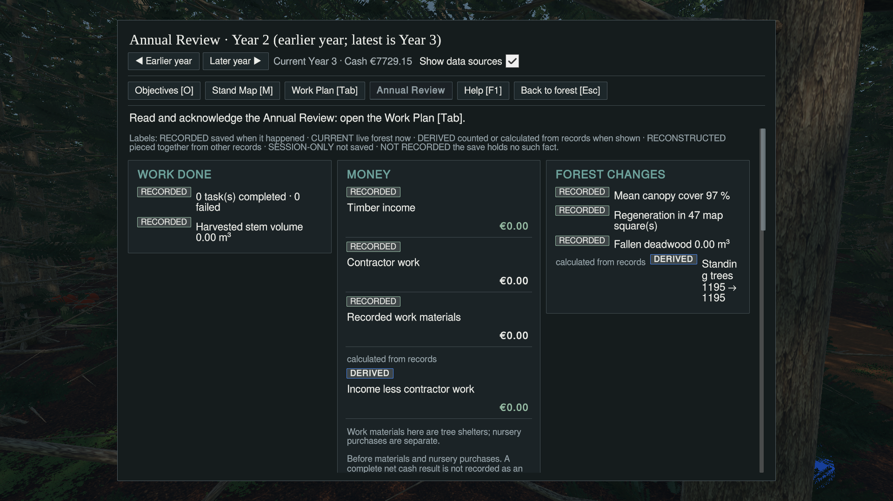
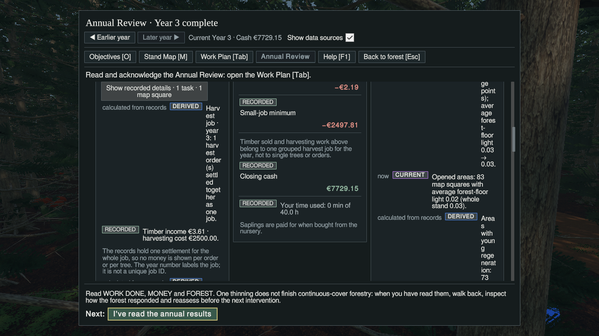

# #378 Annual Review Money row repair and guarded Unity result

**Money repair: PASS at 1280×720 and 1920×1080. Overall UI: NOT QUALIFIED / worker recommendation NEEDS CHANGES.** The continuation exposed severe wrapping in the **unchanged `AddTagged` helper for non-money Work/Forest text when Show data sources is enabled**. No further matrix, live production repair, merge or build followed that finding. Return to [Manager #200](https://github.com/jermur788/CCF/issues/200) for separate disposition.

## Exact source and bounded change

- Base: `c9c7d0100c7b8011b69686cdbfce5f2ecc5f0f86`, the #377 Crop Tree inspection repair.
- **Repaired and Unity-tested game source:** `ebe061bae8d3f9da1e810b4c49f49199db8b3d61`.
- Source branch: `fix/scenario-one-ui-annual-review-row-layout-20261110-v1`; source worktree `/media/jer/Files/CCF/Operations/CCF-S1-UI-Annual-Row-Repair-Sol`.
- Context snapshot: `63044dfbbeb869996ceecec8a47619dcba048b0b`; live coordination and current #378 binding packet checked independently.
- T3 Code / Codex gpt-6.1-sol medium; no child/delegate or Fable review.
- Production changes: only `Assets/ForestPrototype/UI/AnnualReviewView.cs` and Annual Review scoped classes appended to `Assets/ForestPrototype/UI/Resources/ScenarioOneUi.uss`. Additive checker: `Tools/Verification/ScenarioOneUiPresentation/annual_rows.py`.

`TaggedLine` now places provenance on its own line, the complete label across the available width and the numeric value underneath, right aligned and without wrapping. This applies to headline and detailed tagged name/value entries within Annual Review. Normal vertical growth uses the existing scroll view. The trade-off is more vertical space per entry, rather than competition for a narrow horizontal row. No font reduction, label shortening, hidden qualifier or amount substitution.

**Unchanged:** `TreeInspectionView.cs` (the verified Crop Tree repair), shared `UiKit.Line`, `Tag`, `AddTagged`, `BuildHeadlines`, every financial calculation/data source/year selector, acknowledgement rule, gameplay, ecology, save format, package, scene and frozen reference. Exact inventory and unchanged-helper checks: [source receipt](evidence-378/source-receipt.json). No production edits occurred under the Unity lease.

## Phase A verification and ownership

Fresh #378 source claim followed clean branch/worktree, no competing UI writer, handed-off #377, free physical Unity lease/no Editor and #361 personal-test status checks. The existing Primary changes to `AGENTS.md` and `Docs/Operations/StorageArchitecture.md` were preserved. The source writer was released/frozen after committing and pushing `ebe061ba`, before obtaining the separate Unity lease. Claim transitions are recorded on [#378](https://github.com/jermur788/CCF/issues/378).

Actual source results:

- Typed runtime compilation: **189 sources, zero errors, zero warnings** using installed Unity/package references.
- Existing focused checks **160**, exact consumer paths **219**, review-reset lifecycle **18**, presentation slices **157** PASS.
- Existing repair consumer contracts/10 negative controls and inspection-fit contracts/61 actual draft-page routes/negative controls PASS. No old assertion was edited or rebaselined.
- New exact `TaggedLine` consumer: **30 cases** covering all four headline names, a long record name, Recorded/Derived classifications and zero/positive/negative/long amounts. Original strings/classes preserved.
- **Meaningful compiled negative control:** restoring the previous side-by-side provenance/nested name-value composition fails `INDEPENDENT_SOURCE_NAME_AMOUNT`. Scoped USS contracts verify column layout, normal label wrapping and nowrap/right-aligned amounts.

These checks establish source/consumer contracts, **not rendered fit**. Exact logs: [compile](evidence-378/compile.log), [new consumer](evidence-378/annual-check.log), [160/219](evidence-378/feedback.log), [18](evidence-378/review-reset.log), [presentation](evidence-378/presentation.log), [repair consumers](evidence-378/repair-consumers.log), [inspection](evidence-378/inspection-fit.log).

## Phase B admission, isolation and release

- Existing separate warm lane, reused clean: `/media/jer/ZX20/CCF-S1-UI-Presentation-V1-Qual`, qualification branch `qualify/scenario-one-ui-annual-row-20261110-v1`, exact `ebe061ba`.
- Fresh exclusive lease **`0844eb93a17a4cd29a83295beda7bcd0`**, acquired `2026-11-10T23:28:08Z`, owner `Codex-Sol-CCF378`, task `CCF-378-UI-QUALIFICATION`.
- Correct mounted SSD: `/dev/sdd2`, UUID **`18D6-896E`**, exFAT read/write, **27.56 GiB free**, above the 15 GiB reserve. No personal lane fallback.
- **Unity 6000.6.0f1**, URP17.6.0/Input System1.20.0 from installed project. One actual Editor launch, **332.8 seconds**, normal **exit0**, no reaper. A detached shell-launch attempt did not persist or create an Editor; the supervised driver then started the sole Editor. No second import/run was commissioned.
- New-process actual persistent/F5-F9/Prefs paths proven before fixture load or year advance: all beneath `/media/jer/Files/CCF/Verification/CCF-378-AnnualRow-20261110/run/config/unity3d/DefaultCompany/CCF`. See [paths](evidence-378/paths.txt).
- Source writer remained released. Editor exited normally; disposable harness and `.meta` removed, copied licence removed. Six generated Editor side effects exactly matched the known #377 patch, were preserved to durable evidence, then only those files were restored to admitted clean bytes. Shared VS Code settings were not used for local configuration.
- Lease **released normally, not forced**; final registry FREE, no Editor, qualification lane clean: [release](evidence-378/release.json), [final lock](evidence-378/lock-after.json), [process receipt](evidence-378/result.json).

**Driver `PASS` records controlled session completion only. It is not the overall UI verdict.**

## First mandatory render gate — PASS

Same genuine #369 Year 2 fixture, SHA-256 `c715ea5bfada226ec737386df4f089817eaddec531e84f2cf84f96099ff15ae2`, copied into the proven disposable slot. Native F9 loaded it, native X marked **P0709**, native Tab opened Work Plan, actual first-use Help was dismissed. The real **Approve Work Plan** callback approved one pending job while Year remained2; a **separate Advance one year** callback executed it and produced the genuine latest-unread Year3 report. No stage, cash, report or progress was injected.

Actual Year3 facts preserved: 1 task completed/0 failed, 0.11m³ harvested, timber income **€3.61**, contractor work **€2500.00**, recorded work materials **€0.00**, income less contractor work **−€2496.39**, current closing cash **€7729.15**. The derived subtotal still explicitly excludes material/nursery purchases; it is not labelled complete annual net cash.

At both sizes all four headline names and amounts are readable and independent of source width. The previously squeezed name occupies **331.25 logical pixels at720p** and **328.33 at1080p** (previous720p width33.75). Its full signed amount remains right aligned (`MiddleRight`); the calculated-from-records qualifier remains visible with sources off. Native full-resolution, nonblack captures and complete UI trees are below. Measurement records include natural text sizes, rectangles and resolved alignment: [720p](evidence-378/01-annual-year3-repaired-1280-money-fit.tsv), [1080p](evidence-378/01-annual-year3-repaired-1920-money-fit.tsv).

## Focused continuation and stop finding

Selecting Earlier year showed **Year2**, with that year's €0 money totals, while the header continued to identify **Current Year3 / Cash €7729.15**. Enabling Show data sources retained the historical year and displayed Recorded/Derived chips. The historical view had **no visible acknowledgement button** and left the latest report unread. Returning to the later year restored Year3. Source classification and signed values in the repaired money rows remained intact at both sizes.

The new adverse evidence is outside the repaired name/value helper:

- With source labels enabled, Forest Changes text **“Standing trees 1195 → 1195”** is squeezed beside its always-visible qualifier and DERIVED chip. Label bounds: **53.75×131.25 logical pixels at720p**, **67.50×90.00 at1080p**. The word “Standing” breaks into fragments; this is material readability failure, not ordinary two-line wrapping.
- Expanded records show the same unchanged `AddTagged` composition problem in Work/Forest details: at720p **“Harvest job · year3: 1 harvest order(s) settled together as one job.”** occupies **45×323.75**, and **“Areas with young regeneration:73 (was47) — Sitka spruce73.”** occupies **43.75×323.75**. Original spaces/punctuation are retained in the TSV; abbreviated wording here only identifies the labels.
- `AddTagged` still places qualifier, chip and text side by side in a `.row`. `Tag`, `AddTagged` and its callers are byte-identical to the baseline. This is a **newly observed remaining defect**, not evidence that the Money layout repair failed or a new regression caused by changing data. No non-money repair was attempted under the machine lease.

The bounded continuation batch had already completed the back/ACK/save observations before the raw screenshots were visually audited and this failure confirmed. **After confirmation, no further matrix slice or production change was started; Unity was exited.** Next recommendation: a bounded Manager-authorised Annual Review **non-money tagged-text** layout repair preserving qualifier/chip/text authority, followed by targeted source-on Work/Forest renders. Do not waive source disclosures or relabel this result as overall qualified.

## Runtime matrix

| Check | 1280×720 | 1920×1080 |
|---|---|---|
| Genuine Year3 four Money headline labels/values, qualifier, sign, right alignment | **PASS** | **PASS** |
| Historical Year2 selection vs current Year3 header/cash; selected-year source toggle | **PASS** | **PASS** |
| Money rows with source labels enabled | **PASS** | **PASS** |
| Non-money Forest Changes source-labelled text | **FAIL**, fragmented Standing trees label | **FAIL**, fragmented Standing trees label |
| Expanded annual records | **FAIL** Work/Forest readability; Money geometry passes | **FAIL** Work/Forest readability; Money geometry passes |
| Detailed Money labels/amounts | **PARTIAL**:12 tagged entries measured incl. offscreen scroll content; visible minimum/cash/cost sampled, not every row scrolled into view | **PARTIAL**, same limitation |
| Earlier-year acknowledgement absent, latest remains unread | **PASS**, hidden control in actual historical state | **PASS**, same selected state |
| Latest Back before ACK leaves unread, distinct ACK clears unread | **NOT RUN separately at this size** | **PASS**, native Escape and actual production ACK callback |
| Native marking, Work Plan approval distinct from Advance | **PASS**, genuine P0709 pending→approved→executed flow | **NOT RUN separately** |
| Disposable F5 save after ACK | **NOT RUN separately** | **PARTIAL**, native save and actual state export; no F9 roundtrip in this task |
| Objective1 locked Planting/Pruning/Nursery note/pointer checks | **NOT RUN**, stopped | **NOT RUN**, stopped |
| MFM C/N candidate accept/reject/reopen | **NOT RUN**, no genuine suitable stage fixture established before stop | **NOT RUN** |
| Held Shift+V reverse and missing720p Condition page | **NOT RUN**, stopped | **NOT RUN**, stopped |
| Fresh Crop inspection render/sweep | **NOT RUN**; source byte-identical, scoped #377 fit evidence carried, no full sweep repeated | Same |
| Pointer/focus and rank occlusion | **NOT RUN** beyond native keys used above | **NOT RUN** |
| Low-value quote/unapproved warning; Legacy40/frozen Reference runtime | **NOT RUN**, stopped | **NOT RUN**, stopped |
| Grayscale visual qualification | **NOT RUN** | **NOT RUN** |

No missing cell is counted as PASS. User playtest acceptance, general UI qualification, Legacy compatibility and full-loop behaviour are not established by these narrow results.

## Evidence, replay and protection

Six original raw PNGs (about **6.22MiB**), full UI bounds/state dumps, money-fit measurements, source logs, driver, verifier and external command/replay helpers are in [evidence-378](evidence-378/). [SHA-256 manifest](evidence-378/SHA256SUMS.txt). These are actual exact-candidate Unity captures, not posters/mockups or screenshots carried from #377. The complete local durable root is `/media/jer/Files/CCF/Verification/CCF-378-AnnualRow-20261110/`; it is not assumed remotely accessible.

Reproduction in a newly admitted isolated session:

1. Prove disposable persistent/save/Prefs paths; load the genuine Year2 fixture above with native F9.
2. Aim at P0709, native X, native Tab; dismiss Help. Approve its one pending job, then separately Advance one year.
3. Open Year3 Annual Review at both sizes: expect full Money names and right-aligned values as shown, including **−€2496.39**.
4. Select Earlier year (Year2), enable Show data sources: expect year-specific totals with current Year3 status, no historical ACK, and reproduce the fragmented Standing trees text in Forest Changes. Expand annual records and scroll to the work/money/forest columns to reproduce the additional non-money text wrapping.

Input distinction: native OS F9/X/Tab/Escape/F5 were used. Named/text button callbacks, toggle changes, Foldout expansion and scroll positioning used the real UI objects via the disposable verifier; **these are not native pointer acceptance tests**. Natural-text fit checks inspect layout, including scroll content outside the current clip; screenshots remain the visual authority. Verifier [source](evidence-378/Ccf378.cs) and [first-gate replay](evidence-378/first-gate.py)/[continuation replay](evidence-378/review-continuation.py) are published. Nothing remains staged under Assets.

[Final protection receipt](evidence-378/protection-after.json): all **36 valued user-origin files** hash-identical, **27 licensed asset manifest entries** and **six frozen protected entries** match in both U3 and qualification lane. U3, dirty Workbench and Primary Git status **and binary diffs** match their preflight bytes. Crop inspection and shared UiKit unchanged; qualification lane clean. No original save/Prefs overwrite, personal fork edit, unrelated cleanup, external package or LFS change.

## Handoff boundary

Source and evidence published; source writer and Unity ownership released. Close [#378](https://github.com/jermur788/CCF/issues/378) as **HANDED-OFF**, not accepted/integrated. **Worker recommendation: retain the passing Money repair; overall UI NEEDS CHANGES for remaining source-labelled non-money rows.** Manager #200 owns G2/G4 disposition and next bounded assignment. No Fable/substitute review, additional Editor launch, whole inspection sweep, main merge, Player or Windows build.

**DASHBOARD SYNC: NOT VERIFIED. PUBLISHED DASHBOARD REFLECTS THIS TASK: NOT VERIFIED.** Canonical GitHub report/claim publication does not prove downstream ingestion, audit-snapshot advance or published-state readback. The inspected local CCF-Ops deployment has no supported dashboard publisher CLI. Manager #200 owns authoritative active-tasks/dashboard reconciliation; no single-writer coordination or generated dashboard file was manually edited.
