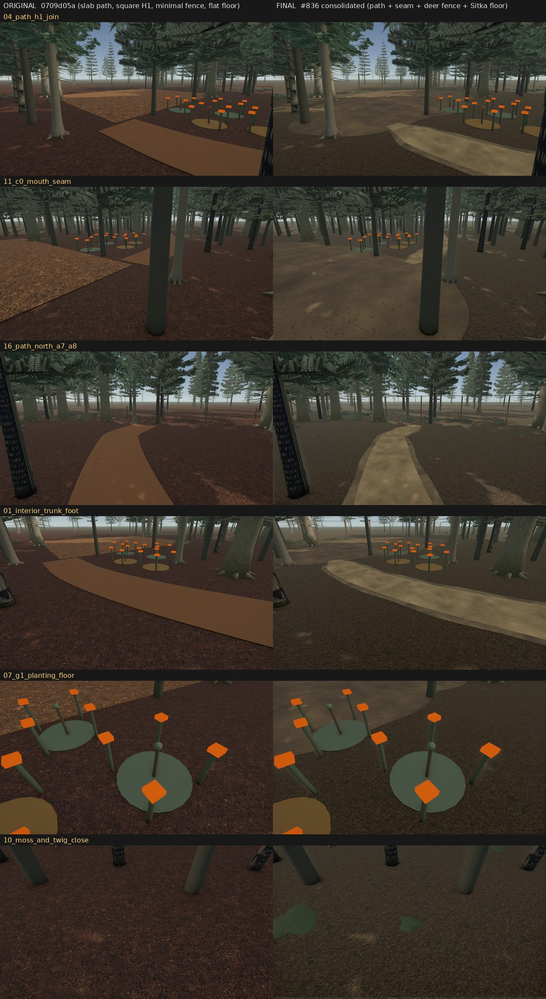
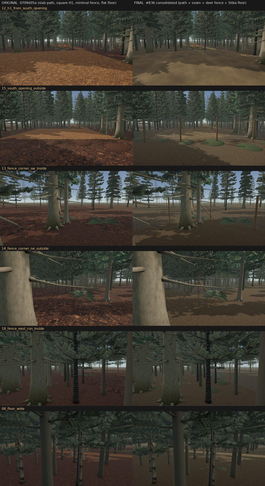

# Sen-1 #836: consolidated result for the Compact30 path, seam, deer fence and Sitka forest floor

**Status: IMPLEMENTED and NATIVE-QUALIFIED (Unity 6000.6.0f1, batchmode with GPU) on one candidate branch. Independent review DELTA APPROVED. Not integrated, not merged, not owner-accepted. An owner walk is still required.**

**Date:** 20 November 2026.
**For:** Scenario One Manager #824.
**Task:** [#836](https://github.com/jermur788/CCF/issues/836).
**Design inputs:**
- [#835](https://github.com/jermur788/CCF/issues/835) and the [#824 path/fence verdict](https://github.com/jermur788/CCF/blob/docs/sen-1-824-835-path-fence-design-verdict-20261119-v1/Docs/Handoffs/ScenarioOne-Visual-Research-20261119/Sen-1-824-MANAGER-835-PATH-AND-DEER-FENCE-DESIGN-VERDICT-TO-836-20261119.md).
- [#838](https://github.com/jermur788/CCF/issues/838) and the [#824 floor verdict / one-parent addendum](https://github.com/jermur788/CCF/blob/docs/sen-1-824-838-floor-verdict-to-836-20261119-v1/Docs/Handoffs/ScenarioOne-Sitka-Forest-Floor-Research-20261119/Sen-1-824-838-MANAGER-DESIGN-VERDICT-AND-836-ONE-PARENT-GROUND-ART-INTEGRATION-ADDENDUM-20261119.md).
- The #786 H1 kit, used as owned input.

## 1. What to review

| Item | Value |
|---|---|
| **Consolidated candidate** | branch **`sen-1/836-compact30-sitka-floor-20261119-v1`**, at the HEAD that carries this document |
| Original base | `0709d05a` (accepted #813 E1 scene) |
| Path/fence layer | `0709d05a → 9a7e3a0d`. This is the branch `sen-1/836-path-seam-deer-fence-20261119-v1`, already reported and APPROVED, with its own [result document](Sen-1-836-TG-FORK-PATH-SEAM-AND-REUSABLE-DEER-FENCE-IMPLEMENTATION-AND-UNITY-QUALIFICATION-RESULT.md) |
| Floor layer | `9a7e3a0d → 28451f15 → 669e408b → 32514615 → e8821932`, plus this document |
| Worktree | `/media/jer/ZX20/CCF-Sen1-836-Floor-20261119`, which has its own Library |
| Evidence | `/media/jer/Files/CCF/Verification/Sen1-836-Floor-20261119/consolidated-20261120/` |

**Merge note:** this branch *contains* the path/fence branch, because the floor work was fast-forwarded onto `9a7e3a0d` before any floor scene edit. Integrate **this branch only**. Merging both branches as siblings is a no-op for the path/fence branch and cannot conflict.

## 2. Actors, custody and how the run went

- **Parent orchestrator:**
  - The run started as an OpenCode DeepSeek parent (`deepseek-v4.1-flash`).
  - The user interrupted it twice ("continue with opus", "try to finish the task").
  - It was finished by **Claude Opus 5.5** as the successor parent in the same orchestration.
  - The Fable 5.2 asset-creation request was not carried out separately. The floor textures and meshes are procedural (see §5).
- **Predecessor state found at takeover:**
  - The floor worktree was on base **`091bb04b`**, four commits behind the approved path/fence head.
  - It had an uncommitted scene edit and an unintended Unity package auto-bump: `com.unity.sdk.linux-*` and `toolchain` 1.1.0→1.1.1.
  - Its WIP commit `73e4ad14` had been reset away.
  - Its interrupted capture had left a stale lock record (`49b80dcc…`, no Editor PID).
  - Handling:
    - The predecessor scene and diff were preserved under `…/predecessor-state-20261120/`.
    - The scene and package edits were reverted. **No package change is in the candidate.**
    - The branch was fast-forwarded to `9a7e3a0d`.
    - The floor build was re-run against the approved path/fence scene.
- **Unity custody:**
  - Lock `49b80dcc…` was released with its matching owner, task and lock ID. No Editor was running, and the user confirmed that Unity was free.
  - The successor then acquired `b32aac15…` for the build, captures and fix rebuild, and released it.
  - It later acquired `8a306c95…` for the original-scene capture and released it.
  - **One Editor at a time** throughout. The lock is now **free**.
- **Path/fence custody disclosure ([#836 comment](https://github.com/jermur788/CCF/issues/836#issuecomment-7025633339)):**
  - That author's late Editor runs overlapped the floor lease.
  - The path/fence scene at `9a7e3a0d` (sha256 `c99803eb…`) has now been loaded and rendered **under a clean lease**: 18 viewpoints in `before/`.
  - The floor build, run on top of it, left every path/fence YAML document byte-identical (§4).
  - The path/fence structural verifier itself was **not** re-run, because its tool is not in the repo.

## 3. What changed (consolidated)

### A. Path and seam (from the path/fence layer, unchanged here)
- The 176 cube slabs are replaced by **one continuous ribbon**:
  - centripetal Catmull–Rom through the nine C0 anchors;
  - a **1.2 m core with a 0.14–0.20 m verge**;
  - continuous UV and tapered tips, ending at A8.
- The square `H1_WornEarth_12x10` slab is replaced by an **organic H1 clearing**. It has a lobe that overlaps the C0 mouth, so the bare wedge and the square join are gone.
- No colliders were added.

### B. Deer fence (from the path/fence layer, unchanged here)
- A first-party modular kit:
  - post 2.10 m (⌀90 mm), strainer 2.30 m (⌀130 mm);
  - 3 m and 1.5 m netting panels, 1.9 m high;
  - corner braces.
- Placed on **all four edges at ±15.75 m**: 38 posts, 6 strainers, 39 × 3 m panels and 4 × 1.5 m panels. Every corner is closed, and all 8 braces are inside the enclosure.
- There is one clear 3 m **southern H1 opening** (x −3.75 … −0.75). There is no gate, because no gated access is authorised.
- No colliders.

### C. Sitka spruce forest floor (this layer)
- **`Ground` (30 × 30 m)** now uses `Sen1_SpruceFloor.mat`:
  - URP Lit, needle-litter albedo (2048², 4 m tile) plus a normal map on the same tile;
  - tint 0.90/0.88/0.84, smoothness 0.07, metallic 0.
  - The geometry and BoxCollider are untouched.
- **The 46 `LowCover_*` perimeter mounds** use `Sen1_FloorMarginMoss.mat`, a restrained olive bryophyte.
- **`Outside_Ground_Continuation`** (260 m plane) uses `Sen1_SpruceFloorFar.mat`, with the same tile, tint and normal, so there is no tonal step at the ±15 m Ground edge inside the fence.
- **New `Sen1_SpruceFloorScatter`** under `Compact30World`. It has 2 renderers and **no colliders**:
  - `MossPatches`: 44 low cushions (22 at trunk feet), 5,544 triangles, casts shadows;
  - `Twigs`: 44 fine twigs, 1,584 triangles, no shadows.
  - Scatter placement keeps out of the path ribbon (≥1.91 m), the H1 clearing (0 inside, ≥0.63 m clear), the G1 markers (≥2.20 m) and stems, and stays within ±14.2 m.
- `Forest Ground.mat` itself is **unmodified**. The new materials are referenced only by the Compact30 scene.

## 4. Verification evidence

| Check | Result |
|---|---|
| Floor build (`Sen1ForestFloorBuild.Run`, `logs/build-r2.log`) | `SEN1_FLOOR_SETUP_PASS`, 0 `error CS` |
| Scene diff `9a7e3a0d → candidate`, parsed per YAML document (`scene-diff-summary-r2.txt`) | 1522 → 1532 documents, **0 removed**. Only three kinds of change: 48 MeshRenderer material references (`Forest Ground` → floor/margin/far), 10 new scatter documents, and 1 child appended to `Compact30World`. **Every other document is byte-identical**, including the path ribbon, H1 clearing, fence, G1 markers, Crop Trees, exterior trees, Player, Camera and Sun. |
| Protected counts (in-Editor structural report, original / path-fence / final) | `Trees` direct children **175 / 175 / 175**; scene colliders **6 / 6 / 6** (5 box + Player CharacterController); scatter colliders 0 |
| Diff scope `0709d05a → candidate` (77 files) | Only `Art/Sen1PathFence/**`, `Art/Sen1SpruceFloor/**`, `ScenarioOneCompact30.unity`, `Tools/Verification/Sen1Floor/` (the authoring tool and texture generator, kept for provenance) and `Docs/Handoffs/…`. **No** `Packages/`, `ProjectSettings/`, script, save, world-manifest, ecology or other-scene change. No temporary Editor script or `.meta` remains under `Assets/`. |
| Texture provenance | The deterministic Pillow-only generator was **re-run by the reviewer to a scratch folder, and all four PNGs came out byte-identical**. Fixed seeds, no network access, no third-party imagery. Hashes are in the floor README. |
| Renders | 18 player-relevant viewpoints × 2 resolutions, at three states: `original-0709d05a/`, `before/` (`9a7e3a0d`), `after-r2/` (final). The superseded `after/` (r1) is kept. `RECEIPT.txt` binds each set to its commit and scene sha256. All three sets were rendered under a held lease from the committed scene, with no material swap. |
| Compatibility | Legacy40, Enlarged80 and Reference Future do not reference any new material or mesh, and `Forest Ground.mat` is unchanged. Not rendered. |
| Runtime performance | **NOT TESTED** (no frame-time capture). Proxy: the floor adds 2 renderers and 7,128 triangles. The path/fence layer added about 19 k triangles and 97 renderers. Scene total is about 17.46 M triangles, dominated by the trees. |
| Play mode, save/load, walk | **NOT RUN** in this run. These changes affect presentation only: no colliders, scripts or save fields were touched. |

### Original (`0709d05a`) vs final: path, seam and floor

### Original (`0709d05a`) vs final: fence and entrance

The full-resolution PNGs (1280×720 and 1920×1080) for all 18 viewpoints, including overhead `17` and the floor-only pairs `before/` vs `after-r2/`, are in the evidence folder.

## 5. Reviews

| Review | Scope | Verdict | Outcome |
|---|---|---|---|
| Path/fence reviews (4 rounds, earlier) | `0709d05a → 9a7e3a0d` | **APPROVED** at `f5768480` | See the path/fence result document |
| Independent fresh-context review (Opus 5.5 subagent, non-author of the floor edits) | floor `9a7e3a0d → 669e408b` | **NEEDS CHANGES**: 2 blocking, 1 should-fix | **B1:** the clearing test had the wrong sign, so 4 moss cushions and 8 twigs sat inside the H1 clearing and could be confused with G1 discs. **B2:** URP Lit samples `_BumpMap` and `_OcclusionMap` with the base-map UV, so the claimed 1.6 m normal tile and the once-over-30 m macro occlusion were not real. **S1:** a tonal seam at ±15 m inside the fence. |
| Repair `32514615` | | | Sign fixed. Occlusion map removed and the normal shares the 4 m tile, with the README corrected. Far material matched to the floor. Rebuilt and re-rendered. |
| Independent delta re-check (new subagent) | `669e408b → 32514615` plus whole-candidate scope | **DELTA APPROVED**, 0 blocking, 0 should-fix | It re-decoded the meshes: 0 inside the clearing, all clearances pass. Its README note N-2 was fixed in `e8821932`. |

Authorship caveat: the reviewers were separate fresh-context Claude agents, not another model family. A cross-provider review was not run.

## 6. Known limitations

1. **Moss and margin shapes:** the cushions and the 46 margin mounds read as smooth, hard-edged green discs, not true cushions (`10`, `15`, `18`). The colour is restrained as intended. This is a candidate for a later shape pass.
2. **Normal-map scale:** the normal map was authored for a 1.6 m tile and is now stretched over 4 m, so the bumps are about 2.5× coarser than the albedo needles. This is not obvious in the renders.
3. **Unused macro texture:** `Sen1_SpruceFloor_Macro_512.png` (49 KB) is committed but **unused**, because URP Lit cannot sample it once over the plane. It is kept for a future custom-shader pass, and the README explains this.
4. **Floor tone:** at 4–10 m the floor reads as a mid taupe-brown. It is darker and more organic than the original red mulch but lighter than a deep humus. Against the darker floor the H1 clearing reads lighter (`12`). Tint is a one-line change if the owner wants it darker.
5. **Footprint:**
   - The floor art adds **about 7.5 MB**; the 2048² albedo PNG alone is 4.9 MB.
   - The path/fence art is about 1.1 MB.
   - The two handoff contact sheets are about 1.0 MB of JPEG.
   - No Git LFS is used.
6. **Fence realism:** the 3.0 m post rhythm is a readability choice, not an Irish forestry specification (carried over from the path/fence result).
7. **Not done in this run:** frame-time measurement, a play-mode walk, save/load, Windows build (excluded), and renders of other scenarios.

## 7. Verdict and next step

**#836 is substantially complete on one consolidated branch.**
- The path and seam fix, the reusable deer fence and the approved needle-litter-first Sitka floor are implemented together.
- Native Unity render qualification passed under a single clean lease.
- Protected world state is unchanged at the YAML document level.
- The independent review is DELTA APPROVED.

**Recommended next step (Manager #824 / owner):** do one owner walk in the Editor on this branch. Check the path seam at C0/H1, the south opening, the fence corners and the floor under the trees. Then decide whether to integrate, and whether limitations 1 and 4 warrant a follow-up pass.
