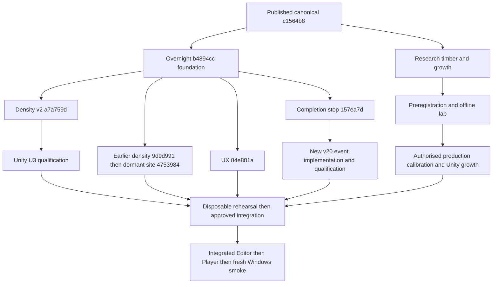

# Three-species integration readiness v1

Non-Unity repository audit, 2026-10-14. No integration approval, main merge, production modification or runtime claim.

## Authority and source identity

Exact audit base: `321791b8203bc709c57615fd4d6a19614d78db24`, retrieved locally; no fallback used. Published canonical / eventual rehearsal baseline: `c1564b857972ee18917e8a461c457533a54cc3f1` (origin/main read-back). Local manager context is docs-only relative to that baseline. User packet decisions govern two-cycle completion, save v20 and resolutions. Read AGENTS and context workflow, decision log, milestone, brief, overview, research index; live origin/main coordination shows no owner for these new audit paths. Existing dirty worktrees were inspected and preserved. All required exact commits exist; timber and cc54d6a qualification are local-only, absent as origin branch refs. Do not substitute newer local UX fixes (`549eae3`) for the specified qualification source.

## Ownership and prerequisite matrix

| Lane / exact source | Class | Semantic owner | Prerequisite / disposition |
|---|---|---|---|
| `task/mixed-density-architecture-rework-v2` @ `a7a759ded087a824c1e8149e480ddf58ac0585eb` | WAITING_ON_UNITY | Implementation: composite density v2; supersedes the overnight pooled density and early generic density. U3 required. | U3 actual pure-Sitka anchors, near-pure transitions, actual long-run/regeneration, save/load; no Model 2 default change. |
| `task/oak-beech-site-infrastructure-v1` @ `47539847d7e2531824c30f3dfe635d55404699a8` | DORMANT_FOUNDATION | Dormant infrastructure: multidimensional site descriptors and neutral response API; no wired production multiplier or persisted site profile. | Neutral offline tests; eventual Unity API qualification, keep dormant. |
| `research/oak-beech-timber-economy-v1` @ `b9d4cd939837263a1a11a9768252a394e62b6fa0` | RESEARCH_ONLY | Research evidence and parity audit, not a timber implementation. | Manager review of evidence, reconcile calibration and product claims with existing implementation. |
| `claude/stoic-mccarthy-gtzaub` @ `b4894ccf7966cfa5fa4d9c0df653d99b1846fa5a` | READY_AFTER_QUALIFICATION | Implementation foundation: timber model-2 gate, history/UI, verification. Its density component is SUPERSEDED; adult growth/site remained stopped. | Integrated timber/history/type-check and Unity gates; retain history/timber while replacing obsolete density. |
| `claude/dazzling-pascal-s0jzlz` @ `84e881aa6d0e96c5752f09492d5db37d2cc8925e` | READY_AFTER_QUALIFICATION | Implementation: review guard, teaching/controls/help reset. Qualification cc54d6a is B with fixes; not integrated. Native Windows and P3 declared text-anchor decision remain. | Requalify after integration; fix declared text-anchor decision explicitly, required 1280×720 and 1920×1080. |
| `task/scenario-one-two-cycle-completion` @ `157ea7d12f361b824f56405284d46312e7c0b9fc` | WAITING_ON_IMPLEMENTATION | Verification/stop report only. No N3/U4 implementation candidate; persistence extension now authorised by packet but not implemented. | Implement chronological event extension, grandfather outcomes, negative/positive save/load gates before merge. |
| `research/oak-beech-ordinal-growth-calibration-v1` @ `c35e0016fe28b6302bb4e120642f3b917b14cb67` | RESEARCH_ONLY | Research: Kernel A supports coarse ordinal calibration. No fitted coefficients; corrects Beech height/diameter confusion. | Preregister then offline lab; bounded production-calibration packet and Unity growth qualification. |

## File conflict matrix

Matrix below records actual changed-file intersections relative to the published baseline. An intersection is potential ownership overlap, not proof of a Git conflict; exclusive deltas and ancestry below prevent double-porting inherited files. Textual merge conflicts are measured in Job 6. Semantic overlap requires review even when Git auto-merges.

| File | Lanes changing baseline | Risk / owner |
|---|---|---|
| `Assets/ForestPrototype/AdultMortalityAccount.cs` | density, site, overnight, ux, completion | Density v2 owns; earlier branches carry superseded interface/calibration. Semantic stop if resolving reverts v2. |
| `Assets/ForestPrototype/ForestEcologyController.cs` | density, site, overnight, ux, completion | Density owner keeps v2 routing, exact legacy path; site adds no wiring. Textual risk if earlier controller changes are replayed. |
| `Assets/ForestPrototype/MixedDensityModel.cs` | density, site, overnight, ux, completion | Density v2 owns; earlier branches carry superseded interface/calibration. Semantic stop if resolving reverts v2. |
| `Assets/ForestPrototype/ScenarioOne/ManagementHistoryText.cs` | density, site, overnight, ux, completion | History/UX owners preserve model-aware copy and data derivation; future completion owns chronology. Manager/UI semantic interaction. |
| `Assets/ForestPrototype/ScenarioOne/ScenarioInterventionHistory.cs` | density, site, overnight, ux, completion | History/UX owners preserve model-aware copy and data derivation; future completion owns chronology. Manager/UI semantic interaction. |
| `Assets/ForestPrototype/ScenarioOne/ScenarioOneEconomyAdapter.cs` | density, site, overnight, ux, completion | Economy owner preserves Sitka ordinals/prices and model-2 gate; research supplies evidence, not replacement bytes. |
| `Assets/ForestPrototype/ScenarioOne/ScenarioOneManager.History.cs` | density, site, overnight, ux, completion | History/UX owners preserve model-aware copy and data derivation; future completion owns chronology. Manager/UI semantic interaction. |
| `Assets/ForestPrototype/ScenarioOne/ScenarioOneManager.cs` | density, site, overnight, ux, completion | History/UX owners preserve model-aware copy and data derivation; future completion owns chronology. Manager/UI semantic interaction. |
| `Assets/ForestPrototype/SitkaGrowthModel.cs` | density, site, overnight, ux, completion | Inherited overnight bytes; avoid duplicate port; subsystem owner reviews. |
| `Assets/ForestPrototype/Species/BeechSpecies.asset` | density, site, overnight, ux, completion | Inherited overnight bytes; avoid duplicate port; subsystem owner reviews. |
| `Assets/ForestPrototype/Species/SessileOak.asset` | density, site, overnight, ux, completion | Inherited overnight bytes; avoid duplicate port; subsystem owner reviews. |
| `Assets/ForestPrototype/TimberYield/TimberYieldCalculator.cs` | density, site, overnight, ux, completion | Economy owner preserves Sitka ordinals/prices and model-2 gate; research supplies evidence, not replacement bytes. |
| `Assets/ForestPrototype/TimberYield/TimberYieldConfiguration.cs` | density, site, overnight, ux, completion | Economy owner preserves Sitka ordinals/prices and model-2 gate; research supplies evidence, not replacement bytes. |
| `Assets/ForestPrototype/TimberYield/TimberYieldValidation.cs` | density, site, overnight, ux, completion | Economy owner preserves Sitka ordinals/prices and model-2 gate; research supplies evidence, not replacement bytes. |
| `Assets/ForestPrototype/TreeSpeciesDefinition.cs` | density, site, overnight, ux, completion | Density v2 tooltip/class semantics; site has no exclusive delta here. No coefficient edits. |
| `Assets/ForestPrototype/UI/AnnualReviewView.cs` | density, site, overnight, ux, completion | History/UX owners preserve model-aware copy and data derivation; future completion owns chronology. Manager/UI semantic interaction. |
| `Assets/ForestPrototype/UI/ScenarioOneUiRoot.cs` | density, site, overnight, ux, completion | History/UX owners preserve model-aware copy and data derivation; future completion owns chronology. Manager/UI semantic interaction. |
| `Assets/ForestPrototype/UI/TreeInspectionView.cs` | density, site, overnight, ux, completion | History/UX owners preserve model-aware copy and data derivation; future completion owns chronology. Manager/UI semantic interaction. |
| `Assets/ForestPrototype/UI/WalkingHudView.cs` | density, site, overnight, ux, completion | History/UX owners preserve model-aware copy and data derivation; future completion owns chronology. Manager/UI semantic interaction. |
| `Assets/ForestPrototype/UI/WorkPlanView.cs` | density, site, overnight, ux, completion | History/UX owners preserve model-aware copy and data derivation; future completion owns chronology. Manager/UI semantic interaction. |
| `Assets/ForestPrototype/WorkEconomy/ForestryWorkDomain.cs` | density, site, overnight, ux, completion | Economy owner preserves Sitka ordinals/prices and model-2 gate; research supplies evidence, not replacement bytes. |
| `Assets/ForestPrototype/WorkEconomy/Stage1EconomyDefaults.cs` | density, site, overnight, ux, completion | Economy owner preserves Sitka ordinals/prices and model-2 gate; research supplies evidence, not replacement bytes. |
| `Assets/ForestPrototype/WorkEconomy/TimberAssortmentLabels.cs` | density, site, overnight, ux, completion | Economy owner preserves Sitka ordinals/prices and model-2 gate; research supplies evidence, not replacement bytes. |
| `Tools/Verification/CloudTypeCheck/InputSystemStub.cs` | density, site, overnight, ux, completion | Inherited overnight bytes; avoid duplicate port; subsystem owner reviews. |
| `Tools/Verification/CloudTypeCheck/UnityEditorStub.cs` | density, site, overnight, ux, completion | Inherited overnight bytes; avoid duplicate port; subsystem owner reviews. |
| `Tools/Verification/CloudTypeCheck/baseline-prod.txt` | density, site, overnight, ux, completion | Inherited overnight bytes; avoid duplicate port; subsystem owner reviews. |
| `Tools/Verification/CloudTypeCheck/baseline-tools.txt` | density, site, overnight, ux, completion | Inherited overnight bytes; avoid duplicate port; subsystem owner reviews. |
| `Tools/Verification/CloudTypeCheck/run_typecheck.py` | density, site, overnight, ux, completion | Inherited overnight bytes; avoid duplicate port; subsystem owner reviews. |
| `Tools/Verification/ThreeSpecies/BroadleafAdultGrowthVerification.cs` | density, site, overnight, ux, completion | Inherited overnight bytes; avoid duplicate port; subsystem owner reviews. |
| `Tools/Verification/ThreeSpecies/BroadleafTimberEconomyVerification.cs` | density, site, overnight, ux, completion | Economy owner preserves Sitka ordinals/prices and model-2 gate; research supplies evidence, not replacement bytes. |
| `Tools/Verification/ThreeSpecies/MixedDensityVerification.cs` | density, site, overnight, ux, completion | Density v2 owns; earlier branches carry superseded interface/calibration. Semantic stop if resolving reverts v2. |
| `Tools/Verification/ThreeSpecies/OfflineLogic/BroadleafTimberOfflineCheck.cs` | density, site, overnight, ux, completion | Economy owner preserves Sitka ordinals/prices and model-2 gate; research supplies evidence, not replacement bytes. |
| `Tools/Verification/ThreeSpecies/OfflineLogic/HistoryOfflineStubs.cs` | density, site, overnight, ux, completion | History/UX owners preserve model-aware copy and data derivation; future completion owns chronology. Manager/UI semantic interaction. |
| `Tools/Verification/ThreeSpecies/OfflineLogic/MixedDensityIsolatedCheck.cs` | density, site | Density v2 owns; earlier branches carry superseded interface/calibration. Semantic stop if resolving reverts v2. |
| `Tools/Verification/ThreeSpecies/OfflineLogic/MixedDensityOfflineCheck.cs` | density, site, overnight, ux, completion | Density v2 owns; earlier branches carry superseded interface/calibration. Semantic stop if resolving reverts v2. |
| `Tools/Verification/ThreeSpecies/OfflineLogic/ScenarioHistoryOfflineCheck.cs` | density, site, overnight, ux, completion | History/UX owners preserve model-aware copy and data derivation; future completion owns chronology. Manager/UI semantic interaction. |
| `Tools/Verification/ThreeSpecies/OfflineLogic/SitkaYieldFixture.cs` | density, site, overnight, ux, completion | Inherited overnight bytes; avoid duplicate port; subsystem owner reviews. |
| `Tools/Verification/ThreeSpecies/OfflineLogic/UnityShim.cs` | density, site, overnight, ux, completion | Inherited overnight bytes; avoid duplicate port; subsystem owner reviews. |
| `Tools/Verification/ThreeSpecies/OfflineLogic/run_offline_check.py` | density, site, overnight, ux, completion | Inherited overnight bytes; avoid duplicate port; subsystem owner reviews. |
| `Tools/Verification/ThreeSpecies/ScenarioHistoryVerification.cs` | density, site, overnight, ux, completion | History/UX owners preserve model-aware copy and data derivation; future completion owns chronology. Manager/UI semantic interaction. |
| `Tools/Verification/ThreeSpecies/run_unity_gates.py` | density, site, overnight, ux, completion | Inherited overnight bytes; avoid duplicate port; subsystem owner reviews. |

### Persistence boundary

`ForestSaveData.cs` and `ForestSaveController.cs` have **no changes** in these implementation deltas. Work orders, events, reports, snapshots and outcome are existing persisted inputs. History is derived, not a new save structure. `ScenarioOneManager.cs` capture/restore and MarkAnnualReviewSeen need future completion review; the existing boolean cannot establish event order. `AnnualReviewView` / `ScenarioOneUiRoot` acknowledgement handler integration must call the future event path exactly once per actual acknowledgement. Site types are not persisted or connected to runtime growth.

## Dependency graph

## Recommended eventual merge order

1. Lock c1564b8 gameplay baseline plus manager docs context; no integration candidate created here.
2. Qualified density-v2 lineage a7a759d: brings overnight timber/history prerequisites too. It remains WAITING_ON_UNITY until U3; rehearsal alone is not acceptance.
3. Site 4753984 exclusive seven-file infrastructure delta from common ancestor 9d9d991; whole-branch merge may safely preserve v2 via ancestry, but verify tree. Do not downgrade density or wire response.
4. Timber/economy evidence review against inherited overnight implementation; no second merge of b4894cc required. Apply only an explicitly approved correction branch if needed. Research docs may be kept separately.
5. Future bounded Oak/Beech production-calibration candidate following Jobs 3/4; missing, cannot invent assets/coefficients here. Stage independently after U3 rather than compensating for density.
6. Future N3 completion candidate on accepted history/save lineage; missing. Extension must preserve event ordinals/outcomes, v20 and eight objective bytes.
7. UX 84e881a (inherits b4894cc), plus explicitly approved small-fix/qualification deltas. Requalify integrated acknowledgement, history, completion and controls. Do not silently adopt the P3 anchor.
8. Integrated qualification and fresh post-parity/full-loop Windows candidate; no pre-parity build qualifies for external demo.

Available predecessor rehearsal order: density v2 → site → UX. Completion stop and calibration research are inspected, not treated as implementation merges.

## Integration STOP conditions

Exact source unavailable/mismatched; ownership conflict; canonical contradiction; accepted mechanics conflict; schema bump; Assets modification required by this audit; anchor/reference change required without explicit authority. During eventual integration additionally stop on pure-Sitka drift, older enum reinterpretation, Model 2 default adoption without a separate decision, undocumented site activation, reintroduced pooled Sitka density, false broadleaf product/price claim, or missing blocking qualification. Text conflicts with ambiguous mechanic precedence return to Manager; rehearsal captures and aborts them instead of inventing a resolution.

## Complete changed-file inventories

For each source, the first inventory is branch-exclusive changes against its identified parent. The full baseline inventory includes inherited implementation/research/docs; neither inventory is a proposed merge patch.

### density: `a7a759ded087a824c1e8149e480ddf58ac0585eb`

Exclusive comparison `b4894ccf7966cfa5fa4d9c0df653d99b1846fa5a` → source (30 files):

- `Assets/ForestPrototype/AdultMortalityAccount.cs`
- `Assets/ForestPrototype/ForestEcologyController.cs`
- `Assets/ForestPrototype/MixedDensityModel.Composite.cs`
- `Assets/ForestPrototype/MixedDensityModel.Composite.cs.meta`
- `Assets/ForestPrototype/MixedDensityModel.cs`
- `Assets/ForestPrototype/SitkaSubsetDensitySignal.cs`
- `Assets/ForestPrototype/SitkaSubsetDensitySignal.cs.meta`
- `Assets/ForestPrototype/TreeSpeciesDefinition.cs`
- `Docs/Verification/ThreeSpeciesProgramme/CompositeDensityV2Evidence/baseline-density-and-isolation.txt`
- `Docs/Verification/ThreeSpeciesProgramme/CompositeDensityV2Evidence/final-composite.txt`
- `Docs/Verification/ThreeSpeciesProgramme/CompositeDensityV2Evidence/initial-run.txt`
- `Docs/Verification/ThreeSpeciesProgramme/CompositeDensityV2Evidence/manifest.json`
- `Docs/Verification/ThreeSpeciesProgramme/CompositeDensityV2Evidence/mutations.json`
- `Docs/Verification/ThreeSpeciesProgramme/CompositeDensityV2Evidence/production-typecheck.txt`
- `Docs/Verification/ThreeSpeciesProgramme/CompositeDensityV2Evidence/timber-history.txt`
- `Docs/Verification/ThreeSpeciesProgramme/CompositeDensityV2Evidence/tools-typecheck.txt`
- `Docs/Verification/ThreeSpeciesProgramme/CompositeDensityV2Handoff.md`
- `Docs/Verification/ThreeSpeciesProgramme/CompositeDensityV2Predeclared.md`
- `Docs/Verification/ThreeSpeciesProgramme/Phase1-DensityRework.md`
- `Docs/Verification/ThreeSpeciesProgramme/Phase1-MixedDensity.md`
- `Docs/Verification/ThreeSpeciesProgramme/Phase10-Qualification.md`
- `Docs/Verification/ThreeSpeciesProgramme/README.md`
- `Tools/Verification/ThreeSpecies/BroadleafAdultGrowthVerification.cs`
- `Tools/Verification/ThreeSpecies/MixedDensityVerification.cs`
- `Tools/Verification/ThreeSpecies/OfflineLogic/CompositeDensityOfflineCheck.cs`
- `Tools/Verification/ThreeSpecies/OfflineLogic/MixedDensityIsolatedCheck.cs`
- `Tools/Verification/ThreeSpecies/OfflineLogic/MixedDensityOfflineCheck.cs`
- `Tools/Verification/ThreeSpecies/OfflineLogic/SitkaIsolatedCheck.cs`
- `Tools/Verification/ThreeSpecies/OfflineLogic/run_composite_mutations.py`
- `Tools/Verification/ThreeSpecies/OfflineLogic/run_offline_check.py`

Published baseline → source (71 files):

- `Assets/ForestPrototype/AdultMortalityAccount.cs`
- `Assets/ForestPrototype/ForestEcologyController.cs`
- `Assets/ForestPrototype/MixedDensityModel.Composite.cs`
- `Assets/ForestPrototype/MixedDensityModel.Composite.cs.meta`
- `Assets/ForestPrototype/MixedDensityModel.cs`
- `Assets/ForestPrototype/MixedDensityModel.cs.meta`
- `Assets/ForestPrototype/ScenarioOne/ManagementHistoryText.cs`
- `Assets/ForestPrototype/ScenarioOne/ManagementHistoryText.cs.meta`
- `Assets/ForestPrototype/ScenarioOne/ScenarioInterventionHistory.cs`
- `Assets/ForestPrototype/ScenarioOne/ScenarioInterventionHistory.cs.meta`
- `Assets/ForestPrototype/ScenarioOne/ScenarioOneEconomyAdapter.cs`
- `Assets/ForestPrototype/ScenarioOne/ScenarioOneManager.History.cs`
- `Assets/ForestPrototype/ScenarioOne/ScenarioOneManager.History.cs.meta`
- `Assets/ForestPrototype/ScenarioOne/ScenarioOneManager.cs`
- `Assets/ForestPrototype/SitkaGrowthModel.cs`
- `Assets/ForestPrototype/SitkaSubsetDensitySignal.cs`
- `Assets/ForestPrototype/SitkaSubsetDensitySignal.cs.meta`
- `Assets/ForestPrototype/Species/BeechSpecies.asset`
- `Assets/ForestPrototype/Species/SessileOak.asset`
- `Assets/ForestPrototype/TimberYield/TimberYieldCalculator.cs`
- `Assets/ForestPrototype/TimberYield/TimberYieldConfiguration.cs`
- `Assets/ForestPrototype/TimberYield/TimberYieldValidation.cs`
- `Assets/ForestPrototype/TreeSpeciesDefinition.cs`
- `Assets/ForestPrototype/UI/AnnualReviewView.cs`
- `Assets/ForestPrototype/UI/ScenarioOneUiRoot.cs`
- `Assets/ForestPrototype/UI/TreeInspectionView.cs`
- `Assets/ForestPrototype/UI/WalkingHudView.cs`
- `Assets/ForestPrototype/UI/WorkPlanView.cs`
- `Assets/ForestPrototype/WorkEconomy/ForestryWorkDomain.cs`
- `Assets/ForestPrototype/WorkEconomy/Stage1EconomyDefaults.cs`
- `Assets/ForestPrototype/WorkEconomy/TimberAssortmentLabels.cs`
- `Assets/ForestPrototype/WorkEconomy/TimberAssortmentLabels.cs.meta`
- `Docs/Verification/ThreeSpeciesProgramme/CompositeDensityV2Evidence/baseline-density-and-isolation.txt`
- `Docs/Verification/ThreeSpeciesProgramme/CompositeDensityV2Evidence/final-composite.txt`
- `Docs/Verification/ThreeSpeciesProgramme/CompositeDensityV2Evidence/initial-run.txt`
- `Docs/Verification/ThreeSpeciesProgramme/CompositeDensityV2Evidence/manifest.json`
- `Docs/Verification/ThreeSpeciesProgramme/CompositeDensityV2Evidence/mutations.json`
- `Docs/Verification/ThreeSpeciesProgramme/CompositeDensityV2Evidence/production-typecheck.txt`
- `Docs/Verification/ThreeSpeciesProgramme/CompositeDensityV2Evidence/timber-history.txt`
- `Docs/Verification/ThreeSpeciesProgramme/CompositeDensityV2Evidence/tools-typecheck.txt`
- `Docs/Verification/ThreeSpeciesProgramme/CompositeDensityV2Handoff.md`
- `Docs/Verification/ThreeSpeciesProgramme/CompositeDensityV2Predeclared.md`
- `Docs/Verification/ThreeSpeciesProgramme/Phase0-Baseline.md`
- `Docs/Verification/ThreeSpeciesProgramme/Phase1-DensityRework.md`
- `Docs/Verification/ThreeSpeciesProgramme/Phase1-MixedDensity.md`
- `Docs/Verification/ThreeSpeciesProgramme/Phase10-Qualification.md`
- `Docs/Verification/ThreeSpeciesProgramme/Phase2to5-BroadleafParity.md`
- `Docs/Verification/ThreeSpeciesProgramme/Phase6-BroadleafTimber.md`
- `Docs/Verification/ThreeSpeciesProgramme/Phase7to9-HistoryAndRepeatedInterventions.md`
- `Docs/Verification/ThreeSpeciesProgramme/README.md`
- `Tools/Verification/CloudTypeCheck/InputSystemStub.cs`
- `Tools/Verification/CloudTypeCheck/UnityEditorStub.cs`
- `Tools/Verification/CloudTypeCheck/baseline-prod.txt`
- `Tools/Verification/CloudTypeCheck/baseline-tools.txt`
- `Tools/Verification/CloudTypeCheck/run_typecheck.py`
- `Tools/Verification/ThreeSpecies/BroadleafAdultGrowthVerification.cs`
- `Tools/Verification/ThreeSpecies/BroadleafTimberEconomyVerification.cs`
- `Tools/Verification/ThreeSpecies/MixedDensityVerification.cs`
- `Tools/Verification/ThreeSpecies/OfflineLogic/BroadleafTimberOfflineCheck.cs`
- `Tools/Verification/ThreeSpecies/OfflineLogic/CompositeDensityOfflineCheck.cs`
- `Tools/Verification/ThreeSpecies/OfflineLogic/HistoryOfflineStubs.cs`
- `Tools/Verification/ThreeSpecies/OfflineLogic/MixedDensityIsolatedCheck.cs`
- `Tools/Verification/ThreeSpecies/OfflineLogic/MixedDensityOfflineCheck.cs`
- `Tools/Verification/ThreeSpecies/OfflineLogic/ScenarioHistoryOfflineCheck.cs`
- `Tools/Verification/ThreeSpecies/OfflineLogic/SitkaIsolatedCheck.cs`
- `Tools/Verification/ThreeSpecies/OfflineLogic/SitkaYieldFixture.cs`
- `Tools/Verification/ThreeSpecies/OfflineLogic/UnityShim.cs`
- `Tools/Verification/ThreeSpecies/OfflineLogic/run_composite_mutations.py`
- `Tools/Verification/ThreeSpecies/OfflineLogic/run_offline_check.py`
- `Tools/Verification/ThreeSpecies/ScenarioHistoryVerification.cs`
- `Tools/Verification/ThreeSpecies/run_unity_gates.py`

### site: `47539847d7e2531824c30f3dfe635d55404699a8`

Exclusive comparison `9d9d991cd5288c2a7e6818f28f7c83a927467ff4` → source (8 files):

- `Assets/ForestPrototype/ForestSiteProfile.cs`
- `Assets/ForestPrototype/ForestSiteProfile.cs.meta`
- `Assets/ForestPrototype/ScenarioSiteProfiles.cs`
- `Assets/ForestPrototype/ScenarioSiteProfiles.cs.meta`
- `Assets/ForestPrototype/SpeciesSiteResponse.cs`
- `Assets/ForestPrototype/SpeciesSiteResponse.cs.meta`
- `Tools/Verification/SiteInfrastructure/OfflineLogic/SiteInfrastructureOfflineCheck.cs`
- `Tools/Verification/SiteInfrastructure/run_site_check.py`

Published baseline → source (62 files):

- `Assets/ForestPrototype/AdultMortalityAccount.cs`
- `Assets/ForestPrototype/ForestEcologyController.cs`
- `Assets/ForestPrototype/ForestSiteProfile.cs`
- `Assets/ForestPrototype/ForestSiteProfile.cs.meta`
- `Assets/ForestPrototype/MixedDensityModel.cs`
- `Assets/ForestPrototype/MixedDensityModel.cs.meta`
- `Assets/ForestPrototype/ScenarioOne/ManagementHistoryText.cs`
- `Assets/ForestPrototype/ScenarioOne/ManagementHistoryText.cs.meta`
- `Assets/ForestPrototype/ScenarioOne/ScenarioInterventionHistory.cs`
- `Assets/ForestPrototype/ScenarioOne/ScenarioInterventionHistory.cs.meta`
- `Assets/ForestPrototype/ScenarioOne/ScenarioOneEconomyAdapter.cs`
- `Assets/ForestPrototype/ScenarioOne/ScenarioOneManager.History.cs`
- `Assets/ForestPrototype/ScenarioOne/ScenarioOneManager.History.cs.meta`
- `Assets/ForestPrototype/ScenarioOne/ScenarioOneManager.cs`
- `Assets/ForestPrototype/ScenarioSiteProfiles.cs`
- `Assets/ForestPrototype/ScenarioSiteProfiles.cs.meta`
- `Assets/ForestPrototype/SitkaGrowthModel.cs`
- `Assets/ForestPrototype/Species/BeechSpecies.asset`
- `Assets/ForestPrototype/Species/SessileOak.asset`
- `Assets/ForestPrototype/SpeciesSiteResponse.cs`
- `Assets/ForestPrototype/SpeciesSiteResponse.cs.meta`
- `Assets/ForestPrototype/TimberYield/TimberYieldCalculator.cs`
- `Assets/ForestPrototype/TimberYield/TimberYieldConfiguration.cs`
- `Assets/ForestPrototype/TimberYield/TimberYieldValidation.cs`
- `Assets/ForestPrototype/TreeSpeciesDefinition.cs`
- `Assets/ForestPrototype/UI/AnnualReviewView.cs`
- `Assets/ForestPrototype/UI/ScenarioOneUiRoot.cs`
- `Assets/ForestPrototype/UI/TreeInspectionView.cs`
- `Assets/ForestPrototype/UI/WalkingHudView.cs`
- `Assets/ForestPrototype/UI/WorkPlanView.cs`
- `Assets/ForestPrototype/WorkEconomy/ForestryWorkDomain.cs`
- `Assets/ForestPrototype/WorkEconomy/Stage1EconomyDefaults.cs`
- `Assets/ForestPrototype/WorkEconomy/TimberAssortmentLabels.cs`
- `Assets/ForestPrototype/WorkEconomy/TimberAssortmentLabels.cs.meta`
- `Docs/Verification/ThreeSpeciesProgramme/Phase0-Baseline.md`
- `Docs/Verification/ThreeSpeciesProgramme/Phase1-DensityRework.md`
- `Docs/Verification/ThreeSpeciesProgramme/Phase1-MixedDensity.md`
- `Docs/Verification/ThreeSpeciesProgramme/Phase10-Qualification.md`
- `Docs/Verification/ThreeSpeciesProgramme/Phase2to5-BroadleafParity.md`
- `Docs/Verification/ThreeSpeciesProgramme/Phase6-BroadleafTimber.md`
- `Docs/Verification/ThreeSpeciesProgramme/Phase7to9-HistoryAndRepeatedInterventions.md`
- `Docs/Verification/ThreeSpeciesProgramme/README.md`
- `Tools/Verification/CloudTypeCheck/InputSystemStub.cs`
- `Tools/Verification/CloudTypeCheck/UnityEditorStub.cs`
- `Tools/Verification/CloudTypeCheck/baseline-prod.txt`
- `Tools/Verification/CloudTypeCheck/baseline-tools.txt`
- `Tools/Verification/CloudTypeCheck/run_typecheck.py`
- `Tools/Verification/SiteInfrastructure/OfflineLogic/SiteInfrastructureOfflineCheck.cs`
- `Tools/Verification/SiteInfrastructure/run_site_check.py`
- `Tools/Verification/ThreeSpecies/BroadleafAdultGrowthVerification.cs`
- `Tools/Verification/ThreeSpecies/BroadleafTimberEconomyVerification.cs`
- `Tools/Verification/ThreeSpecies/MixedDensityVerification.cs`
- `Tools/Verification/ThreeSpecies/OfflineLogic/BroadleafTimberOfflineCheck.cs`
- `Tools/Verification/ThreeSpecies/OfflineLogic/HistoryOfflineStubs.cs`
- `Tools/Verification/ThreeSpecies/OfflineLogic/MixedDensityIsolatedCheck.cs`
- `Tools/Verification/ThreeSpecies/OfflineLogic/MixedDensityOfflineCheck.cs`
- `Tools/Verification/ThreeSpecies/OfflineLogic/ScenarioHistoryOfflineCheck.cs`
- `Tools/Verification/ThreeSpecies/OfflineLogic/SitkaYieldFixture.cs`
- `Tools/Verification/ThreeSpecies/OfflineLogic/UnityShim.cs`
- `Tools/Verification/ThreeSpecies/OfflineLogic/run_offline_check.py`
- `Tools/Verification/ThreeSpecies/ScenarioHistoryVerification.cs`
- `Tools/Verification/ThreeSpecies/run_unity_gates.py`

### timber: `b9d4cd939837263a1a11a9768252a394e62b6fa0`

Exclusive comparison `321791b8203bc709c57615fd4d6a19614d78db24` → source (2 files):

- `Docs/Research/OakBeechSpeciesParity/ParityAudit.md`
- `Docs/Research/OakBeechTimberEconomy/OakBeechTimberEconomyEvidence_v1.md`

Published baseline → source (5 files):

- `Docs/Project/current-milestone.md`
- `Docs/Project/decision-log.md`
- `Docs/Project/unity-project-overview.md`
- `Docs/Research/OakBeechSpeciesParity/ParityAudit.md`
- `Docs/Research/OakBeechTimberEconomy/OakBeechTimberEconomyEvidence_v1.md`

### overnight: `b4894ccf7966cfa5fa4d9c0df653d99b1846fa5a`

Exclusive comparison `c1564b857972ee18917e8a461c457533a54cc3f1` → source (52 files):

- `Assets/ForestPrototype/AdultMortalityAccount.cs`
- `Assets/ForestPrototype/ForestEcologyController.cs`
- `Assets/ForestPrototype/MixedDensityModel.cs`
- `Assets/ForestPrototype/MixedDensityModel.cs.meta`
- `Assets/ForestPrototype/ScenarioOne/ManagementHistoryText.cs`
- `Assets/ForestPrototype/ScenarioOne/ManagementHistoryText.cs.meta`
- `Assets/ForestPrototype/ScenarioOne/ScenarioInterventionHistory.cs`
- `Assets/ForestPrototype/ScenarioOne/ScenarioInterventionHistory.cs.meta`
- `Assets/ForestPrototype/ScenarioOne/ScenarioOneEconomyAdapter.cs`
- `Assets/ForestPrototype/ScenarioOne/ScenarioOneManager.History.cs`
- `Assets/ForestPrototype/ScenarioOne/ScenarioOneManager.History.cs.meta`
- `Assets/ForestPrototype/ScenarioOne/ScenarioOneManager.cs`
- `Assets/ForestPrototype/SitkaGrowthModel.cs`
- `Assets/ForestPrototype/Species/BeechSpecies.asset`
- `Assets/ForestPrototype/Species/SessileOak.asset`
- `Assets/ForestPrototype/TimberYield/TimberYieldCalculator.cs`
- `Assets/ForestPrototype/TimberYield/TimberYieldConfiguration.cs`
- `Assets/ForestPrototype/TimberYield/TimberYieldValidation.cs`
- `Assets/ForestPrototype/TreeSpeciesDefinition.cs`
- `Assets/ForestPrototype/UI/AnnualReviewView.cs`
- `Assets/ForestPrototype/UI/ScenarioOneUiRoot.cs`
- `Assets/ForestPrototype/UI/TreeInspectionView.cs`
- `Assets/ForestPrototype/UI/WalkingHudView.cs`
- `Assets/ForestPrototype/UI/WorkPlanView.cs`
- `Assets/ForestPrototype/WorkEconomy/ForestryWorkDomain.cs`
- `Assets/ForestPrototype/WorkEconomy/Stage1EconomyDefaults.cs`
- `Assets/ForestPrototype/WorkEconomy/TimberAssortmentLabels.cs`
- `Assets/ForestPrototype/WorkEconomy/TimberAssortmentLabels.cs.meta`
- `Docs/Verification/ThreeSpeciesProgramme/Phase0-Baseline.md`
- `Docs/Verification/ThreeSpeciesProgramme/Phase1-MixedDensity.md`
- `Docs/Verification/ThreeSpeciesProgramme/Phase10-Qualification.md`
- `Docs/Verification/ThreeSpeciesProgramme/Phase2to5-BroadleafParity.md`
- `Docs/Verification/ThreeSpeciesProgramme/Phase6-BroadleafTimber.md`
- `Docs/Verification/ThreeSpeciesProgramme/Phase7to9-HistoryAndRepeatedInterventions.md`
- `Docs/Verification/ThreeSpeciesProgramme/README.md`
- `Tools/Verification/CloudTypeCheck/InputSystemStub.cs`
- `Tools/Verification/CloudTypeCheck/UnityEditorStub.cs`
- `Tools/Verification/CloudTypeCheck/baseline-prod.txt`
- `Tools/Verification/CloudTypeCheck/baseline-tools.txt`
- `Tools/Verification/CloudTypeCheck/run_typecheck.py`
- `Tools/Verification/ThreeSpecies/BroadleafAdultGrowthVerification.cs`
- `Tools/Verification/ThreeSpecies/BroadleafTimberEconomyVerification.cs`
- `Tools/Verification/ThreeSpecies/MixedDensityVerification.cs`
- `Tools/Verification/ThreeSpecies/OfflineLogic/BroadleafTimberOfflineCheck.cs`
- `Tools/Verification/ThreeSpecies/OfflineLogic/HistoryOfflineStubs.cs`
- `Tools/Verification/ThreeSpecies/OfflineLogic/MixedDensityOfflineCheck.cs`
- `Tools/Verification/ThreeSpecies/OfflineLogic/ScenarioHistoryOfflineCheck.cs`
- `Tools/Verification/ThreeSpecies/OfflineLogic/SitkaYieldFixture.cs`
- `Tools/Verification/ThreeSpecies/OfflineLogic/UnityShim.cs`
- `Tools/Verification/ThreeSpecies/OfflineLogic/run_offline_check.py`
- `Tools/Verification/ThreeSpecies/ScenarioHistoryVerification.cs`
- `Tools/Verification/ThreeSpecies/run_unity_gates.py`

Published baseline → source (52 files):

- `Assets/ForestPrototype/AdultMortalityAccount.cs`
- `Assets/ForestPrototype/ForestEcologyController.cs`
- `Assets/ForestPrototype/MixedDensityModel.cs`
- `Assets/ForestPrototype/MixedDensityModel.cs.meta`
- `Assets/ForestPrototype/ScenarioOne/ManagementHistoryText.cs`
- `Assets/ForestPrototype/ScenarioOne/ManagementHistoryText.cs.meta`
- `Assets/ForestPrototype/ScenarioOne/ScenarioInterventionHistory.cs`
- `Assets/ForestPrototype/ScenarioOne/ScenarioInterventionHistory.cs.meta`
- `Assets/ForestPrototype/ScenarioOne/ScenarioOneEconomyAdapter.cs`
- `Assets/ForestPrototype/ScenarioOne/ScenarioOneManager.History.cs`
- `Assets/ForestPrototype/ScenarioOne/ScenarioOneManager.History.cs.meta`
- `Assets/ForestPrototype/ScenarioOne/ScenarioOneManager.cs`
- `Assets/ForestPrototype/SitkaGrowthModel.cs`
- `Assets/ForestPrototype/Species/BeechSpecies.asset`
- `Assets/ForestPrototype/Species/SessileOak.asset`
- `Assets/ForestPrototype/TimberYield/TimberYieldCalculator.cs`
- `Assets/ForestPrototype/TimberYield/TimberYieldConfiguration.cs`
- `Assets/ForestPrototype/TimberYield/TimberYieldValidation.cs`
- `Assets/ForestPrototype/TreeSpeciesDefinition.cs`
- `Assets/ForestPrototype/UI/AnnualReviewView.cs`
- `Assets/ForestPrototype/UI/ScenarioOneUiRoot.cs`
- `Assets/ForestPrototype/UI/TreeInspectionView.cs`
- `Assets/ForestPrototype/UI/WalkingHudView.cs`
- `Assets/ForestPrototype/UI/WorkPlanView.cs`
- `Assets/ForestPrototype/WorkEconomy/ForestryWorkDomain.cs`
- `Assets/ForestPrototype/WorkEconomy/Stage1EconomyDefaults.cs`
- `Assets/ForestPrototype/WorkEconomy/TimberAssortmentLabels.cs`
- `Assets/ForestPrototype/WorkEconomy/TimberAssortmentLabels.cs.meta`
- `Docs/Verification/ThreeSpeciesProgramme/Phase0-Baseline.md`
- `Docs/Verification/ThreeSpeciesProgramme/Phase1-MixedDensity.md`
- `Docs/Verification/ThreeSpeciesProgramme/Phase10-Qualification.md`
- `Docs/Verification/ThreeSpeciesProgramme/Phase2to5-BroadleafParity.md`
- `Docs/Verification/ThreeSpeciesProgramme/Phase6-BroadleafTimber.md`
- `Docs/Verification/ThreeSpeciesProgramme/Phase7to9-HistoryAndRepeatedInterventions.md`
- `Docs/Verification/ThreeSpeciesProgramme/README.md`
- `Tools/Verification/CloudTypeCheck/InputSystemStub.cs`
- `Tools/Verification/CloudTypeCheck/UnityEditorStub.cs`
- `Tools/Verification/CloudTypeCheck/baseline-prod.txt`
- `Tools/Verification/CloudTypeCheck/baseline-tools.txt`
- `Tools/Verification/CloudTypeCheck/run_typecheck.py`
- `Tools/Verification/ThreeSpecies/BroadleafAdultGrowthVerification.cs`
- `Tools/Verification/ThreeSpecies/BroadleafTimberEconomyVerification.cs`
- `Tools/Verification/ThreeSpecies/MixedDensityVerification.cs`
- `Tools/Verification/ThreeSpecies/OfflineLogic/BroadleafTimberOfflineCheck.cs`
- `Tools/Verification/ThreeSpecies/OfflineLogic/HistoryOfflineStubs.cs`
- `Tools/Verification/ThreeSpecies/OfflineLogic/MixedDensityOfflineCheck.cs`
- `Tools/Verification/ThreeSpecies/OfflineLogic/ScenarioHistoryOfflineCheck.cs`
- `Tools/Verification/ThreeSpecies/OfflineLogic/SitkaYieldFixture.cs`
- `Tools/Verification/ThreeSpecies/OfflineLogic/UnityShim.cs`
- `Tools/Verification/ThreeSpecies/OfflineLogic/run_offline_check.py`
- `Tools/Verification/ThreeSpecies/ScenarioHistoryVerification.cs`
- `Tools/Verification/ThreeSpecies/run_unity_gates.py`

### ux: `84e881aa6d0e96c5752f09492d5db37d2cc8925e`

Exclusive comparison `b4894ccf7966cfa5fa4d9c0df653d99b1846fa5a` → source (24 files):

- `Assets/ForestPrototype/ScenarioOne/ScenarioOneManager.cs`
- `Assets/ForestPrototype/UI/AdvanceGuard.cs`
- `Assets/ForestPrototype/UI/AdvanceGuard.cs.meta`
- `Assets/ForestPrototype/UI/AnnualReviewView.cs`
- `Assets/ForestPrototype/UI/ControlsReference.cs`
- `Assets/ForestPrototype/UI/ControlsReference.cs.meta`
- `Assets/ForestPrototype/UI/LearningObjectivesView.Curriculum.cs`
- `Assets/ForestPrototype/UI/LearningObjectivesView.Curriculum.cs.meta`
- `Assets/ForestPrototype/UI/LearningObjectivesView.cs`
- `Assets/ForestPrototype/UI/MenuHelpView.Text.cs`
- `Assets/ForestPrototype/UI/MenuHelpView.Text.cs.meta`
- `Assets/ForestPrototype/UI/MenuHelpView.cs`
- `Assets/ForestPrototype/UI/ScenarioOneUiRoot.cs`
- `Assets/ForestPrototype/UI/StandaloneSessionMenu.Startup.cs`
- `Assets/ForestPrototype/UI/StandaloneSessionMenu.cs`
- `Assets/ForestPrototype/UI/TreeInspectionView.cs`
- `Assets/ForestPrototype/UI/WalkingHudView.cs`
- `Assets/ForestPrototype/UI/WorkPlanOverview.cs`
- `Assets/ForestPrototype/UI/WorkPlanView.cs`
- `Docs/Verification/ScenarioOneUxGap/Handoff.md`
- `Tools/Verification/MenuTutorialVerification.cs`
- `Tools/Verification/ScenarioOneTeachingCopyVerification.cs`
- `Tools/Verification/ScenarioOneUx/OfflineLogic/ScenarioOneUxOfflineCheck.cs`
- `Tools/Verification/ScenarioOneUx/run_ux_check.py`

Published baseline → source (70 files):

- `Assets/ForestPrototype/AdultMortalityAccount.cs`
- `Assets/ForestPrototype/ForestEcologyController.cs`
- `Assets/ForestPrototype/MixedDensityModel.cs`
- `Assets/ForestPrototype/MixedDensityModel.cs.meta`
- `Assets/ForestPrototype/ScenarioOne/ManagementHistoryText.cs`
- `Assets/ForestPrototype/ScenarioOne/ManagementHistoryText.cs.meta`
- `Assets/ForestPrototype/ScenarioOne/ScenarioInterventionHistory.cs`
- `Assets/ForestPrototype/ScenarioOne/ScenarioInterventionHistory.cs.meta`
- `Assets/ForestPrototype/ScenarioOne/ScenarioOneEconomyAdapter.cs`
- `Assets/ForestPrototype/ScenarioOne/ScenarioOneManager.History.cs`
- `Assets/ForestPrototype/ScenarioOne/ScenarioOneManager.History.cs.meta`
- `Assets/ForestPrototype/ScenarioOne/ScenarioOneManager.cs`
- `Assets/ForestPrototype/SitkaGrowthModel.cs`
- `Assets/ForestPrototype/Species/BeechSpecies.asset`
- `Assets/ForestPrototype/Species/SessileOak.asset`
- `Assets/ForestPrototype/TimberYield/TimberYieldCalculator.cs`
- `Assets/ForestPrototype/TimberYield/TimberYieldConfiguration.cs`
- `Assets/ForestPrototype/TimberYield/TimberYieldValidation.cs`
- `Assets/ForestPrototype/TreeSpeciesDefinition.cs`
- `Assets/ForestPrototype/UI/AdvanceGuard.cs`
- `Assets/ForestPrototype/UI/AdvanceGuard.cs.meta`
- `Assets/ForestPrototype/UI/AnnualReviewView.cs`
- `Assets/ForestPrototype/UI/ControlsReference.cs`
- `Assets/ForestPrototype/UI/ControlsReference.cs.meta`
- `Assets/ForestPrototype/UI/LearningObjectivesView.Curriculum.cs`
- `Assets/ForestPrototype/UI/LearningObjectivesView.Curriculum.cs.meta`
- `Assets/ForestPrototype/UI/LearningObjectivesView.cs`
- `Assets/ForestPrototype/UI/MenuHelpView.Text.cs`
- `Assets/ForestPrototype/UI/MenuHelpView.Text.cs.meta`
- `Assets/ForestPrototype/UI/MenuHelpView.cs`
- `Assets/ForestPrototype/UI/ScenarioOneUiRoot.cs`
- `Assets/ForestPrototype/UI/StandaloneSessionMenu.Startup.cs`
- `Assets/ForestPrototype/UI/StandaloneSessionMenu.cs`
- `Assets/ForestPrototype/UI/TreeInspectionView.cs`
- `Assets/ForestPrototype/UI/WalkingHudView.cs`
- `Assets/ForestPrototype/UI/WorkPlanOverview.cs`
- `Assets/ForestPrototype/UI/WorkPlanView.cs`
- `Assets/ForestPrototype/WorkEconomy/ForestryWorkDomain.cs`
- `Assets/ForestPrototype/WorkEconomy/Stage1EconomyDefaults.cs`
- `Assets/ForestPrototype/WorkEconomy/TimberAssortmentLabels.cs`
- `Assets/ForestPrototype/WorkEconomy/TimberAssortmentLabels.cs.meta`
- `Docs/Verification/ScenarioOneUxGap/Handoff.md`
- `Docs/Verification/ThreeSpeciesProgramme/Phase0-Baseline.md`
- `Docs/Verification/ThreeSpeciesProgramme/Phase1-MixedDensity.md`
- `Docs/Verification/ThreeSpeciesProgramme/Phase10-Qualification.md`
- `Docs/Verification/ThreeSpeciesProgramme/Phase2to5-BroadleafParity.md`
- `Docs/Verification/ThreeSpeciesProgramme/Phase6-BroadleafTimber.md`
- `Docs/Verification/ThreeSpeciesProgramme/Phase7to9-HistoryAndRepeatedInterventions.md`
- `Docs/Verification/ThreeSpeciesProgramme/README.md`
- `Tools/Verification/CloudTypeCheck/InputSystemStub.cs`
- `Tools/Verification/CloudTypeCheck/UnityEditorStub.cs`
- `Tools/Verification/CloudTypeCheck/baseline-prod.txt`
- `Tools/Verification/CloudTypeCheck/baseline-tools.txt`
- `Tools/Verification/CloudTypeCheck/run_typecheck.py`
- `Tools/Verification/MenuTutorialVerification.cs`
- `Tools/Verification/ScenarioOneTeachingCopyVerification.cs`
- `Tools/Verification/ScenarioOneUx/OfflineLogic/ScenarioOneUxOfflineCheck.cs`
- `Tools/Verification/ScenarioOneUx/run_ux_check.py`
- `Tools/Verification/ThreeSpecies/BroadleafAdultGrowthVerification.cs`
- `Tools/Verification/ThreeSpecies/BroadleafTimberEconomyVerification.cs`
- `Tools/Verification/ThreeSpecies/MixedDensityVerification.cs`
- `Tools/Verification/ThreeSpecies/OfflineLogic/BroadleafTimberOfflineCheck.cs`
- `Tools/Verification/ThreeSpecies/OfflineLogic/HistoryOfflineStubs.cs`
- `Tools/Verification/ThreeSpecies/OfflineLogic/MixedDensityOfflineCheck.cs`
- `Tools/Verification/ThreeSpecies/OfflineLogic/ScenarioHistoryOfflineCheck.cs`
- `Tools/Verification/ThreeSpecies/OfflineLogic/SitkaYieldFixture.cs`
- `Tools/Verification/ThreeSpecies/OfflineLogic/UnityShim.cs`
- `Tools/Verification/ThreeSpecies/OfflineLogic/run_offline_check.py`
- `Tools/Verification/ThreeSpecies/ScenarioHistoryVerification.cs`
- `Tools/Verification/ThreeSpecies/run_unity_gates.py`

### completion: `157ea7d12f361b824f56405284d46312e7c0b9fc`

Exclusive comparison `b4894ccf7966cfa5fa4d9c0df653d99b1846fa5a` → source (2 files):

- `Docs/Verification/ScenarioOneCompletion/TwoCycleCompletionPersistenceBoundary.md`
- `Tools/Verification/ScenarioOneCompletion/review_persistence_boundary.py`

Published baseline → source (54 files):

- `Assets/ForestPrototype/AdultMortalityAccount.cs`
- `Assets/ForestPrototype/ForestEcologyController.cs`
- `Assets/ForestPrototype/MixedDensityModel.cs`
- `Assets/ForestPrototype/MixedDensityModel.cs.meta`
- `Assets/ForestPrototype/ScenarioOne/ManagementHistoryText.cs`
- `Assets/ForestPrototype/ScenarioOne/ManagementHistoryText.cs.meta`
- `Assets/ForestPrototype/ScenarioOne/ScenarioInterventionHistory.cs`
- `Assets/ForestPrototype/ScenarioOne/ScenarioInterventionHistory.cs.meta`
- `Assets/ForestPrototype/ScenarioOne/ScenarioOneEconomyAdapter.cs`
- `Assets/ForestPrototype/ScenarioOne/ScenarioOneManager.History.cs`
- `Assets/ForestPrototype/ScenarioOne/ScenarioOneManager.History.cs.meta`
- `Assets/ForestPrototype/ScenarioOne/ScenarioOneManager.cs`
- `Assets/ForestPrototype/SitkaGrowthModel.cs`
- `Assets/ForestPrototype/Species/BeechSpecies.asset`
- `Assets/ForestPrototype/Species/SessileOak.asset`
- `Assets/ForestPrototype/TimberYield/TimberYieldCalculator.cs`
- `Assets/ForestPrototype/TimberYield/TimberYieldConfiguration.cs`
- `Assets/ForestPrototype/TimberYield/TimberYieldValidation.cs`
- `Assets/ForestPrototype/TreeSpeciesDefinition.cs`
- `Assets/ForestPrototype/UI/AnnualReviewView.cs`
- `Assets/ForestPrototype/UI/ScenarioOneUiRoot.cs`
- `Assets/ForestPrototype/UI/TreeInspectionView.cs`
- `Assets/ForestPrototype/UI/WalkingHudView.cs`
- `Assets/ForestPrototype/UI/WorkPlanView.cs`
- `Assets/ForestPrototype/WorkEconomy/ForestryWorkDomain.cs`
- `Assets/ForestPrototype/WorkEconomy/Stage1EconomyDefaults.cs`
- `Assets/ForestPrototype/WorkEconomy/TimberAssortmentLabels.cs`
- `Assets/ForestPrototype/WorkEconomy/TimberAssortmentLabels.cs.meta`
- `Docs/Verification/ScenarioOneCompletion/TwoCycleCompletionPersistenceBoundary.md`
- `Docs/Verification/ThreeSpeciesProgramme/Phase0-Baseline.md`
- `Docs/Verification/ThreeSpeciesProgramme/Phase1-MixedDensity.md`
- `Docs/Verification/ThreeSpeciesProgramme/Phase10-Qualification.md`
- `Docs/Verification/ThreeSpeciesProgramme/Phase2to5-BroadleafParity.md`
- `Docs/Verification/ThreeSpeciesProgramme/Phase6-BroadleafTimber.md`
- `Docs/Verification/ThreeSpeciesProgramme/Phase7to9-HistoryAndRepeatedInterventions.md`
- `Docs/Verification/ThreeSpeciesProgramme/README.md`
- `Tools/Verification/CloudTypeCheck/InputSystemStub.cs`
- `Tools/Verification/CloudTypeCheck/UnityEditorStub.cs`
- `Tools/Verification/CloudTypeCheck/baseline-prod.txt`
- `Tools/Verification/CloudTypeCheck/baseline-tools.txt`
- `Tools/Verification/CloudTypeCheck/run_typecheck.py`
- `Tools/Verification/ScenarioOneCompletion/review_persistence_boundary.py`
- `Tools/Verification/ThreeSpecies/BroadleafAdultGrowthVerification.cs`
- `Tools/Verification/ThreeSpecies/BroadleafTimberEconomyVerification.cs`
- `Tools/Verification/ThreeSpecies/MixedDensityVerification.cs`
- `Tools/Verification/ThreeSpecies/OfflineLogic/BroadleafTimberOfflineCheck.cs`
- `Tools/Verification/ThreeSpecies/OfflineLogic/HistoryOfflineStubs.cs`
- `Tools/Verification/ThreeSpecies/OfflineLogic/MixedDensityOfflineCheck.cs`
- `Tools/Verification/ThreeSpecies/OfflineLogic/ScenarioHistoryOfflineCheck.cs`
- `Tools/Verification/ThreeSpecies/OfflineLogic/SitkaYieldFixture.cs`
- `Tools/Verification/ThreeSpecies/OfflineLogic/UnityShim.cs`
- `Tools/Verification/ThreeSpecies/OfflineLogic/run_offline_check.py`
- `Tools/Verification/ThreeSpecies/ScenarioHistoryVerification.cs`
- `Tools/Verification/ThreeSpecies/run_unity_gates.py`

### calibration: `c35e0016fe28b6302bb4e120642f3b917b14cb67`

Exclusive comparison `c1564b857972ee18917e8a461c457533a54cc3f1` → source (6 files):

- `Docs/Research/OakBeechAdultParity/Evidence/expected_trajectories.csv`
- `Docs/Research/OakBeechAdultParity/Evidence/reproduce_tables.py`
- `Docs/Research/OakBeechAdultParity/Evidence/reproduce_tables_output.txt`
- `Docs/Research/OakBeechAdultParity/OakBeechAdultGrowthSiteSpecification_v1.md`
- `Docs/Research/OakBeechAdultParity/OakBeechAdultGrowthSiteSpecification_v2.md`
- `Docs/Research/OakBeechAdultParity/OakBeechOrdinalGrowthCalibrationDesign_v1.md`

Published baseline → source (6 files):

- `Docs/Research/OakBeechAdultParity/Evidence/expected_trajectories.csv`
- `Docs/Research/OakBeechAdultParity/Evidence/reproduce_tables.py`
- `Docs/Research/OakBeechAdultParity/Evidence/reproduce_tables_output.txt`
- `Docs/Research/OakBeechAdultParity/OakBeechAdultGrowthSiteSpecification_v1.md`
- `Docs/Research/OakBeechAdultParity/OakBeechAdultGrowthSiteSpecification_v2.md`
- `Docs/Research/OakBeechAdultParity/OakBeechOrdinalGrowthCalibrationDesign_v1.md`
