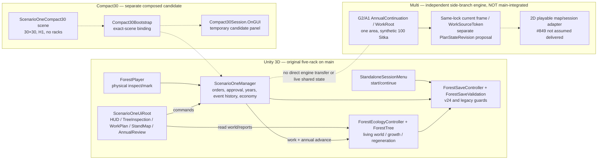
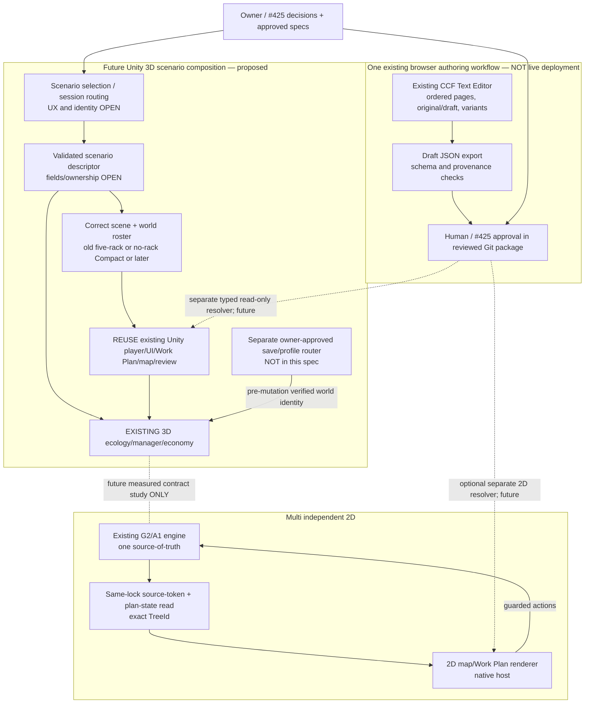

# CCF shared foundation architecture v1 — consolidated technical specification

**Status: DRAFT / NOT APPROVED — SPEC REQUIRED; document authoring only.** Issue [#850](https://github.com/jermur788/CCF/issues/850) · 20 November 2026 · Source inspection base `main@7758e17c882fad01970d2f2fb8c09586bbcab5c1`. This document cannot authorise implementation, new source permissions, changed saves, scene composition, a runtime/Unity claim, a cross-engine merger or a release. Overall Manager [#425](https://github.com/jermur788/CCF/issues/425) and the product owner retain G4/G5 authority; [#844](https://github.com/jermur788/CCF/issues/844) owns 3D delivery and [#730](https://github.com/jermur788/CCF/issues/730) owns Multi's independent 2D delivery. All implementation checks remain unchecked in the companion [requirements](checklists/requirements.md).

## 1. Purpose, evidence order and status vocabulary

**Accepted owner principle (20 Nov 2026):** preserve the **original, mature five-rack Scenario One** as the **Unity/3D foundation** for familiar player movement, management, Work Plan, Stand Map, Annual Review, ecology, economy, UI and compatible save behaviour wherever applicable. New 3D scenarios, including the no-rack Compact30, should use the established systems with genuinely different forest/scene, species, site, management permissions, objectives and content. Preserve the original five-rack world as a playable historical context, not a disposable prototype. The owner also requires the **existing page-sequenced CCF browser Text Editor** to support future scenario authoring. This is owner intent, **not an approved class design**. Sources: [owner-framed overall consultation](https://github.com/jermur788/CCF/blob/Dashboard-shared-ccf-architecture-cross-programme-proposal-20261120-v1/Docs/Handoffs/CCF-Shared-Architecture-Consultation-20261120/Dashboard-CCF-Shared-Architecture-Overall-Proposal-2D-3D-Consultation-20261120.md), [3D source audit and diagrams](https://github.com/jermur788/CCF/blob/Scenario-One-shared-ccf-foundation-architecture-source-audit-20261120-v1/Docs/Handoffs/ScenarioOne-Shared-Foundation-Architecture-20261120/Scenario-One-CCF-Shared-Foundation-Source-Mapped-Architecture-Draft-20261120.md), [#425 owner-editor clarification](https://github.com/jermur788/CCF/issues/425#issuecomment-7026779369).

**Cross-programme correction:** Multi [#730's independent full A–E review](https://github.com/jermur788/CCF/issues/730#issuecomment-7026958964) returns **AGREE WITH CHANGES / DESIGN ONLY**; [3D #844 expressly accepts all five amendments](https://github.com/jermur788/CCF/issues/425#issuecomment-7026998744). The two engines **are not already unified** and should not be conflated. A long-term common forestry-simulation foundation is a direction for later evidence-led decision, not a licence to merge two current engines.

**Authority:** [Decision Log](https://github.com/jermur788/CCF/blob/7758e17c882fad01970d2f2fb8c09586bbcab5c1/Docs/Project/decision-log.md), [Current Milestone](https://github.com/jermur788/CCF/blob/7758e17c882fad01970d2f2fb8c09586bbcab5c1/Docs/Project/current-milestone.md), [Game Brief](https://github.com/jermur788/CCF/blob/7758e17c882fad01970d2f2fb8c09586bbcab5c1/Docs/Project/game-brief.md), [AgentWorkflow](https://github.com/jermur788/CCF/blob/7758e17c882fad01970d2f2fb8c09586bbcab5c1/Docs/Project/AgentWorkflow.md), live read-only [active tasks](https://github.com/jermur788/CCF/blob/main/Docs/Project/coordination/active-tasks.md), inspected GitHub C# at base; Unity Project Overview is secondary. Owner instructions outrank this DRAFT. D-078–D-081 govern eight independent Irish forestry cases, their sequence and species education; D-083–D-085 govern Compact30 first beta; D-059/D-060 preserve three-species parity and full-loop teaching; D-064/D-065/D-071/D-072 remain historical Enlarged80 rack/management contracts. No fresh world/signature/save approval is implied here.

**Status classes used below:** `EXISTS IN MAIN` = directly inspected GitHub source at registered base, **not** runtime-verified today; `EXISTS ON SIDE BRANCH / CANDIDATE` = source outside base; `PROPOSED ONLY` = conceptual boundary/API, not implemented; `DEFERRED` = not required for imminent playable slices and no implementation permission.

## 2. Scope and non-goals

**In scope for this architecture DRAFT:** a truthful mapping of current 3D and Multi source ownership; separation of shared **game semantics** from source binaries; minimal 3D composition/scene-selection and 2D adapter direction; common terminology and content authoring; conditional map portability; historical save/profile constraints; incremental future review/verification gates.

**Out of scope:** writing a new generic `ScenarioManager`, giant refactor, rehoming all `ScenarioOne*` partials, new forestry coefficients, changed calibrated ecology, importing all Unity systems into Multi, deterministic numerical equivalence, a newly granted shared code library, implementation of any profile/scene/save schema, editor runtime text loader, automatic export-to-game changes, construction/survival/Stage 2, Windows build or a merge. Scope here is **documentation only**.

**Minimum product-first objective:** two independent, genuine demonstrations remain higher priority than architecture clean-up: (a) Compact30 entered as its actual authored scene and using the established Unity Work Plan/map/review and causal 3D forestry with no fake racks; (b) Multi 2D one-area actual tree selection to pending/approved/atomic Fell and Year+1. Neither is certified by this spec. Their local source/Unity/physical grants and independent qualification remain separately controlled.

## 3. Current source and boundary diagram — observations versus candidates

Solid arrows show **source-observed** relationships or Multi's source-defined session contract; dashed arrows indicate unintegrated candidate steps. Containers are responsibilities, **not one-class-per-box instructions**.

**Current source qualification boundary:** GitHub confirms [`ScenarioOneUiRoot`](https://github.com/jermur788/CCF/blob/7758e17c882fad01970d2f2fb8c09586bbcab5c1/Assets/ForestPrototype/UI/ScenarioOneUiRoot.cs) composes the view instances and invokes manager APIs; [`ScenarioOneManager`](https://github.com/jermur788/CCF/blob/7758e17c882fad01970d2f2fb8c09586bbcab5c1/Assets/ForestPrototype/ScenarioOne/ScenarioOneManager.cs) is a **partial MonoBehaviour** with existing work/history/economy, not a generic independent library; [`StandMapModel`](https://github.com/jermur788/CCF/blob/7758e17c882fad01970d2f2fb8c09586bbcab5c1/Assets/ForestPrototype/UI/Map/StandMapModel.cs) is Unity-free data but its `MapTree` has no exact `TreeId`; [`ForestSaveData`](https://github.com/jermur788/CCF/blob/7758e17c882fad01970d2f2fb8c09586bbcab5c1/Assets/ForestPrototype/ForestSaveData.cs) declares v24. The **#820 E2** [`Compact30Bootstrap`](https://github.com/jermur788/CCF/blob/8cb22de077b93b4c7af076e19936f3170d6ab48b/Assets/ForestPrototype/ScenarioOne/Compact30/Compact30Bootstrap.cs) exact-scene setup and `Compact30Session` panel are **not in pinned main**. [#836 path/fence visual head](https://github.com/jermur788/CCF/commit/091bb04bb4944336d3a1d8cda98a1b04d73037dc) is divergent from #820 gameplay and not a qualified combined runtime; see [live #844 ownership](https://github.com/jermur788/CCF/issues/844). No current Unity compile, GUI, player or old-save tests are claimed in this chat.

## 4. Responsibility, status and read/write ownership matrix

The rows describe **current or proposed responsibility**, not editable-file grants. No C# compile-link, scene or Unity permission follows.

| Responsibility / observable source | Status at intake | Owner and authoritative data | Reads; authoritative writes |
|---|---|---|---|
| `StandaloneSessionMenu` / startup | **EXISTS IN MAIN** — [source](https://github.com/jermur788/CCF/blob/7758e17c882fad01970d2f2fb8c09586bbcab5c1/Assets/ForestPrototype/UI/StandaloneSessionMenu.cs) | 3D #844; current save/scene | Reads validation/menu; start/continue calls existing loader, **not** an approved multi-scenario selector. On pinned main, the [build list](https://github.com/jermur788/CCF/blob/7758e17c882fad01970d2f2fb8c09586bbcab5c1/ProjectSettings/EditorBuildSettings.asset) contains only `ForestTest`; fresh start [reloads active build index](https://github.com/jermur788/CCF/blob/7758e17c882fad01970d2f2fb8c09586bbcab5c1/Assets/ForestPrototype/UI/StandaloneSessionMenu.cs). Compact entry requires a separately approved route and one-writer serialized ProjectSettings change |
| `ForestPlayer`, tree marking, inspection | **EXISTS IN MAIN** — [source](https://github.com/jermur788/CCF/blob/7758e17c882fad01970d2f2fb8c09586bbcab5c1/Assets/ForestPrototype/ForestPlayer.cs) | 3D; real tree IDs/actions | Reads physical tree/permission; marks through established manager/marking owner |
| `ScenarioOneUiRoot` plus `WorkPlanView`, `StandMapView`, `AnnualReviewView`, `TreeInspectionView` | **EXISTS IN MAIN** — [crosswalk](https://github.com/jermur788/CCF/blob/Scenario-One-shared-ccf-foundation-architecture-source-audit-20261120-v1/Docs/Handoffs/ScenarioOne-Shared-Foundation-Architecture-20261120/Scenario-One-CCF-Shared-Foundation-Source-Mapped-Architecture-Draft-20261120.md) | 3D UI #844; **not** an extra simulator | Read real manager/tree/ecology and history; submit commands to manager; never write an independent ledger/world |
| `ScenarioOneManager`, work orders, economic settlement | **EXISTS IN MAIN** — [source](https://github.com/jermur788/CCF/blob/7758e17c882fad01970d2f2fb8c09586bbcab5c1/Assets/ForestPrototype/ScenarioOne/ScenarioOneManager.cs) | 3D #844; work, inventory, cash, annual events | Reads work/available money/saved state; writes orders, approved execution and recorded outcomes |
| `ForestEcologyController`, `ForestTree`, `TreeSpeciesDefinition` | **EXISTS IN MAIN** — [ecology](https://github.com/jermur788/CCF/blob/7758e17c882fad01970d2f2fb8c09586bbcab5c1/Assets/ForestPrototype/ForestEcologyController.cs) | 3D; authoritative tree/juvenile/site/model version | Reads actual state/parameters; annual ecological transitions write living forest, not the UI |
| `ForestSaveController`/`ForestSaveValidation`/`ForestSaveData` | **EXISTS IN MAIN** — [v24](https://github.com/jermur788/CCF/blob/7758e17c882fad01970d2f2fb8c09586bbcab5c1/Assets/ForestPrototype/ForestSaveData.cs) | 3D; old identity and stored world are protected | Read/validate **before mutation**, then existing restore; write only approved save format/slot in a separately authorised task |
| Five-rack `ForestTest` scene/Rack V2/MFM | **EXISTS IN MAIN** — [scene](https://github.com/jermur788/CCF/blob/7758e17c882fad01970d2f2fb8c09586bbcab5c1/Assets/Scenes/ForestTest.unity) | 3D #844; Enlarged80 historical; Legacy40/Reference preserved | World/rack state within current accepted profile; **no** Compact rack inference |
| Compact30 `Bootstrap`/`Session.OnGUI` | **EXISTS ON SIDE BRANCH / CANDIDATE** — [#820](https://github.com/jermur788/CCF/blob/8cb22de077b93b4c7af076e19936f3170d6ab48b/Assets/ForestPrototype/ScenarioOne/Compact30/Compact30Bootstrap.cs) | 3D #844; **not main, not integrated with #836** | Candidate real scene binding and temporary panel; later route existing UI when lawfully qualified |
| Multi `AnnualContinuation`/`WorkRoot` G2+A1 | **EXISTS ON SIDE BRANCH / CANDIDATE** — [exact A1 commit](https://github.com/jermur788/CCF/commit/4bb809732fb691f15630e1fbc5ea20dca6dbbe2f) | Multi #730; one-area source-owned synthetic stand | Same-lock immutable frame/token, pending→approve→atomic Fell; current source's annual event and growth; **not Unity save/manager** |
| Multi proposed player session and clickable map | **PROPOSED ONLY / #849 separate** — [session source fence](https://github.com/jermur788/CCF/blob/docs/multi-player-session-adapter-contract-20261119-v1/Docs/Handoffs/MultiRack-Simulation-20261116/Multi-Player-Session-Adapter-Source-Fenced-Contract-20261119.md) | Multi #730; G2/A1 root and ledger stay sole truth | Atomic one-lock read of source token, exact ID, pending, approvals, events; commands validate current state; no map-owned world |
| Shared 3D scenario selection/descriptor/binding seam | **PROPOSED ONLY** | Owner/#425 product; 3D #844 source; future file owner **TBD** | Validate world/scene/allowed actions before mutation; bind existing UI/manager/ecology; no invented class, field or save ID |
| Existing CCF browser editor | **EXISTS ON SIDE BRANCH / CANDIDATE** — [#487 README](https://github.com/jermur788/CCF/blob/feature/ccf-text-editor-treemarks-n01-20261114-v1/Tools/ContentReview/README.md) | Current separate content-review prototype; source-catalogue authoring, not runtime | Browser edits static text/draft JSON in memory/export; **no** save or live game write; #492 independent delta review pending |
| Approved-package validation and typed platform resolver | **PROPOSED ONLY** — existing [DRAFT text spec](https://github.com/jermur788/CCF/blob/feature/ccf-text-editor-treemarks-n01-20261114-v1/specs/ccf-cross-scenario-text-editor-v1/spec.md) | Owner/#425 content approval; later Unity/Multi owners separately | Read reviewed Git-versioned catalogue; typed resolver returns display text only; failure/refusal/fallback per approved policy; **no** command or gameplay write |
| Common underlying 2D/3D engine, shared save/binary | **DEFERRED** | Owner G5/#425 G4 and independent reviewers | Evidence-driven parity evaluation first; **no production dependency or cross-engine data mutation** |

**Known world/rack coupling in the existing 3D UI — source fact, not a new grant:** [`ScenarioOneUiRoot.cs`](https://github.com/jermur788/CCF/blob/7758e17c882fad01970d2f2fb8c09586bbcab5c1/Assets/ForestPrototype/UI/ScenarioOneUiRoot.cs) constructs `RackLayoutTracker` and `StandMapSource` unconditionally (around L103–105), and when a manager exists creates `RackTool`, `PlannedFellMarkers` and a rack-confirmed subscription (L106–112). Rack-aware help contexts (around L395–401) also remain. The existing `ScenarioOneRackLayout.AppliesTo(ecology.StandGeometryModelVersion)` update guard (around L255) is **partial**, not proof that composition is no-rack-safe. [`StandMapSource.cs`](https://github.com/jermur788/CCF/blob/7758e17c882fad01970d2f2fb8c09586bbcab5c1/Assets/ForestPrototype/UI/Map/StandMapSource.cs) scans scene `ForestTree` objects and named path planks plus `GameObject.Find("Forest Clearing")` (around L202/L348–369). [#820 Compact candidate](https://github.com/jermur788/CCF/blob/8cb22de077b93b4c7af076e19936f3170d6ab48b/Assets/ForestPrototype/ScenarioOne/Compact30/Compact30Bootstrap.cs) binds a manager but uses a temporary `Compact30Session.OnGUI`, **not** the established `ScenarioOneUiRoot` as a verified player UI. The **proposed minimum seam** is explicit validated capability gating at shared UI-root/rack-tool and map-source composition, followed by exact no-rack and historical positive tests; no class is mandated by this observation. [Independent review F-3](https://github.com/jermur788/CCF/issues/854#issuecomment-7028083636).

**Data consistency:** a view can cache a *read-only* rendering projection, but may never create a second authoritative tree inventory, event history, price ledger or work approval. In 3D, authoritative commands remain in established game components; in Multi, every command remains on its source-root guard. Per-scenario absence (racks, cost quotes, G1) must be honestly absent/disabled, not a zero-valued fiction.

## 5. Intended incremental composition — PROPOSED ONLY

This second diagram shows **possible responsibilities after separately approved feature packets**, not present runtime classes or authorised dependencies. Dashed cross-platform link is a research interface only.

A future 3D descriptor should define **only approved variable inputs** (scene/world, roster/species, physical bounds, model/site, lessons/objectives, allowed work and validated content association), explicitly separate optional features from missing data and refuse invalid or wrong-world entry **before** any world alteration. **Do not assign actual descriptor fields, scene registry, type names, ScriptableObjects, profile IDs, default routes or save slots until owner/#425 decision and source inspection.** No assumption that scene-swapping alone is sufficient. `ScenarioOne*` class names are not a refactoring emergency. Preserve existing composite behaviour first; extract narrowly only for proven duplication or incompatible responsibilities.

### 5.1 Shared foundation vs copyable blank starter — owner proposal, OPEN

**Two-level direction, not implemented:** maintain **one** shared Unity/3D source implementation for existing UI, manager, ecology, economy and save logic; when starting a new scenario, copy or compose only its **scenario-specific scene, configuration and authoring/text assets**, referencing common code rather than duplicating it. The exact scene-copy versus prefab/composition technique remains an owner/Overall and source-owner choice. [Owner discussion / #850 record](https://github.com/jermur788/CCF/issues/850#issuecomment-7027226499).

A **flat, empty 30 × 30 m ground** is a proposed authoring-preview *starter default* with configurable dimensions, not a mandatory footprint, not the signed Compact30 forest, and not Multi's independent 30 × 30 m 100-Sitka fixture. The starter has player spawn/controls and appropriately connected UI but **no invented trees, paths, works, objectives or forestry results**. Its Stand Map shows only true empty bounds, Work Plan truthfully says there are **no eligible operations**, and Annual Review shows **no fabricated year or outcome**. A rendered empty shell proves UI preview, **not a playable forestry scenario**. Shared labels are real; scenario-specific text uses dev-only placeholders and required-copy validation (§8). Current code may need corrections to achieve these conditions.

## 6. 3D Unity user flow and safety invariants

1. **Existing base:** familiar title and controls, walking, tree inspection/marks, Stand Map, Work Plan approval, annual advance, actual economy/ecology, Annual Review and history. Same existing systems should be retained where applicable, rather than an independent Compact management HUD.
2. **New Compact scene, different content:** 30×30 m no-internal-rack world, pre-existing H1 clearing (not player Fell/revenue), pedestrian footpath, 2 Oak + 2 Beech exact placed Pending→Approved→Completed orders, visible €12,000 starting funds and actual costs, later substantive adaptive management and review. D-083–D-085 describe **owner intent**, while world/signature, route/guard, combined scene+source, saved profile and full player qualification remain gated. No historical five-rack rack lesson or MFM obligation is inserted into the new no-rack world.
3. **Work Plan gate:** spatial decision → exact pending order → inspected quoted/available work → player approval → actual resolution → annual ecology/economy event → Annual Review. No display-only faux felling, backdated event, income from pre-world omissions or unsupported automatic successful recruitment. The earlier D-084 W-A decision blocks direct changes to approved orders and requires cancel/reapproval on a new order; this remains a feature-spec/verification gate, **not shown as implemented** by this document.
4. **No-rack negative witness:** entry into Compact30 must not show rack-geometry editor, five-rack instructions, rack marks, fake extraction roads or use rack-specific saved keys; correct map bounds, north-up geometry, planting selection and report must derive from the real Compact world.
5. **Historical regression:** re-enter old `ForestTest`/Enlarged80, Rack V2/MFM, Legacy40 and frozen Reference Future v1 without changing their exact approved identities, saves, calibration, deterministic anchors or UI requirements; reject a wrong-world or invalid save **before state mutation**. No silent historical world conversion. The existing signed three-profile save direction and O2 pre-mutation safety (D-079/D-081) **do not certify router implementation**.
6. **Current practical blocker:** #820 candidate's native 71/71 targeted checks opened exact Compact scene; they do **not** prove default start/title routing or a fused #836 visual/gameplay runtime. A source writer and locked single Unity Editor qualification are necessary later. Nothing here changes or pauses #844's player-test task.

### 6.7 Interim historical save fence — safety requirement, not final save policy

On pinned main, [`ForestSaveController.cs`](https://github.com/jermur788/CCF/blob/7758e17c882fad01970d2f2fb8c09586bbcab5c1/Assets/ForestPrototype/ForestSaveController.cs) writes one `Application.persistentDataPath/forest-save.json`, and [`StandaloneSessionMenu.cs`](https://github.com/jermur788/CCF/blob/7758e17c882fad01970d2f2fb8c09586bbcab5c1/Assets/ForestPrototype/UI/StandaloneSessionMenu.cs) exposes Save/Load plus F5/F9 shortcuts. **Until an independently approved, implemented and qualified scenario-specific profile/world router exists, any nonhistorical scene (including Compact30) must disable/refuse all Save, Load and Continue-from-file operations targeting this historical file, including keyboard and UI paths; it must neither read nor write it.** An interim Compact demonstration may mutate **in-session memory only**, with explicit unsaved-session UX; it must not claim persistence or overwrite historical files. This safeguard does **not** select future filenames, schema, migration, default profile, auto-switch behaviour or permitted final Continue policy. Historical `ForestTest` original save behaviour stays intact; verify bytes unchanged after a Compact session and reject wrong-world loads pre-mutation. Owner G5 and separate T3 approval remain OPEN.

### Same human concepts, independent platform command timings

In the original Unity/3D flow, Work Plan approval is followed by **annual advance**, when approved work and ecology resolve through manager-owned results. In current Multi source, approval precedes **explicit atomic Execute/Fell**, then Year+1. The UI may use consistent terms for *pending*, *approved*, *executed* and *reviewed*, but must not pretend these timings or event schemas match byte-for-byte. See [Multi source contract](https://github.com/jermur788/CCF/blob/docs/multi-player-session-adapter-contract-20261119-v1/Docs/Handoffs/MultiRack-Simulation-20261116/Multi-Player-Session-Adapter-Source-Fenced-Contract-20261119.md). 

## 7. Multi 2D invariants and conditional map reuse

**Authoritative existing scope:** a **single undivided 30×30 m source-derived synthetic fixture with 100 Sitka trees**, not a five-rack forest, second authoritative inventory, area-wide simulated history or multi-rack equivalence. Multi's exact tree IDs are **case-sensitive**; UI must select a tree from the same **atomic immutable read frame** as the source token/current work and event state. Proposed ephemeral `PlanStateRevision` guards edits/approvals that do not change the engine's existing `WorkRevision`; no silent change to `WorkSourceToken` or persisted annual snapshot. Work commands must be fenced to current session/source, and approved work executes exactly once before Year+1. A stale frame, wrong-cased ID, missing/dead tree, duplicate Fell, all-living-stems Fell, invalid plan or wrong session must refuse safely with no partial state/event/clock mutation. Exact detailed adapter design **remains proposed** until separately approved and qualified.

**Status honesty:** optional G1 comparator `DISABLED — Manual/NotCovered`; economics `UNAVAILABLE` (not `€0`); do not claim Multi has five racks, a validated Irish forecast, wildlife, a visualised 3D walk, source parity with Scenario One, or verified multi-area economics.

**Map portability gate:** [Multi reuse assessment](https://github.com/jermur788/CCF/blob/docs/Multi-StandMap-Reuse-Assessment-20261120-v1/Docs/Handoffs/MultiRack-Simulation-20261116/Multi-ScenarioOne-StandMap-Reuse-Fit-Assessment-20261120.md) finds useful world-X/Z metres, north-up [`StandMapTransform`](https://github.com/jermur788/CCF/blob/7758e17c882fad01970d2f2fb8c09586bbcab5c1/Assets/ForestPrototype/UI/Map/StandMapTransform.cs), plain [`StandMapModel`](https://github.com/jermur788/CCF/blob/7758e17c882fad01970d2f2fb8c09586bbcab5c1/Assets/ForestPrototype/UI/Map/StandMapModel.cs), [`StandMapCanopyRaster`](https://github.com/jermur788/CCF/blob/7758e17c882fad01970d2f2fb8c09586bbcab5c1/Assets/ForestPrototype/UI/Map/StandMapCanopyRaster.cs), [`StandMapDrawPlan`](https://github.com/jermur788/CCF/blob/7758e17c882fad01970d2f2fb8c09586bbcab5c1/Assets/ForestPrototype/UI/Map/StandMapDrawPlan.cs) and legend/symbol principles. These are **candidates for a separate dependency closure**, not existing Multi imports. `MapTree` **does not contain a selectable `TreeId`**; simply drawing its seed/position does not safely identify a live source tree. `StandMapSource` scans Unity scene objects, and canvases use UI Toolkit: **do not copy them into standalone Multi unchanged**. Direct reuse requires exact file/blob versions, complete transitive compile-linked closure, explicit new V-01 3D source-owner authorisation (the previous two growth/random blobs are unrelated to map), a source-fenced adapter, independent review and platform compile/runtime tests. If unsuitable, a minimal native 2D renderer based on common cartographic semantics is legitimate, with reason recorded. No speculative 16–20 m rack teaching or five-rack geometry in Multi's one-area screen.

## 8. Shared browser content catalogue, provenance and placeholder policy

**Reuse, do not duplicate:** [existing CCF Text Editor README](https://github.com/jermur788/CCF/blob/feature/ccf-text-editor-treemarks-n01-20261114-v1/Tools/ContentReview/README.md) and its [four-file DRAFT text-editor spec](https://github.com/jermur788/CCF/blob/feature/ccf-text-editor-treemarks-n01-20261114-v1/specs/ccf-cross-scenario-text-editor-v1/spec.md). The latest #487 branch inventories **79 pages / 278 field records** (277 editable, 1 derived preview; 3 explicitly unmerged candidates), predominantly original Scenario One source. This is **not a census of all player-visible strings** or proof Compact/O2–O8 content exists. #480 approved an earlier standalone browser-use version; #487 Tree Marks repair's separate [#492](https://github.com/jermur788/CCF/issues/492) independent review is pending on cited evidence. Browser editor exports a **draft JSON**, not Unity/2D runtime content or automatic Git writes. Its own DRAFT must stay separate, without a second editor implementation.

**Two distinct content classes:**
- **Shared permanent labels:** `Work Plan`, `Stand Map`, `Annual Review`, `Objectives`, `Approve Plan` and, where appropriate, `Execute`. They have common meaning but are **not** new gameplay keys or a requirement for pixel-identical controls. Avoid a 3D-only label when Multi intentionally has no corresponding operation.
- **Scenario/variant-specific static copy:** propose content IDs such as `ccf.scenario.o1.introduction`, `ccf.scenario.o1.objective.primary`, `ccf.scenario.o1.site-guidance`, and `ccf.scenario.o1.rack-lesson`. These are **candidate stable authoring IDs, not published schema changes or current keys**; actual IDs and conditional variants must be reconciled with the existing catalogue. Every field needs page/section order, original text, source path/blob/line or reviewed origin, condition/variant, required/optional status, immutable non-text metadata and editable plain-text copy. Preserve protected lesson IDs and source-fenced variants for Legacy40, Enlarged80 rack, Compact no-rack and later independent cases.

**Development placeholder:** show e.g. `[SCENARIO INTRODUCTION]`, `[OBJECTIVE DESCRIPTION]`, `[SITE-SPECIFIC GUIDANCE]` conspicuously in **authoring/development preview only**, with missing-required validation and a clear `UNAUTHORED` status. Such brackets are **not** suitable shipped user text. Required missing copy should block the related content release or trigger an explicit reviewed safe fallback only where one is authorised; do not claim that shipping absent text is solved by showing a nice placeholder.

**Dynamic values are never authored facts:** tree count/ID/DBH, year, forestry state, inventory, cash, quoted costs, G1 availability, valid work outcomes, Annual Review results, actual completion and ecology remain generated by the active authoritative engine. `{{year}}` and similar typed tokens are *template references only*, require approved allowlisted resolvers, immutable ordered/repeated token signature validation, correct unit/locale formatting and missing-value refusal rather than invented numbers. No runtime evaluation of arbitrary JSON property paths, scripts, HTML, reordering of gameplay keys or mutating source-of-truth state.

**Possible future delivery (PROPOSED):** existing browser editor → validated export → reviewed, versioned Git package with explicit content approval → **separately implemented typed read-only Unity resolver** into current views → optional independent Multi 2D resolver. Preserve exact original-source fallback for old worlds when approved; select conditions from **verified current world facts**, not display substrings/unknown save keys. Audit remaining literal and generated-text coverage, check 720p/1080p layout, actual old/Compact/2D variants and missing/invalid/token-mismatch negatives. Export never hot-reloads the player game. Text work is not a prerequisite to #849 or immediate Compact core-entry demonstration.

## 9. Adoption and decision matrix — Overall proposal and Multi A–E

Each judgement below is **classification for DRAFT synthesis**, not author approval. `ACCEPTED OWNER PRINCIPLE` marks only the user-approved direction; `ADOPT AS DRAFT PROPOSAL` still requires formal approval for production.

| Source item | Proposed disposition | Grounding and disposition in this spec |
|---|---|---|
| Overall §1: five-rack as Unity shared baseline | **ACCEPTED OWNER PRINCIPLE** | Owner statement in [overall proposal](https://github.com/jermur788/CCF/blob/Dashboard-shared-ccf-architecture-cross-programme-proposal-20261120-v1/Docs/Handoffs/CCF-Shared-Architecture-Consultation-20261120/Dashboard-CCF-Shared-Architecture-Overall-Proposal-2D-3D-Consultation-20261120.md); §§2–6 |
| Overall §2: same relevant concepts, per-scenario forest/rules | **ACCEPTED OWNER PRINCIPLE** for Unity; **ADOPT AS DRAFT PROPOSAL** for exact descriptor/interface | §§4–6; D-078–D-085; no agreed class/schema |
| Overall §2: Multi inherits common concept but not Unity host | **ADOPT AS DRAFT PROPOSAL** | §§3–4,7; Multi [A/C](https://github.com/jermur788/CCF/issues/730#issuecomment-7026958964) |
| Overall §2: map math/presentation reuse | **ADOPT AS DRAFT PROPOSAL** conditional on exact scope/permission | §§4,7; Multi B; not source grant |
| Overall §2: shared saves, compatible world identity | **NEEDS OWNER DECISION** | §§6,10; D-079/D-081 pre-mutation; no new slot names |
| Overall §3: shared label/content slots/editor | **ACCEPTED OWNER PRINCIPLE** for one authoring experience; **ADOPT AS DRAFT PROPOSAL** for ID/resolver/fallback | §8; existing #473 and DRAFT text spec |
| Overall §4 A / Multi A: adopt terminology & honest status | **ADOPT AS DRAFT PROPOSAL** across platforms | §§6–8; compatible semantics, not identical UI |
| Overall §4 B / Multi B: source portability | **ADOPT AS DRAFT PROPOSAL** after V-01 transitive map closure | §7; `MapTree.TreeId` absent; `StandMapSource` Unity-bound |
| Overall §4 C / Multi C: independent source truth now | **ADOPT AS DRAFT PROPOSAL** (source-owned invariant) | §§3,7; no Multi-to-Unity engine migration |
| Overall §4 C / Multi C: eventual one common engine | **DEFERRED**; future G5/G4 + measured oracle | §§2,10–11 |
| Overall §4 D / Multi D: one browser authoring and conditional copy | **ADOPT AS DRAFT PROPOSAL** | §8; #487/#492 unresolved, dynamic data excluded |
| Overall §4 E / Multi E: protect small playable work | **ACCEPTED OWNER PRINCIPLE** (current priorities), practical non-blocking plan | §§2,6–7; #849 and Compact continue |
| Overall §5: scenario selector UX & full auto-switch | **NEEDS OWNER DECISION** | §§5,10 |
| Overall §5: pixel-identical 2D/3D interface | **NEEDS OWNER DECISION** only if materially sought; semantic consistency recommended | §§5,7,10 |
| 3D #844 explicit assent to Multi five amendments | **ADOPT AS DRAFT PROPOSAL** | [response](https://github.com/jermur788/CCF/issues/425#issuecomment-7026998744); incorporated §§3–8 without approval claim |

## 10. OPEN — owner / Overall #425 decisions and mandatory gates

1. **G5 scenario selection and session return:** choose explicit new-game scenario picker/availability versus staged unlock; old-session Continue route, scene choice and error screen. No automatic save-world switching is accepted merely because eight cases exist.
2. **G4/G5 3D composition contract:** exact descriptor fields, source owner, content/version/condition handling, typed data vs scene references, capability gating and fallback/refusal, when a UI-dependent `ScenarioOne*` name is retained versus extracted. Only authorised inspected source can decide.
3. **G5 save/profile/world identity:** signed three-profile and O2 safety scope, old `forest-save.json` placement, new slots, v1–v24 migration/old load and wrong-world pre-mutation checks, model version and identity. This **requires its own APPROVED SPEC REQUIRED** work, independent review, regression; do not invent field names/slot numbers.
4. **G4 Compact adoption point:** when and how to route the #820 exact-scene bootstrap through established menu/UI without duplicating/prematurely deleting `Compact30Session.OnGUI`; reconcile diverged #836 art and any floor/scene ownership, physical Unity lease and source grants independently. No architecture-first freeze.
5. **G4/G5 content policy:** authoritative reviewer and package approval format, final content IDs/schema, page/variant rules, required versus optional fallback, dynamic typed formatter contract and deployment timing; independent #492 and full text census/720p/1080p tests before shipping; existing editor DRAFT remains distinct.
6. **G4 Multi map ownership:** new V-01 source-owner grant naming *complete transitive files*, exact map projection/ID adapter, independent same-lock snapshot and UI selection; no old V-01 consent assumption. Dedicated #849 author/reviewer controls production.
7. **G5 cross-engine goals:** whether concept-level equivalence suffices indefinitely or a measured shared-engine compatibility study warrants future work. Any real unification requires explicit state units/precision/tree identity/event/RNG/year/hash oracle, product benefit/cost estimate, independent reviewer, new approved spec and later individual file/source grants.
8. **D-032 assets/policy and release:** scene assets, source rights and exact shipped UX still separately gated, especially current Compact world/route/guard/signature. No Windows build before exact owner Editor playtest and subsequent explicit approval.

9. **G5 blank scenario starter form and footprint:** decide when/if the proposed copyable empty scene/config/text starter becomes a standard authoring asset, whether a scene copy or prefab/composition pattern is appropriate, and the configurable default footprint. The 30 × 30 m flat preview is **not** the Compact30 signed world or Multi fixture; no implementation/source/save authority follows from this OPEN proposal. [Owner clarification](https://github.com/jermur788/CCF/issues/850#issuecomment-7027226499).

**If authority conflicts:** preserve latest direct owner/Decision Log and stop only the conflicting proposed action; return to #425 rather than silently resolving. No open question above is answered by this document.

## 11. Measurable future acceptance and negative witnesses — NOT PERFORMED

- **3D actual-world entry:** from permitted start, load exact Compact scene or old five-rack scene and inspect scene identity/world bounds/real tree roster; show established UI and correct allowed operations. In Compact no rack UI or phantom rack marks; in Enlarged80, existing Rack V2 remains usable. Reject missing/mismatched scene/roster before changes.
- **3D causal loop:** exact player tree/planting choices create pending orders; approval, quote, annual work/event, real ecology/economy outcome and Annual Review agree; repeated later act/no-work choices support complete-loop teaching. No independent fake cash, tree count or review.
- **Multi actual-clickable loop:** select source exact-case tree on 30×30 one-area map; add pending from one current immutable snapshot; approve whole plan; atomic Fell once; move Year+1; observe actual source frame/events. Reject stale token/plan revision, wrong-case/removed/dead IDs, no-living-stems operation and disabled G1/unavailable economics without mutation.
- **Old-world/save safety:** wrong-world, corrupt/unknown versions and cross-profile loads refuse pre-mutation; accepted old saves and frozen Reference Future retain identity/anchors and load/preview per their contracts; no hidden migration or new default.
- **Content:** approved content package only, distinct scenario/conditional text, protected IDs, typed placeholders with exact token sequence and real values; safe fallback/refusal of missing/invalid text; unapproved bracket placeholders never reach shipping. Verify browser editor import/export and actual Unity/2D 720p/1080p only when relevant authorised workers run tests.
- **Source & performance:** map read-model bound to one world frame and exact selection identity; complete compile-linked map closure/permissions before code reuse; renderer performs acceptably at real target scale; no speculative extrapolation to 100k–1m trees.
- **Provenance and state claims:** do not label a DRAFT diagram, 71/71 standalone candidate, browser text JSON, code compile or source readback as a finished cross-programme implementation, integrated game, owner acceptance or rendered player test.

Detailed unchecked IDs, planned methods and reviewer evidence in [requirements](checklists/requirements.md). **All tests for this architecture document: documentation/GitHub inspection only; Unity/C#/Node/browser editor/game execution NOT RUN.**

## 12. Required approval path

Independent nonauthor architectural review first (3D #844 / Multi #730 review their boundaries without becoming spec author), Overall #425 reconciles trade-offs and source/ownership gates, product owner approves material G5 decisions, and only then may authorised workers implement accepted bounded tasks under the project's SPEC REQUIRED, physical/Unity, file-scope, review, integration and verification workflow. Prefer smallest playable feature, then contract extraction only when evidence warrants it. No tasks in [tasks.md](tasks.md) are RUNNING or implementation-authorised by this DRAFT.
