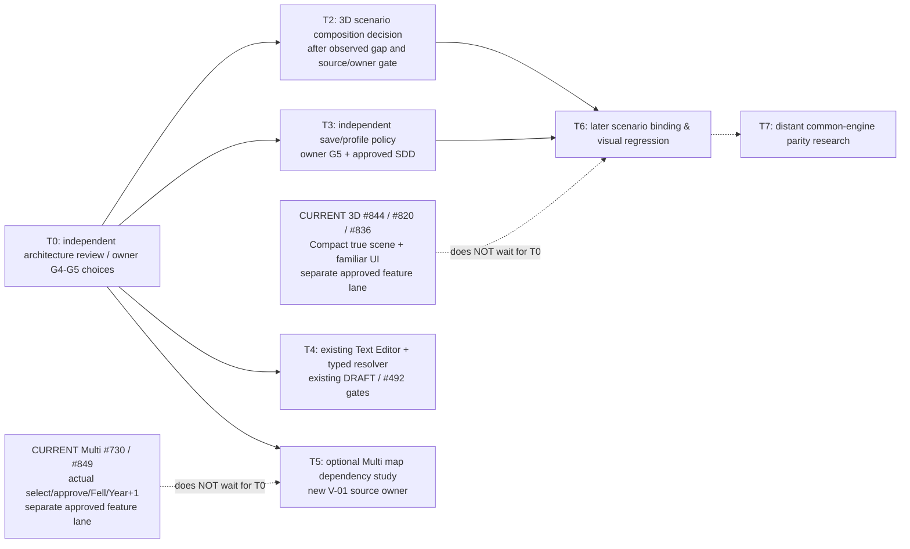

# CCF shared foundation architecture v1 — future task candidates

**Status: DRAFT / NOT APPROVED.** These are **potential** packets for [#425](https://github.com/jermur788/CCF/issues/425) and owner review, not dispatched tasks. **Every row is UNASSIGNED / NOT RUNNING; no path grants or locks.** Actual implementation must follow separately approved [spec.md](spec.md) and [plan.md](plan.md), [AgentWorkflow](https://github.com/jermur788/CCF/blob/main/Docs/Project/AgentWorkflow.md), live [active-tasks](https://github.com/jermur788/CCF/blob/main/Docs/Project/coordination/active-tasks.md), explicit single-writer file scope and required physical/Unity custody. One primary writer per file set. Source reference at task-authoring start: `main@7758e17c882fad01970d2f2fb8c09586bbcab5c1`; **must refresh** before any later dispatch.

## 1. Priority and prerequisite map

**Do not schedule architecture as a blocker:** the two active-priority feature streams, 3D Compact owner-accessible startup and Multi #849, retain their **own earlier approved/held packet and source/physical claims**. They are listed for context, not reassigned or duplicated in this file. Every future unit below needs a new exact base, status, writer, lane, allowed paths, exclusions, test gates and documented manager approval. `Docs/Project/coordination/active-tasks.md` is live-owned outside #850 and **must not be edited through this task**.

## 2. Candidate packet register

| ID / status | Task class & minimum outcome | Prospective owner, execution, permissions **not granted** | Gate / no-go |
|---|---|---|---|
| **T0 — NOT RUNNING** | **SPEC REQUIRED design review**, independent nonauthor review of these four files, diagrams, decision matrix and source citations | Overall #425 adjudication with separate #844 (3D) and #730 (Multi) input; browser/GitHub **review only**; any canonical decision writes separately scoped | Owner G5 choices not decided by #850; DRAFT cannot implement itself |
| **T1-3D — EXISTING WORKSTREAM, NOT dispatched here** | Correct exact Compact scene entry through established Unity UI and genuine Work Plan/Annual Review; no-rack witness and old `ForestTest` regression | #844 existing #820/#836/scene/lawful Unity branches; **source/scene write grants from actual manager**, Sol/Code/Unity if authorised | Need real scene/signature/owner world and combined candidate; no duplicate worker, no Windows |
| **T1-2D — EXISTING WORKSTREAM, NOT dispatched here** | Multi [#849](https://github.com/jermur788/CCF/issues/849) one-area real selectable 2D tree → pending → approve → atomic Fell → Year+1 | Multi #730 existing source and reviewer/lane; T3/native Code if accepted; **no new grant or scheduling** | Preserve source fence, exact ID/one-lock snapshot, G1/economics honesty |
| **T2 — NOT RUNNING** | New 3D scenario-selection / scene binding **contract** after comparing current five-rack and Compact real entry; smallest necessary UI/scene seam | #425 G4 + #844; first GitHub/browser read-only design, then separate approved C#/Unity worker; **file set TBD after inspect** (likely menu/scene-binding vicinity), not automatically all UI | Owner decides start/Continue/new-game semantics. No actual save route unless T3 separately approved |
| **T3 — NOT RUNNING** | Cross-scenario 3D **save/identity** SPEC REQUIRED policy and implementation tasks, preserving old/world and O2 independently | Owner G5 and #425 G4; separate save-spec author/reviewer; only later single Sol/Code/Unity writer, exact controller/data/validation paths **TBD** | Reject wrong world before mutation; keep `forest-save.json`, v1–v24, Legacy40/Enlarged80, Reference v1 and deterministic archives. No field/slot chosen in this DRAFT |
| **T4 — NOT RUNNING** | Expand **existing** CCF Text Editor coverage and later selected typed read-only Unity/optional Multi runtime resolver | Browser content-tool source owner + #425/owner copy review; new content import/resolver file scope **TBD**, no duplicate editor. [Existing DRAFT](https://github.com/jermur788/CCF/blob/feature/ccf-text-editor-treemarks-n01-20261114-v1/specs/ccf-cross-scenario-text-editor-v1/spec.md) must be reconciled first | #487/[#492](https://github.com/jermur788/CCF/issues/492) review and catalogue completeness; no draft JSON → live game auto-write, no preview placeholder shipping |
| **T5 — NOT RUNNING** | **Read-only** study of Multi map borrowing versus standalone draw adapter: exact ID, source-root projection, transitive closure, version/ownership | Multi #730 + original map source owner under #844; browser inspection initially; later C#/2D write only after actual new V-01 and packet. Candidate read paths `Assets/ForestPrototype/UI/Map/StandMap{Transform,Model,CanopyRaster,DrawPlan,Source}.cs`; **read references, NOT allowed writes/imports** | `MapTree.TreeId` absent, `StandMapSource` scene bound, UI Toolkit incompatible; old two-growth/random-file V-01 not sufficient; preserve #849 lane |
| **T6 — NOT RUNNING** | First **second independent 3D** context binding using genuinely common UI/work/ecology and conditional feature hiding; historical regression | #844 future 3D delivery after T2/T3 owner decisions and approved specs; exact scene/asset/script/UIDocument/serializer path grants TBD; local Unity one-lock required | No fake scenario, new unready species or automatic new saved identity; no modification to five-rack or frozen/reference anchors |
| **T7 — DEFERRED / NOT RUNNING** | Research-only comparative read oracle: common tree IDs/state, X/Z, metres/cm/ha, f32/f64, year/event order, RNG/hash, work/economy and save identity; report whether sharing a binary could be justified | Owner G5/#425 G4 separate SPEC REQUIRED research gate; independent 3D/Multi readers and reviewer; no Unity/code changes unless separately approved | Stop on unsupported parity. Never replace the currently authoritative Multi or Unity engine on architecture assertion |

**Approval meanings:** T0's **independent nonauthor reviewer** may return `APPROVED` / `NEEDS CHANGES` / `REJECTED` **for document/design quality only**; only Overall #425 (G4) and the owner (G5) may adopt that verdict or promote the specification. A reviewer verdict alone does not authorise implementation, and no implementation author may infer approval from this DRAFT. T1 current streams remain subject to their existing source/physical guards regardless of this document.

## 3. Packet detail and acceptance outline

### T0. Independent architecture review — first new action

**Goal:** give #425 a short, source-backed choice between minimal 3D scene-binding improvement, content catalogue work and longer-term shared contracts, without overruling #730/#844. **Allowed if assigned:** review these **four new spec Markdown files**, source branch evidence and current owner/manager comments. **Excluded:** source/edit/locks/merges/approving production from review alone. **Checks:** (i) every Multi A–E correction in spec adoption matrix; (ii) all 3D/Multi statuses and diagrams accurate; (iii) D-083–D-085 Compact and D-078–D-081 independent-scenario compatibility; (iv) current #849 and 3D priorities unaffected; (v) OPEN list complete; **(vi) the owner blank starter/shared-source clarification (#850 comment 7027226499) is explicitly represented**. **Handoff:** independent **APPROVED / NEEDS CHANGES / REJECTED for architecture design quality**, then owner G5 separately. No automatic authority promotion.

### T2. Minimal Unity scene/UI reuse contract

**Goal:** the **right world**, **same existing UI and real state**, **no rack leaks**. **Before authorisation:** exact main+candidate code and scene/binary versions, current on-host Unity lease, branch/actor/file ownership, approved feature spec and owner answer on entry UX. **Candidate read references:** [`StandaloneSessionMenu`](https://github.com/jermur788/CCF/blob/7758e17c882fad01970d2f2fb8c09586bbcab5c1/Assets/ForestPrototype/UI/StandaloneSessionMenu.cs), [`ScenarioOneUiRoot`](https://github.com/jermur788/CCF/blob/7758e17c882fad01970d2f2fb8c09586bbcab5c1/Assets/ForestPrototype/UI/ScenarioOneUiRoot.cs), [`StandMapSource.cs`](https://github.com/jermur788/CCF/blob/7758e17c882fad01970d2f2fb8c09586bbcab5c1/Assets/ForestPrototype/UI/Map/StandMapSource.cs), [`MenuHelpView.cs`](https://github.com/jermur788/CCF/blob/7758e17c882fad01970d2f2fb8c09586bbcab5c1/Assets/ForestPrototype/UI/MenuHelpView.cs), existing `ScenarioOneManager` rack-related partials (read-only discovery required), [`EditorBuildSettings.asset`](https://github.com/jermur788/CCF/blob/7758e17c882fad01970d2f2fb8c09586bbcab5c1/ProjectSettings/EditorBuildSettings.asset) (**one serialized ProjectSettings writer later**), [`Compact30Bootstrap`](https://github.com/jermur788/CCF/blob/8cb22de077b93b4c7af076e19936f3170d6ab48b/Assets/ForestPrototype/ScenarioOne/Compact30/Compact30Bootstrap.cs), historical `ForestTest`. No one owns these files by virtue of appearing here. **Exclusions:** alternative ecology, speculative extra menu, new serializer. **Witness:** actual start opens selected valid scene, correct versioned state, existing `WorkPlanView` and `StandMapView`; invalid scene/roster fails closed; old world still works and does not inherit Compact content. **Stop:** if save identity or world routing cannot be resolved without T3.

### T3. Save/profile/world identity policy — distinct cross-system SDD

**Goal:** keep independent scenario forests independently loadable without ever mutating the wrong one. Define which owner-accepted signed policy actually applies; **do not make up** a saved `scenarioId` property, new file path, automatic migration or profile switch. **Candidate read references:** [v24 `ForestSaveData`](https://github.com/jermur788/CCF/blob/7758e17c882fad01970d2f2fb8c09586bbcab5c1/Assets/ForestPrototype/ForestSaveData.cs), `ForestSaveController`, `ForestSaveValidation`, D-079/D-081/D-083, frozen Reference archive. **Exclusions:** implementation until new independent approved four-file spec. **Acceptance:** accepted historical saves and Reference preview untouched, refusal before mutation of wrong-world/unknown/corrupt input, separate old/new slot behavior, no key/anchor/seed regressions; independent reviewer and exact native/targeted save tests. **Stop:** owner G5 policy not decided.

### T4. One authored text workflow, not second editor

**Goal:** page-by-page external editing of shared labels and per-scenario static copy, then safely reviewed production copy later. **Candidate read references:** [latest README](https://github.com/jermur788/CCF/blob/feature/ccf-text-editor-treemarks-n01-20261114-v1/Tools/ContentReview/README.md) and [existing cross-scenario DRAFT](https://github.com/jermur788/CCF/blob/feature/ccf-text-editor-treemarks-n01-20261114-v1/specs/ccf-cross-scenario-text-editor-v1/spec.md). **Scope after separate grant:** audit missing strings (79/278 not exhaustive); owner reviews stable text IDs, variants, requiredness, provenance, exact ordered typed tokens, original fallback; versioned Git approval; later **read-only typed** renderer call sites. **Exclusions:** player state keys, `PlayerPrefs`, text replacing dynamic figures, auto text-to-C# rewrites. **Acceptance:** invalid token/variant/import rejects, missing required copy not shipped, 720p/1080p/old scene, no-rack copy isolation, real engine numbers. **Stop:** #492 or owner content schema/fallback unresolved.

### T5. Map/UI source portability risk study

**Goal:** decide actual minimum safe 2D map implementation after source audit, avoiding unbounded direct Unity source link. **Candidate source closure to inspect, not alter:** `StandMapModel.cs`, `StandMapTransform.cs`, `StandMapCanopyRaster.cs`, `StandMapDrawPlan.cs`, `StandMapSource.cs`, canvas/surface/UI Toolkit dependency chain and all transitive C# definitions. **Required separate grants:** 3D owner exact V-01 permitted blobs/linked paths, Multi owner import/read access, one writer per actual target file, independent reviewer. **Acceptance:** world X/Z metres north-up, exact current case-sensitive tree ID from immutable Multi frame, same-clocks planned/executed state, bounded render performance, no Rack V2 assumptions. **Negative:** `MapTree` seed or index mistaken for ID, Unity scene scan supplying Multi trees, stale source-token click accepted, phantom racks. **Output:** one justified direct-source-link or native-renderer verdict and tested evidence if code authorised. Existing #849 feature must not wait solely on the portability debate.

### T6. Later scenario evidence-based extension

**Goal:** one real distinct 3D forest under proven common foundation, not a scenario selection screen with dummy species. A future copyable scenario starter, if owner-approved, duplicates **scene/config/text only**, references single-source common UI/manager/ecology/economy/save code, and is empty-safe; 30×30 flat preview is **not** a universal world size or a playable test. **Start** only after T2/T3 and owner scope for which specific scenario to implement. **Tests:** per-scene choice/mission, lawful species depth, negative old-world/regression, source-traced changes to real ecology/work, scenario-specific content, old-save identity. D-079 eight cases and D-080 species lifecycle are direction, not permission to claim O2's complete six species exist. Ensure actual old-world/frozen/reference preservation before acceptance.

### T7. Distant engine-sharing study

**Goal:** demonstrate or reject **measured** common-contract compatibility, not a one-line promise. Propose read-only pairs of actual 2D/3D state, units, deterministic event sequences, numeric precision, spatial tree identity, mortality/Fell, plan approvals, work execution, period advances and save identity. Require source provenance and negative controls. No research number or diagram authorises a binary transplant. If parity evidence fails, **leave separate systems running** and report findings to #425.

## 4. Cross-cutting packet template and handoff duties

For **each later accepted task**: name plain-English real player/result goal, task class and exact approved spec revision, **full base/context SHA**, lane/branch/worktree, worker/provider, actual single-writer and read/write/compile-linked allowlists, excluded paths/saves/branches and other dirty work, G1–G5/physical lease prerequisites, expected positive and negative evidence, independent review if required, stopping condition and direct GitHub Markdown handoff URL. A plan without those fields is **not a dispatch**. Re-fetch live coordination immediately before production. No task in this file overrides current #844, #730, #849, #820, #836 or save/ContentReview author.

**Final task status:** all T0/T2–T7 **NOT RUNNING**. T1-3D and T1-2D are **existing external priority workstreams only**, not newly claimed or proven completed in #850. Architecture approval, implementation, independent review, integration, verification and owner acceptance remain separate states.
